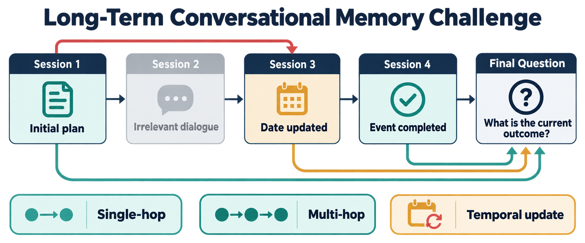
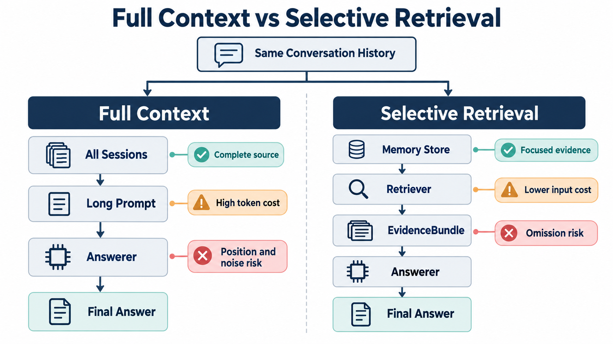
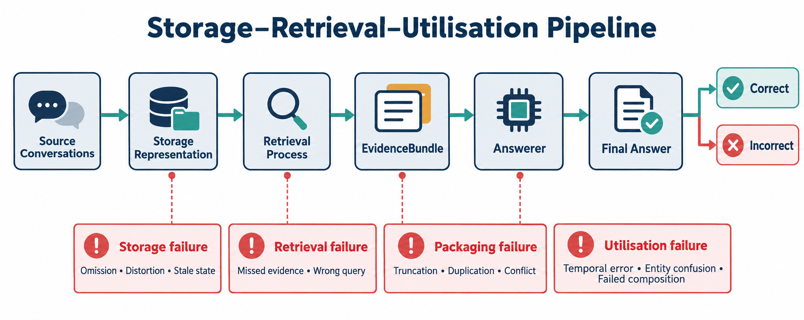
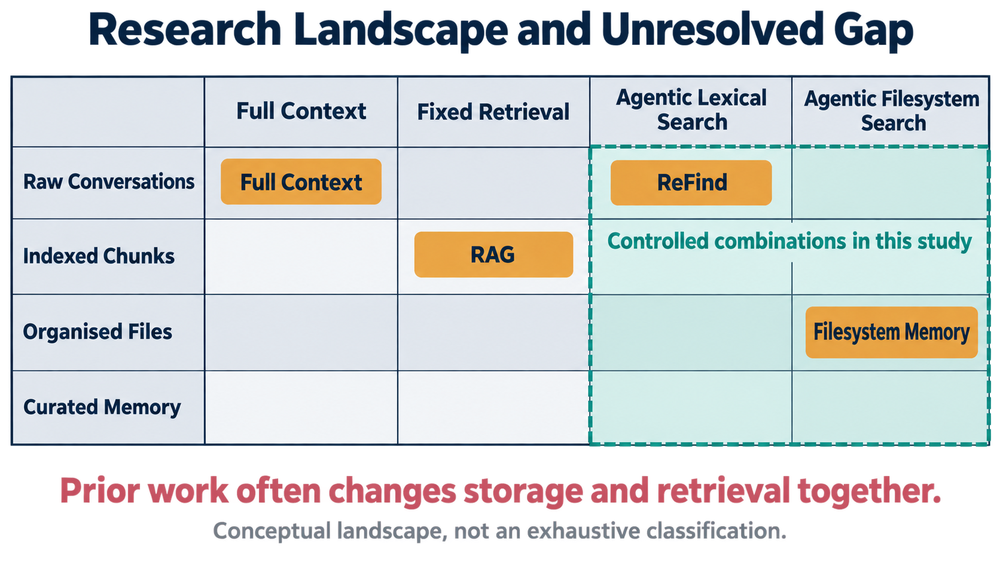
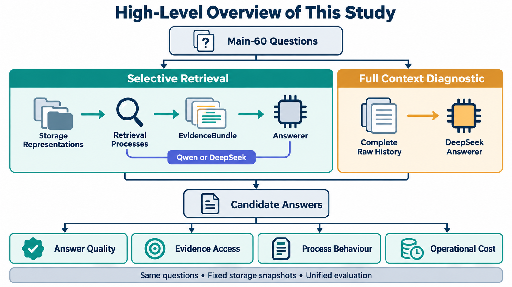

# Chapter 1 Introduction

## 1.1 Research Background

### 1.1.1 From Single-Turn Question Answering to Long-Term Interactive Agents

Large language models (LLMs) are increasingly used as agents that perform tasks, call tools, and interact with users over time. In personal assistance, collaborative work, customer service, and similar settings, users reveal preferences, relationships, events, and plans across many sessions. An effective agent must therefore understand the current request and access information introduced much earlier. LoCoMo frames this challenge as long-term conversational understanding, while MemoryAgentBench emphasises incremental memory in multi-turn environments [1], [2].

Long-term interaction is difficult for more than one reason. Relevant facts may be scattered across sessions, expressed in different words, or updated by later events. A question may also require several pieces of evidence. For example, a user may propose a plan, revise its date, and later report the outcome. Retrieving only the first statement can produce an outdated answer. Retrieving all statements is still insufficient if the model cannot resolve entities, temporal order, and the current state. LoCoMo includes single-hop, multi-hop, and temporal questions, which capture these different requirements [1].

Long-term agents therefore need mechanisms to preserve, update, locate, and use historical information. Many systems provide these capabilities through external memory. Retrieval-augmented generation combines a parametric generator with retrievable non-parametric memory [3]. Filesystem-based memory instead treats files, memory-management agents, search agents, and tool interfaces as parts of a persistent memory system [4]. Reliable memory is important because an agent that cannot access past information may contradict earlier statements, ignore user preferences, or rely on outdated facts.

*Figure 1.1. Long-term conversational memory challenge: relevant evidence may be distributed across sessions, revised over time, and surrounded by irrelevant dialogue.*

### 1.1.2 A Long Context Window Is Not a Long-Term Memory System

A direct approach is to place the entire conversation history in the model context. This preserves the raw source and avoids omissions caused by an explicit retrieval step. However, information that fits in the context window is not always used reliably. Long-context performance can vary with the position of relevant evidence, especially when it appears in the middle of the input [5]. Context capacity and effective memory are therefore not equivalent.

As the history grows, Full Context increases the amount of text that the Answerer must process on each query. This can raise token use, latency, and computation. Raw conversations contain repetition, irrelevant dialogue, similar entities, conflicts, and outdated states. A long-term memory system must address selection, organisation, updating, provenance, and auditability, not only input capacity. Filesystem-Based Memory and ReFind address these needs through maintainable file memory and controlled search over raw chat logs, respectively [4], [6].

This study therefore uses Full Context as a **diagnostic baseline without explicit retrieval selection**. It is not a storage representation, an additional experimental condition in the selective-retrieval matrix, or an oracle. It exposes the complete raw source to the answering model, referred to as the Answerer, but remains subject to long-context localisation, noise, conflict, and reasoning failures [1], [5].

*Figure 1.2. Full Context preserves complete source visibility but increases context length and noise, whereas selective retrieval provides focused evidence at the risk of omission.*

### 1.1.3 External Memory as a Storage–Retrieval–Utilisation System

External memory has three interdependent stages. **Storage** determines how history is represented. The same conversations may be kept as flat raw records, organised into topic directories, or consolidated into entity-, event-, or topic-centred memory. These choices trade off source fidelity, navigation, compression, write cost, and maintenance. Their value also depends on the tools and agents used to access them [4].

**Retrieval** selects evidence for the current question. An agent may browse directories, search for terms, and inspect files. A lexical method such as BM25 may instead rank conversation units, supported by query reformulation, context expansion, temporal constraints, and iterative search. ReFind shows how an agent can use iterative lexical search over raw chat logs without first constructing a semantic memory structure [6]. Narrow retrieval may miss evidence, whereas broad retrieval may introduce noise or conflict.

**Evidence utilisation** occurs when the Answerer produces the final response. Relevant evidence does not guarantee a correct answer. The model may fail to resolve references, order events, combine facts, or identify the latest state. Recent diagnostic work distinguishes retrieval-stage failures from downstream utilisation failures, but groups missing stored detail and missed retrieval under the former category [7]. This study extends that separation by checking stored content, retrieved evidence, evidence packaging, and answer generation as distinct points in the end-to-end system.

*Figure 1.3. End-to-end storage–retrieval–utilisation pipeline and the principal failure points examined in this study.*

## 1.2 Problem Statement

### 1.2.1 Storage: Fidelity, Organisation, and Compression

Raw logs preserve wording, temporal cues, and dialogue context, but distribute relevant facts across many files and turns. They reduce information loss at write time while increasing the search burden at query time. Topic directories can provide useful navigation cues. Organised stores may require more navigation steps while reducing the amount of text read, and they do not improve answer quality uniformly [4].

Curated memory can consolidate related facts and remove repetition. It can reduce the text read at query time, but curation is a lossy transformation. It may condense away details, flatten temporal updates, or leave stale states unreconciled [4]. The first problem is therefore whether storage organisation improves retrieval and answering when the source data are fixed, and whether the effect depends on the retrieval system.

### 1.2.2 Retrieval: Coverage, Noise, and Cost

Retrieval must collect sufficient evidence within a limited context and cost budget. Agent-led file search can adapt after each observation, but it requires repeated model calls and may follow an early wrong decision. Lexical retrieval is efficient and auditable, but depends on query formulation, index units, ranking, and context expansion. ReFind shows that these surrounding design choices affect retrieval from raw conversations [6].

More retrieved text may improve coverage but also add duplicates and conflicts. Less text may reduce noise but remove a critical condition. Retrieval should therefore be assessed through gold-source coverage and the evidence retained in the EvidenceBundle, not only through final answer quality. LoCoMo provides source turn identifiers that support this separation [1]. The broader question is whether retrieval-system effects remain stable across storage representations or form a storage × retrieval interaction.

### 1.2.3 Utilisation: Visible Evidence Does Not Guarantee a Correct Answer

An Answerer may still fail when the EvidenceBundle contains the required information. Common demands include entity resolution, temporal ordering, multi-hop composition, and separation of plans from completed events [1]. Retrieval sufficiency and evidence use must therefore be diagnosed separately [7].

Full Context supports the same distinction. If it repairs an error made by selective retrieval, the likely bottleneck may be access or evidence budget. If selective retrieval succeeds while Full Context fails, selection may have improved focus or reduced noise. If both fail, the cause may lie in reasoning, interpretation, or data ambiguity [5], [7]. Backbone models may differ in both search behaviour and evidence use, so an architecture observed with one backbone model may not transfer unchanged to another.

### 1.2.4 Evaluation: One Final Score Is Insufficient

LoCoMo evaluates question answering with normalised token-level partial-match F1 [1]. This study reports that official-style F1 together with project-defined, aligned token-overlap Precision and Recall as diagnostic measures. The aggregates are means of per-question values, so aggregate Precision and Recall should not be used to recompute aggregate F1. Exact normalisation and category-specific procedures are deferred to Chapter 4, where the evaluator implementation is documented. These metrics are reproducible, but remain sensitive to wording and answer length [1].

An LLM judge can complement lexical overlap with semantic assessment, but prior work documents position, verbosity, and self-enhancement biases, as well as limited reasoning ability [8]. This study therefore uses an independent LLM judge under a fixed rubric and reports Strict Accuracy, Partial Rate, and Soft Semantic Score alongside the deterministic metrics. None is treated as a complete measure of answer quality.

For retrieval, Evidence Recall is the fractional coverage of annotated gold source turns. Any-hit and All-hit capture binary source-access outcomes. These evidence measures apply only to the 58 evidence-eligible Main-60 questions and are not applicable to Full Context, which performs no retrieval. Process evaluation also includes model calls, input and output tokens, latency, construction cost, and maintenance burden.

The studies reviewed here do not provide one controlled comparison that jointly covers storage organisation, retrieval strategy, backbone model, dual-source fusion, and Full Context under shared data and evaluation [4], [6], [7]. This study addresses that combined gap and traces outcome differences to evidence access, evidence packaging, evidence utilisation, and cost.

## 1.3 Research Landscape and Gaps

### 1.3.1 Existing Memory Representations

Research on long-term agent memory has produced a wide range of representations. Retrieval-augmented generation introduced the general pattern of combining a parametric generator with externally retrievable, non-parametric memory [3]. Subsequent systems have represented memory as extracted facts, summaries, graph structures, linked notes, discourse units, embedding-organised indexes, raw interaction records, and hierarchical files [4]. Long-conversation benchmarks such as LoCoMo and incremental-agent evaluations further show why these representations matter: relevant information may be introduced across sessions, revised later, or require several pieces of evidence to answer one question [1], [2].

These representations make different trade-offs. Raw conversations preserve wording, provenance, temporal cues, and surrounding dialogue, but leave relevant facts distributed across many turns. Topic-based files add navigational structure without rewriting the source. Curated memory can consolidate related material and reduce repetition, but curation is a lossy operation that may omit qualifiers, weaken temporal relationships, or preserve an outdated state. Filesystem-Based Memory treats organisation, management agents, search agents, tool interfaces, cost, and store health as parts of one persistent-memory design space [4]. Its analysis also shows that a well-organised store should not automatically be assumed to produce better answers: the value of a representation depends on how it is searched and used.

### 1.3.2 Retrieval Paradigms

Memory representations are accessed through several retrieval paradigms. The simplest diagnostic is Full Context, in which the complete raw history is placed in the model input. This removes explicit retrieval selection but does not guarantee that the model will locate and use the relevant evidence. Long-context performance can depend on evidence position, with information in the middle of an input often used less reliably than information near its boundaries [5]. Full Context also increases input size and exposes the Answerer to irrelevant, repeated, or conflicting material.

Selective retrieval attempts to reduce this burden. Agent-led filesystem search allows a model to inspect directories, formulate search terms, open files, and revise its search after each observation [4]. ReFind instead uses an agent-controlled iterative lexical process over raw chat logs, combining query formulation, ranked retrieval, local context expansion, temporal constraints, and stopping decisions before a separate answering stage [6]. These approaches differ not only in search algorithm but also in the actions available to the agent, the units being ranked or viewed, the number of iterations, and the evidence finally passed to the Answerer. Retrieval quality must therefore be analysed as a process rather than treated as a single interchangeable component.

### 1.3.3 Evaluation Practices

Evaluation has likewise moved beyond one final accuracy number. LoCoMo uses normalised token-level partial-match F1 and provides answer-source turn identifiers for questions with annotated evidence [1]. Token overlap is transparent and reproducible, but it is sensitive to wording and answer length [1]. Semantic evaluation with an LLM judge can recognise meaning beyond exact token overlap, yet LLM judges may exhibit position, verbosity, and self-enhancement biases, as well as limited reasoning ability [8]. LLM judge scores should consequently complement rather than replace deterministic metrics.

A second distinction concerns where failure occurs. Recent diagnostic work distinguishes retrieval-stage failures from downstream utilisation failures and hallucinations, although its retrieval-stage category includes both missing stored detail and missed retrieval [7]. This study further separates storage fidelity, evidence access, evidence packaging, and answer utilisation. Filesystem-Based Memory additionally measures search effort, token use, content read, and store health, showing the importance of evaluating operational cost alongside answer quality [4]. Together, these practices motivate a multi-level evaluation comprising answer quality, gold-evidence coverage, process traces, and resource use.

### 1.3.4 Unresolved Gaps

Four gaps remain. First, emerging studies have begun to isolate memory shape [4] or cross write and retrieval strategies [7], but many end-to-end system comparisons still vary representation and access procedures jointly [6]. A result obtained with a curated store and a specialised retriever cannot reveal whether the gain came from representation, search procedure, their interaction, or the Answerer. Cross-paper comparisons are especially weak for this purpose because datasets, prompts, tools, budgets, and models also differ.

Second, the backbone model is itself a source of variation. Model capability can change query formulation, tool use, stopping behaviour, memory maintenance, and downstream outcomes [4]. An apparent property of a memory architecture may therefore depend on the Retrieval Agent or Answerer used to test it.

Third, the studies reviewed here do not establish the per-question paired diagnostic between selective retrieval and Full Context used in this study [1], [4], [6], [7]. Complete visibility may repair retrieval omissions, while selective evidence may outperform a longer context by reducing noise. If both fail despite access to the same source, the bottleneck may instead lie in evidence utilisation or answer generation [5], [7].

Fourth, final rankings provide limited causal explanation. Similar answer scores can conceal different evidence coverage, token cost, latency, and failure stages. Practical recommendations therefore require question-level comparisons, evidence measures, process records, and manual case analysis, not only aggregate F1 or LLM judge scores.

*Figure 1.4. Conceptual synthesis of retrieval-augmented generation [3], organised and curated filesystem memory [4], ReFind-style raw-chat search [6], and controlled write–retrieval crossings [7]. The figure motivates cross-combination analysis rather than treating any cited system as one fixed storage–access pair.*

### 1.3.5 Response of This Study

This study addresses these gaps through one controlled framework built on a unified Main-60 question set. It compares three storage representations—flat raw conversations, topic-organised source files, and agent-curated memory—and three retrieval processes—agent-led filesystem search, ReFind-style iterative lexical retrieval over raw conversation units, and an adaptation of that iterative process to curated memory. All selective-retrieval paths produce a standardised EvidenceBundle for the Answerer. Matched raw-memory and topic-organised conditions support cleaner storage and retrieval contrasts; the curated-memory conditions are evaluated as complete systems and are not interpreted as pure single-component ablations.

The same selective-retrieval configurations are run with Qwen and DeepSeek Retrieval Agents and Answerers while the stored snapshots remain fixed, enabling matched analysis across backbone models. A DeepSeek Full Context run supplies a separate diagnostic comparison. Full Context performs no explicit retrieval selection and is therefore neither a storage representation, an eighth selective-retrieval condition, nor an oracle.

Evaluation combines LoCoMo-style token F1 [1] with this study's aligned token Precision and Recall, semantic Strict Accuracy, Partial Rate, and Soft Semantic Score produced by an independent LLM judge under a fixed rubric [8], gold-source coverage for evidence-eligible questions, and process measures including model calls, tokens, latency, construction cost, and maintenance burden. Paired contrasts and manual review then trace likely failures to storage fidelity, retrieval access, evidence packaging, answer utilisation, or long-context processing. The purpose is not to identify one context-free winner, but to determine which conclusions are architecturally stable, which depend on the backbone model, and which system offers the most defensible quality–cost trade-off under different deployment priorities. Chapter 3 defines the system components and condition identifiers, while Chapter 4 specifies their implementation, controls, and evaluation protocol.

*Figure 1.5. High-level overview of the study, including the selective-retrieval and Full Context paths and the four levels of evaluation.*

## 1.4 Research Objectives

### 1.4.1 Overall Objective

This study aims to evaluate long-term conversational memory under a controlled framework. It examines how storage representation, retrieval strategy, and backbone model capability affect answer quality, evidence coverage, and operational cost. Dual-source fusion and Full Context are used to diagnose system bottlenecks. The goal is to determine when each design is useful and whether its gains justify its cost.

### 1.4.2 Specific Objectives

The study has six objectives:

1. Construct three traceable storage representations from the same source data.
2. Connect agent-led file search, iterative lexical retrieval, and curated-memory retrieval to a common EvidenceBundle interface.
3. Compare the same selective-retrieval configurations with Qwen and DeepSeek Retrieval Agents and Answerers.
4. Use a DeepSeek Full Context diagnostic baseline to examine access and long-context utilisation.
5. Evaluate lexical quality, semantic quality, gold-evidence coverage, model calls, tokens, latency, and maintenance burden.
6. Develop a stage-based error analysis and derive bounded practical implications for different quality, cost, scalability, and auditability needs.

## 1.5 Research Questions

### 1.5.1 Architecture: RQ1

**RQ1: What effects do storage representation and retrieval strategy have, and do they interact?**

The experiment uses matched conditions that vary storage organisation while holding the retrieval approach fixed, and vary retrieval while holding storage fixed. These comparisons estimate storage effects, retrieval effects, and their interaction. Complete curated-memory systems are analysed separately because their outcomes cannot be attributed to one isolated component.

### 1.5.2 Robustness: RQ2

**RQ2: Are these architectural effects stable across Qwen and DeepSeek?**

The analysis compares the direction and magnitude of matched contrasts across the two backbone models. Consistency supports a more general architectural interpretation; a direct difference between model-specific effects indicates dependence on the backbone model.

### 1.5.3 Mechanisms: RQ3–RQ5

**RQ3: When does dual-source fusion repair errors, and when does it introduce interference?**

The dual-source condition reuses evidence from two existing retrieval paths and adds no new retrieval process. Its repair, preserve, harm, and unresolved outcomes are compared with those of the two single-source parent conditions.

**RQ4: Does Full Context outperform selective retrieval, and what bottlenecks does each approach reveal?**

The within-DeepSeek paired descriptive comparison tests whether complete source visibility repairs selective-retrieval failures and whether selected evidence can reduce noise. Full Context is not a storage representation, an additional selective-retrieval condition, or an oracle.

**RQ5: Do errors mainly arise from storage fidelity, retrieval coverage, evidence packaging, answer utilisation, or long-context processing?**

Stored content, retrieval traces, EvidenceBundles, gold evidence, candidate answers, and evaluation outputs are combined with manual review to locate the likely failure stage.

### 1.5.4 Decision-Making: RQ6

**RQ6: Considering quality, cost, stability, and maintenance complexity, which conditions are most suitable for practical use?**

RQ6 examines quality–cost trade-offs and stability across backbone models. It develops conditional guidance for quality-first, cost-sensitive, and audit-focused settings, while treating implications for continuously growing memory as tentative because sustained memory updates are outside the present experiment.

| Research question | Main experimental material | Main evidence |
|---|---|---|
| RQ1 | Controlled storage–retrieval comparisons and complete curated-memory systems | Paired quality differences, Evidence Recall, storage–retrieval interaction |
| RQ2 | The same selective-retrieval configurations with two backbone models | Effect direction and magnitude across backbone models |
| RQ3 | Two single-source conditions and their dual-source fusion condition | Repair, preserve, harm, unresolved, evidence complementarity and conflict |
| RQ4 | DeepSeek selective retrieval and Full Context | Paired outcomes, answer quality, context size, and cost |
| RQ5 | Storage, retrieval traces, EvidenceBundles, and answers | Stage-based errors, evidence conversion, and manual cases |
| RQ6 | All formal conditions | Quality–cost Pareto analysis, cost amortisation, and decision matrix |

Chapter 3 formally defines the system components and experimental condition identifiers. Chapter 4 presents the execution protocol, metric definitions, and statistical tests.

## 1.6 Research Contributions

### 1.6.1 Controlled Experimental Design

The study provides one storage–retrieval–answering framework with shared data, questions, storage snapshots, and evidence interfaces. Matched conditions support architecture contrasts, while separate integrated conditions evaluate complete curated-memory systems. This separation limits unsupported single-component claims and supports explicit analysis of storage–retrieval interaction.

### 1.6.2 Evidence Across Backbone Models and Full Context

The same selective-retrieval configurations are evaluated with Qwen and DeepSeek Retrieval Agents and Answerers while storage snapshots remain fixed. A DeepSeek-family Full Context diagnostic adds evidence about selective retrieval, complete source visibility, and long-context utilisation.

### 1.6.3 Multi-Level Evaluation and Error Diagnosis

The study combines LoCoMo-style token F1 [1] with this study's aligned token Precision and Recall, plus three semantic metrics defined for this study and produced by an independent LLM judge. The LLM judge follows the general semantic-evaluation paradigm described in prior work [8]. Gold-evidence measures and process and cost records provide further diagnostic evidence. Paired comparisons and manual case review distinguish failures to retrieve evidence from failures to use it correctly.

### 1.6.4 Practical Decision Support

Answer quality is considered together with model calls, tokens, latency, construction cost, maintenance burden, and stability across backbone models. The study provides bounded, conditional guidance rather than one unconditional system ranking.

## 1.7 Research Scope and Boundaries

### 1.7.1 Included Scope

The formal study uses the frozen Main-60 question set from LoCoMo `conv-50`. All 60 questions form one unified test set and cover the C1–C4 categories used in this work. The study uses only the question-answering material and relevant source annotations [1].

The experiments include three storage representations, three retrieval processes, seven selective-retrieval configurations, two backbone model configurations for the Retrieval Agent and Answerer, and one DeepSeek-family Full Context diagnostic. The evaluation covers token-level metrics and answer metrics produced by an LLM judge, evidence measures for the 58 eligible questions, model calls, tokens, latency, and maintenance cost. Retrieval traces, EvidenceBundles, and run audits support stage-based analysis.

### 1.7.2 Excluded Scope

This is not a full reproduction across all LoCoMo conversations. Other self-organising, fact-based, graph-based, and vector-RAG memory systems are not formal baselines. The study does not simulate months of continuous writing, active forgetting, conflict accumulation, or automatic reorganisation.

The backbone model comparison is not a full Retrieval-Agent × Answerer factorial design. The Retrieval Agent and Answerer change together, while the topic-organised and curated-memory snapshots remain fixed. It therefore measures dependence on the backbone model across the query-time pipeline, not the separate effect of each model role or the writing model. Full Context is evaluated only with DeepSeek, so it cannot support a conclusion across backbone models about Full Context prompting.

### 1.7.3 Limits on Interpretation

The matched raw-memory and topic-organised conditions provide the cleaner architecture contrasts, but retrieval-system comparisons still include their full search procedures. The integrated curated-memory conditions jointly change the memory representation and its corresponding retrieval process. They cannot support a claim about changing only storage or only retrieval.

Full Context performs no retrieval, but it is neither a new storage method nor an accuracy ceiling. Its comparison with selective retrieval is diagnostic rather than a strict causal ablation because the input mechanism and context scale differ. All conclusions are limited to the present question set, storage snapshots, models, and protocols. Broader generalisation requires further validation.

The remainder of this report is organised as follows. Chapter 2 reviews the relevant literature. Chapters 3 and 4 define the system and experimental methodology. Chapters 5 and 6 present and discuss the empirical findings. Chapters 7 and 8 address validity and future research directions, followed by the conclusion in Chapter 9.
