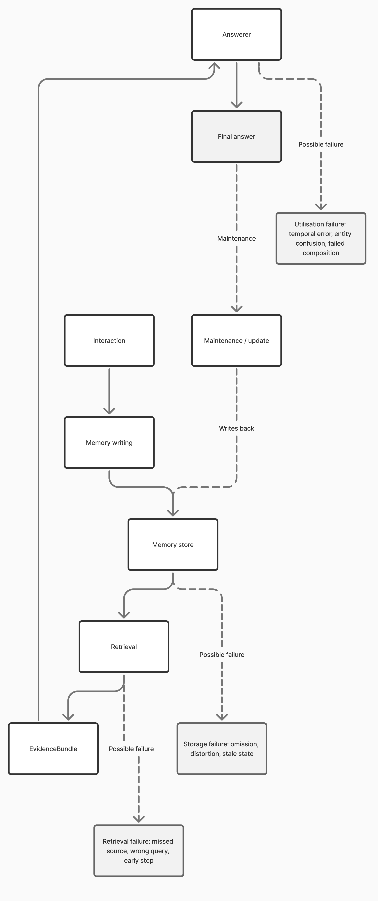
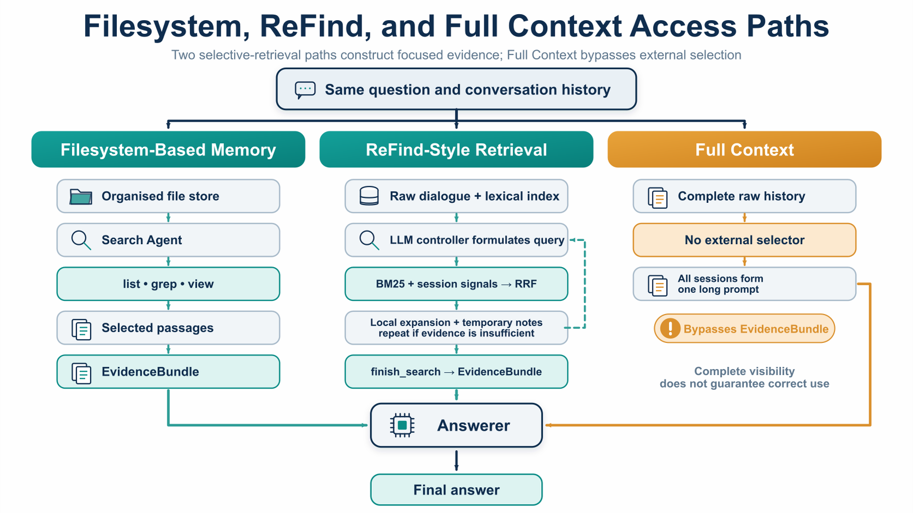
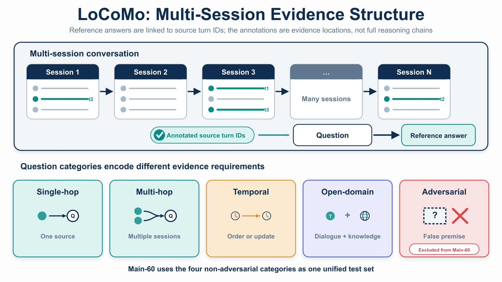
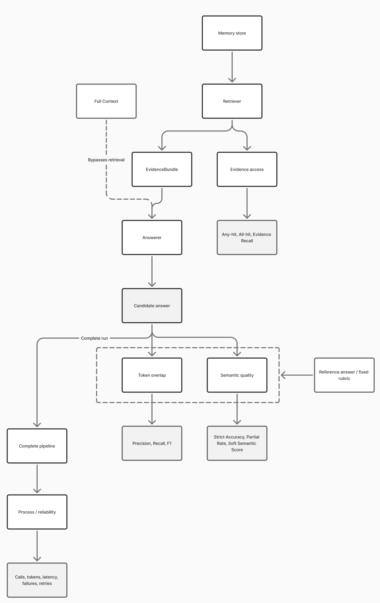

# Chapter 2 Background and Related Work

This chapter defines the concepts and prior work needed to study long-term conversational memory. It reviews memory representations, access methods, the two core system papers, the LoCoMo benchmark, and relevant evaluation methods. Exact system definitions, parameters, and formulas are deferred to Chapters 3 and 4.

## 2.1 Foundations of Long-Term Memory for LLM Agents

### 2.1.1 Parametric, Contextual, and External Memory

An LLM agent can obtain past information from three broad forms of memory. **Parametric memory** is encoded in model weights and is difficult to inspect or update with one local fact after deployment. **Contextual memory** is placed in the current input. It is immediately available, but bounded by the context window and the cost of long prompts. Models may also use different positions within a long input with unequal reliability [5].

**External memory** stores information outside the model as logs, files, summaries, indexes, vectors, or graphs. Relevant content can then be selected and returned to the model. This follows the retrieval-augmented principle of combining a parametric generator with an updateable, non-parametric source [3]. External memory can support provenance, local editing, and auditability, depending on its representation and tools [4], [9]. This study concerns text-centred external memory rather than weight editing or memory-policy training. Full Context uses the same external source but places it directly in the current input.

### 2.1.2 The Long-Term Memory Lifecycle

Long-term memory is a process rather than a static database. A conversation produces events, preferences, plans, corrections, and personal facts. A system must decide what to retain, how to represent it, and how to organise it by session, time, topic, entity, or relation. At query time, retrieval locates candidate evidence and an answering component uses it. Later maintenance may add entries, resolve conflicts, remove stale material, or reorganise the store. Incremental evaluation matters because memory agents receive information over time rather than as one fixed document [2].

The lifecycle therefore contains a feedback loop:

> interaction → writing → organisation → retrieval → evidence use → answer → maintenance

An early error can propagate, while maintenance can change what later searches find. Chapter 3 maps this lifecycle to the study's concrete components.

### 2.1.3 Storage, Retrieval, and Utilisation as Distinct Problems

Three questions should be separated. **Storage fidelity** asks whether memory retains the required fact and its qualifiers. **Retrieval coverage** asks whether relevant material reaches the Answerer. **Utilisation** asks whether the Answerer correctly interprets and combines that material. A final score combines all three.

Consider an abstract question about the latest date of an event. The updated date may have been omitted during summarisation. This is a storage failure. It may be present in the store but absent from the retrieved evidence. This is a retrieval failure. It may also appear in the evidence while the Answerer still selects an older date. This is a utilisation failure. These cases require different remedies.

Recent diagnostic work crosses write strategies with retrieval methods and separately probes retrieval relevance and downstream memory utilisation [7]. Its failure taxonomy groups missing stored detail and missed retrieval under one retrieval-stage category; it does not independently measure write-time information loss. This study therefore uses a finer project-defined distinction among storage, retrieval, and utilisation while preserving the paper's retrieval-to-generation separation.

*Figure 2.1. Long-term memory lifecycle and the project-defined separation of storage, retrieval, and utilisation failures. The retrieval-to-generation distinction is informed by [7], which does not independently measure write-time information loss.*

### 2.1.4 Principal Design Axes of Long-Term Memory Systems

Long-term memory systems can be organised along five design axes.

1. **Fidelity versus compression.** Raw records preserve detail, whereas summaries and extracted facts reduce size but may lose context.
2. **Flat versus hierarchical organisation.** A flat store is simple. A hierarchy may support navigation, but only if the search process can use it.
3. **Passive versus agent-controlled retrieval.** A fixed ranker returns one result list. An agent may reformulate queries, inspect paths, and stop when evidence is sufficient.
4. **Selective evidence versus Full Context.** Selection reduces noise and input size. Full Context avoids explicit search misses but creates a long-context utilisation problem.
5. **Quality versus total cost.** A system may move cost between memory construction, query-time search, answering, maintenance, and recovery.

These axes are not independent. Compression may lower query cost while increasing construction and fidelity risks; hierarchy helps only when access tools expose it; and Full Context removes explicit retrieval but not selection inside the model. Evaluation must therefore compare complete data paths as well as isolated components. The later chapters use these axes to distinguish clean contrasts from pipeline-level comparisons. This distinction also prevents a tidy store from being treated as evidence of better memory.

## 2.2 Main Representations of External Memory

### 2.2.1 Raw Dialogue and Log-Based Storage

Raw dialogue retains wording, speaker labels, session boundaries, dates, and turn order. It therefore preserves provenance and allows later reinterpretation without relying on an earlier summary. This matters when a qualifier, correction, or temporal cue becomes important.

Its weakness is dispersion. An answer may depend on turns from several sessions, while repetition, pronouns, and omitted context make isolated matches difficult to interpret. Raw logs still have minimal structure through session, turn, time, and speaker metadata, but they require effective search or full-archive processing.

### 2.2.2 Filesystem-Based Memory

A filesystem adds addressable structure to textual memory. Paths, filenames, folders, headings, and descriptions can act as retrieval cues. An agent can list directories, search text, inspect files, and follow new leads. Files are also editable and compatible with standard tools.

*Filesystem-Based Memory* defines a memory store as files under a rooted hierarchy and a tool harness as the operations through which agents access that store [4]. Store shape and access interface can therefore jointly influence what the agent finds.

Hierarchy is not automatically useful. A taxonomy can add maintenance work without improving answers if the searcher ignores it. Filesystem quality must be evaluated with navigation behaviour, tool constraints, and model capability.

### 2.2.3 Agent-Curated or Summarised Memory

Agent-curated memory rewrites interaction history into a compact form. A manager may extract facts, group events, merge repetition, or maintain topic notes. Mem0 uses extraction and consolidation, while A-MEM adds linked, evolving notes [10], [11].

Curation introduces another interpretation layer. It can surface stable facts, but may omit qualifiers, flatten temporal order, merge entities, or preserve stale states. Its value depends on the writing model, prompt, update policy, and construction and maintenance costs.

The study's curated store belongs to this broad family but remains a fixed experimental snapshot. Chapter 3 defines its construction and audit rules.

### 2.2.4 Vector, Graph, and Other Structured Memories

Vector memory encodes source units as embeddings and retrieves by semantic similarity. This extends the retrieval-augmented pattern of selecting information from non-parametric memory [3]. In practice, semantic similarity is not identical to task relevance, and a vector system also depends on choices such as source units, embedding model, query, and return depth. Graph memory represents entities, events, or notes as connected nodes. It supports relation traversal, but construction and conflict maintenance add assumptions and cost. Mem0 includes a graph-enhanced variant, while A-MEM links evolving notes [10], [11].

Hybrid systems combine several forms. MemGPT, for example, manages information across memory tiers [9]. Such systems define the wider design space but are not formal baselines here because their writing, indexing, and update protocols introduce further variables.

### 2.2.5 Comparison of Representations and Scope of This Study

Table 2.1 compares the main representation families through observable design properties rather than an ordinal ranking.

**Table 2.1. Conceptual comparison of external-memory representations.**

| Representation | Primary stored unit | Source-text preservation | Added organisation or typical access | Typical update | Principal risk |
|---|---|---|---|---|---|
| Raw dialogue logs | Turns or exchanges with session metadata | Verbatim | Session and turn chronology; lexical or long-context access | Append new turns | Relevant facts are dispersed in long histories |
| Foldered raw files | Verbatim turns grouped into session or topic files | Verbatim, subject to grouping | Paths, filenames, and headings; file navigation and text search | Append or reorganise files | The taxonomy may not help the searcher |
| Curated textual memory | Extracted facts, summaries, or topic notes | Selective and rewritten; size may decrease or increase | Explicit thematic or entity structure; file or ranked access | Rewrite, merge, and reconcile notes | Omission, distortion, or stale consolidation |
| Vector index | Embeddings linked to source chunks | Depends on whether the source chunks are retained; the index is additive | Similarity ranking over indexed units | Encode, delete, or re-index chunks | Semantic similarity may miss task relevance |
| Graph or linked memory | Entities, events, or notes plus relations, often linked to source text | Depends on node construction and provenance | Relation traversal or hybrid access | Add, merge, or revise nodes and edges | Construction, linkage, and conflict-maintenance errors |

*Note.* This table is a project-defined conceptual synthesis, not an empirical ranking. The representation families are not mutually exclusive; vector and graph indexes can be layered over textual sources. Sources: [3], [4], [9]–[11].

This study selects the first three representations because they remain human-readable and auditable while spanning different levels of organisation and compression. Adding vector or graph systems would also change the retrieval infrastructure.

## 2.3 Memory Retrieval Methods

### 2.3.1 Agentic File Navigation and Text Search

In agentic filesystem retrieval, an LLM controls a sequence of tool actions. It may inspect directories, formulate keywords, search text, open a matching region, and continue when evidence is incomplete. `grep` is an access tool, not a retrieval strategy; the agent determines the query, scope, inspection sequence, and stopping point.

This approach can use both lexical matches and filesystem structure. Its visible actions support audit and query-specific adjustment, but add model rounds, tool calls, context growth, and behavioural variation. *Filesystem-Based Memory* treats the harness as part of the system rather than a neutral interface [4].

This study adopts the paradigm but separates evidence collection from final answering. Exact controls appear later.

### 2.3.2 Lexical Ranking and Iterative Retrieval

Lexical rankers score stored units against a query. BM25 rewards informative term overlap while accounting for frequency and document length [12]. The query may be the original question or an LLM reformulation, and ranked units may be aggregated at a higher level. Reciprocal Rank Fusion combines multiple ranked views by favouring items that appear near the top of those lists [13].

ReFind applies lexical ranking to dialogue turns and adds session-level signals, local expansion, temporal filtering, and duplicate control [6]. An LLM controller can search again, retain evidence, or stop. Iteration may repair a poor first query, but adds state and cost. The ranker, controller, actions, and final evidence should therefore be distinguished.

### 2.3.3 Multi-Source Retrieval and Evidence Fusion

A system may retrieve from raw logs, curated notes, vector indexes, or other sources. Sources can be complementary: one may preserve exact wording and time, while another offers a cross-session summary. Fusion may also add repetition, conflicting states, or excessive context.

**Multi-source evidence fusion** is not necessarily a new joint retriever. It may combine outputs from existing paths without another search. The study's dual-source condition follows this design: it reuses two fixed evidence bundles and applies deterministic fusion rules before answering. Chapter 3 defines its provenance and budget handling.

### 2.3.4 Full Context and Long-Context Answering

Full Context places the complete available conversation in the Answerer input. It avoids explicit search misses, but does not guarantee correct localisation or use. Long-context models can be sensitive to evidence position [5], while repetition, similar speakers, and changing facts add interference. Search calls disappear, but input cost and attention burden grow with the history.

Here, Full Context is a no-retrieval diagnostic. It is neither a storage representation, an eighth selective condition, nor an oracle. It tests whether complete visibility repairs omissions or whether selected evidence improves focus.

### 2.3.5 Framework for Comparing Retrieval Methods

Table 2.2 separates four access paradigms. It focuses on control flow rather than implementation details.

**Table 2.2. Conceptual comparison of memory-access paradigms.**

| Access paradigm | Control and selection mechanism | Main unit | Iteration | Use of hierarchy | Principal cost or risk |
|---|---|---|---|---|---|
| Agentic filesystem retrieval | An LLM selects paths, queries, tool actions, and the stopping point | Files, sections, and text regions | Multi-round | When hierarchy is exposed and used | Model rounds, tool calls, and behavioural variation |
| Ranked retrieval | A user or LLM formulates a query; a ranker scores indexed units | Exchange, passage, or fact | Optional controller loop | Not required; grouping or reranking may use metadata | Query mismatch and ranker error |
| Multi-source evidence fusion | Existing retrieval outputs are combined by fixed or learned fusion rules | Multiple evidence bundles | Inherits the parent paths; no additional retrieval in this study | Inherits the parent paths | Duplication, conflict, and context expansion |
| Full Context | No external selector; the Answerer receives the complete history | Complete history | No explicit retrieval loop in this study | Not applicable | Long input, attention dispersion, and scaling cost |

*Note.* These access patterns can be composed; the rows identify where explicit selection occurs rather than mutually exclusive algorithms. The filesystem and ReFind-style rows draw on [4] and [6]. The fusion and Full Context operationalisations are project-defined.

## 2.4 Filesystem-Based Memory

### 2.4.1 Memory Store, Tool Harness, and Agent Roles

*Filesystem-Based Memory for LLM Agents* treats the filesystem as an external memory medium [4]. Its **memory store** is a rooted hierarchy of files and folders, while the **tool harness** defines the role-specific operations through which agents access it. Paths, descriptions, content, and headings expose structure.

The paper distinguishes three roles. A management agent writes and maintains memory. In the conversational setting, a search agent answers queries with cited sources. In the skill setting, an execution agent completes tasks using retrieved skills. The same store may therefore behave differently under different tools, prompts, or models.

The filesystem should therefore not be treated as one indivisible algorithm: store shape, access behaviour, and downstream use remain distinct.

### 2.4.2 Experimental Axes and Control Logic

The paper varies memory builder or shape, stream scale, tool harness, and model capability, while identifying what is fixed within each comparison [4, Sec. 2.4]. It organises the analysis around questions of organisation, retrieval, growth, cost, and sustainability. This controlled logic is more informative than a simple system ranking. The present study follows it where possible, while treating inseparable configurations as complete pipelines rather than false single-component ablations.

### 2.4.3 Main Findings and Open Questions

The paper reports that no memory shape gives the best answer quality in every setting [4]. At larger scales, organised variants can reduce the material read and search cost relative to verbatim storage, while heavier curation is not universally superior. Effects depend on the task, scale, model, and harness.

The evaluation also covers cost, growth, and store health, exposing trade-offs between management work and later search. Open questions include horizons beyond those measured, whether useful hierarchy can be maintained, and longer-horizon store health under continued updates.

These findings are conditional on the paper's tasks and systems. Its numerical results are not directly comparable with this study.

### 2.4.4 What This Study Inherits, Changes, and Extends

The relationship is summarised in Table 2.3.

**Table 2.3. Relationship of this study to *Filesystem-Based Memory for LLM Agents* [4].**

| Relationship | Elements in this study |
|---|---|
| Adapted from [4] | Filesystem as an external store; raw, foldered, and curated textual memory as broad comparison families; role separation as a design principle; agentic navigation through tools |
| Project-specific modifications | A common evidence interface before final answering; the composite frozen Main-60 set from one LoCoMo conversation; audited memory snapshots; independently logged retrieval and answer stages |
| Additional components beyond [4] | ReFind-style retrieval; two query-time backbone models; fixed dual-source fusion; a DeepSeek-family Full Context diagnostic; LoCoMo category-aware F1 following the pinned official evaluator [14]; project-defined Precision/Recall, semantic, evidence-coverage, and stage-diagnostic measures |

*Note.* Only the first row describes elements adapted from [4]. The remaining rows document this study's own design choices and evaluation scope; they do not imply that these additions were evaluated in [4].

This is not a line-by-line reproduction. The paper supplies a framework for representation, roles, controlled variation, and operational evaluation; the next section introduces iterative search over unmodified dialogue.

## 2.5 ReFind and Iterative Retrieval over Raw Dialogue

### 2.5.1 Motivation for Searching Raw Dialogue

Preprocessing can ease search but change evidence by removing a name, negation, or event order. Raw chat avoids this write-time transformation and retains speaker and local context, while leaving facts dispersed across the archive. ReFind therefore shifts effort from LLM-based memory construction to LLM-controlled query-time lexical search [6]. The controller must formulate effective searches and recognise sufficient evidence.

### 2.5.2 Two-Level Ranking and Iterative Search

ReFind indexes and ranks dialogue turns with BM25 and derives session-level signals [6], [12]. Reciprocal Rank Fusion combines the turn and session views [13]. High-ranking turns are expanded with local context. Temporal filtering narrows candidates by date, while seen-session filtering prevents later rounds from revisiting returned sessions.

Search and final answering are separate. The controller can query, inspect results, and save question-local notes without rewriting long-term memory. `finish_search` ends evidence collection; a later answering stage uses the notes. Stopping search is therefore not answering the question.

ReFind limits search iterations. This study's exact parameters appear in Chapters 3 and 4.

### 2.5.3 Empirical Findings and Cost Perspective

ReFind reports that agent-controlled lexical search can rival structured-memory methods in its evaluated settings [6]. Its controls and ablations show that single-shot BM25, or BM25 without the iterative and chat-native controls, is insufficient to explain the gains. Local expansion, session-level fusion, temporal filtering, seen-session control, and multi-round control interact to shape the evidence.

The design avoids LLM-based memory construction but uses an LLM controller at query time. Its value therefore requires joint analysis of answer quality and resource use.

The claim remains setting-specific. Relative performance may change with implicit matches, language, benchmark, or controller model.

### 2.5.4 Boundaries of the ReFind-Style Adaptation in This Study

This study adapts ReFind's turn-level idea to exchange-level lexical units while retaining higher-level grouping, rank fusion, local context, iterative control, temporary notes, and separate final answering. The topic-organised raw store adds project-specific path handling.

The study also applies the iterative principle to curated memory, where retrieval units and grouping differ from ReFind's turns and sessions. The common evidence interface, LoCoMo mapping, and curated adapter are project designs.

The report therefore uses **ReFind-style** or **ReFind-inspired**, not exact reproduction, and does not attribute the curated variant to ReFind.

### 2.5.5 Complementarity of Filesystem Memory and ReFind

The papers address complementary questions. *Filesystem-Based Memory* studies store shape, maintenance, and tool access [4], whereas ReFind studies iterative retrieval over raw chat [6]. This study combines their ideas to examine storage–retrieval interaction under shared data, questions, evidence interfaces, and Answerer protocols, not to rank the papers globally.

*Figure 2.2. Conceptual access paths for filesystem-based memory, ReFind-style retrieval, and Full Context. The two selective paths construct an EvidenceBundle before answering, whereas Full Context passes the complete history directly to the Answerer. Adapted conceptually from [4] and [6]; the common interface and Full Context path are project-defined.*

## 2.6 Long-Term Dialogue Evaluation and LoCoMo

### 2.6.1 LoCoMo Data Structure

LoCoMo is a benchmark for very long-term conversational memory [1]. Its conversations span multiple sessions and retain speakers, order, dates, and image captions where relevant. Human verification and editing were used to reduce long-range inconsistencies in the generated conversations.

Each question has a reference answer, and samples include turn identifiers for supporting dialogue evidence. This supports both answer evaluation and source-retrieval analysis.

LoCoMo also contains event-summarisation and dialogue-generation tasks. This study uses question answering; Chapter 4 describes its frozen sample.

### 2.6.2 Question Categories and Required Capabilities

LoCoMo defines five question categories [1]. **Single-hop** questions use a fact from one session; **multi-hop** questions combine sessions; **temporal** questions require ordering or tracking change; **open-domain** questions combine dialogue with commonsense or world knowledge; and **adversarial** questions use misleading, unanswerable premises.

This study uses one unified Main-60 set from the four non-adversarial categories. Category analysis is secondary to paired overall comparisons; Chapter 4 gives the selection rationale and distribution.

### 2.6.3 Gold Answers, Gold Evidence, and Evaluation Boundaries

LoCoMo favours reference wording drawn directly from conversations where feasible and uses partial-match F1 after normalisation [1]. Lexical scoring is reproducible, but can penalise valid paraphrases.

Evidence annotations identify source turns containing the answer and enable retrieval measures. They are not a perfect account of every valid reasoning path: some questions use background knowledge, and alternative passages may support the answer. Evidence metrics should therefore be limited to eligible questions and treated as diagnostics.

Question answering also does not test the full lifecycle, including prolonged updates, active forgetting, conflict repair, or autonomous reorganisation.

*Figure 2.3. LoCoMo's multi-session question-answering structure, question categories, and source-turn annotations. Source-turn identifiers locate annotated evidence but do not constitute complete reasoning chains. The Main-60 set uses the four non-adversarial categories as one unified test set. Adapted conceptually from [1].*

### 2.6.4 Why LoCoMo Is Used

LoCoMo offers dispersed multi-session history, varied reasoning demands, and source-turn annotations. It also provides a common reference point for long-context and memory-system research [1], [7].

The experiment nevertheless uses one frozen conversation and 60 questions. It supports controlled, traceable comparison rather than universal coverage.

## 2.7 Evaluating Long-Term Memory Systems

This section reviews general evaluation perspectives and explains why they are adopted in this study. It does not define the final experimental protocol. The exact metrics, formulas, prompts, eligibility rules, and aggregation procedures are specified in Chapter 4.

### 2.7.1 Token Precision, Recall, and F1

Token metrics compare a candidate with the reference after normalisation. **Precision** is the fraction of candidate tokens overlapping the reference; **Recall** is the fraction of reference tokens recovered by the candidate; and **F1** balances the two for each question. Low precision often reflects extra or non-matching text, while low recall often reflects omission.

The F1 measure aligns with LoCoMo's paper-described QA protocol [1], and its exact category-aware implementation follows the pinned official evaluator [14]. Precision and Recall are project-defined diagnostics that use the same matching basis. These token metrics are deterministic but sensitive to wording and answer length. A valid paraphrase may share few tokens, while a wrong answer may repeat key terms.

Chapter 4 defines normalisation and aggregation. Aggregate F1 is the mean of per-question values, not a recomputation from aggregate Precision and Recall.

### 2.7.2 Semantic Evaluation with an LLM judge

An LLM judge compares meaning rather than exact wording. Under a fixed rubric, **Strict Accuracy** counts fully correct answers, **Partial Rate** records partly correct responses, and **Soft Semantic Score** assigns partial credit.

Judging can recognise meaning beyond exact token overlap, but remains sensitive to position, verbosity, self-enhancement bias, prompt wording, and limited reasoning ability [8]. Accordingly, this study keeps the LLM judge independent of the answering backbone model, blind to condition names, and fixed to one rubric and prompt. It complements rather than replaces token metrics.

The rubric and label mapping are project-specific and specified in Chapter 4.

### 2.7.3 Evidence-Level Evaluation

Evidence evaluation asks whether retrieval surfaced annotated sources. **Any-hit** records at least one match, **All-hit** requires all annotated sources, and **Evidence Recall** is the fraction covered.

These measures help locate failure, but are not causal. Retrieved text may be noisy, annotations incomplete, and the Answerer may use unannotated support. High recall therefore does not imply precise or correctly used evidence.

They apply only to selective retrieval and eligible questions. Full Context performs no retrieval selection, so complete visibility should not be labelled perfect retrieval recall.

### 2.7.4 Process, Efficiency, and Reliability Metrics

Quality must be interpreted with process cost. Query-time measures include model and tool calls, tokens, latency, failures, retries, and recovery. Store-level measures include size, hierarchy, and construction cost. Failed attempts remain part of the record. A filesystem round and an iterative lexical action expose different tools, so their counts are not equivalent. Chapter 4 separates construction, retrieval, answering, judging, and recovery costs.

### 2.7.5 Why Multi-Perspective Evaluation Is Needed

No single metric explains answer quality and system behaviour. Table 2.4 summarises the four complementary views.

**Table 2.4. Evaluation perspectives, scope, and limits.**

| Metric family | Main question answered | What it cannot answer alone |
|---|---|---|
| Official LoCoMo F1 and project-defined token Precision/Recall diagnostics | How much normalised token or stem overlap does the candidate share with the reference? | Whether a valid paraphrase is semantically complete or factually correct |
| LLM judge measures: Strict Accuracy, Partial Rate, and Soft Semantic Score | Is the answer fully correct, partly correct, or incorrect in meaning under the fixed rubric? | Why the system failed or whether required evidence was retrieved |
| Gold-source coverage: Any-hit, All-hit, and Evidence Recall | Did selective retrieval cover the eligible annotated sources? | Evidence precision, source uniqueness, or whether the Answerer used the evidence correctly |
| Process, efficiency, and reliability measures | How many resources, actions, failures, retries, and recovery steps were observed? | Whether output quality is acceptable, or monetary cost without a stated pricing rule |

*Note.* LoCoMo describes normalised partial-match F1 in the paper [1]; the exact category-aware implementation, including its normalisation and stemming rules, follows the pinned official evaluator [14]. Precision and Recall are project-defined diagnostics computed on the same matching basis. The judge-derived and evidence-coverage measures, including label mapping, source matching, and eligibility rules, are also project-defined. LoCoMo supplies the reference answers and source-turn identifiers [1], while [8] motivates the complementary use of an LLM judge.

Together, the four views support mechanism analysis and system choice rather than only a leaderboard.

*Figure 2.4. Observation points of answer-level, evidence-level, and process-level evaluation. Full Context bypasses explicit retrieval, so evidence-retrieval metrics are not applicable to that path.*

## 2.8 Positioning and Differences of This Study

### 2.8.1 Related-Work Comparison Matrix

Table 2.5 locates the study relative to its three main foundations. Two panels separate system design from evaluation so that the comparison remains readable in a standard report layout.

**Table 2.5(a). System-design comparison of the principal related work and this study.**

| Work | Primary focus | Memory representation or benchmark source | Access method | Model scope |
|---|---|---|---|---|
| *Filesystem-Based Memory* [4] | Effects of organisation, tools, scale, and model capability on persistent filesystem memory | Chunk-retrieval control; verbatim dump; foldered sessions; reorganised and agent-curated stores | Agentic filesystem search; BM25 chunk-retrieval control; targeted harness variants | Model capability is an experimental axis |
| ReFind [6] | Whether agent-controlled search over raw chat can rival structured memory | Raw chat logs | Turn-level BM25; session-rank RRF; ±2-turn local context expansion; temporal and seen-session filtering; iterative ReAct controller | GPT-4o-mini in the main suite; GPT-5-mini on LongMemEval subsets rather than a full cross-backbone replication |
| LoCoMo [1] | Evaluation of very long-term conversational memory | Multimodal multi-session conversations plus QA and source-turn annotations; no prescribed system memory store | The paper evaluates base or truncated context, long-context, and RAG variants; the benchmark itself is method-agnostic | Multiple models and methods are compared; backbone is not isolated under one shared pipeline |
| This study | Interaction among storage, retrieval, backbone model, fusion, and context scope under shared controls | Three auditable textual representations built from one frozen conversation source | Agentic file search; ReFind-style iterative retrieval; fixed evidence fusion; Full Context | Two selective-retrieval backbone pipelines under one scientific protocol; one DeepSeek-family Full Context diagnostic |

**Table 2.5(b). Evaluation and diagnostic comparison of the principal related work and this study.**

| Work | Long-context or complete-history comparator | Outcome evaluation | Process or diagnostic analysis |
|---|---|---|---|
| *Filesystem-Based Memory* [4] | No matched complete-history, no-retrieval diagnostic equivalent to this study's Full Context condition | Task quality, cost, and store properties | Growth, search effort, cost, and store health |
| ReFind [6] | Long-context comparator baselines are reported or reused, but not as a matched complete-history diagnostic | Answer quality, retrieval behaviour, ablations, and cost | Component ablations and search-process analysis |
| LoCoMo [1] | Includes long-context baselines | QA, event summarisation, dialogue generation, and RAG context-retrieval recall@k | Category-level QA analysis and RAG recall@k; manual error taxonomy for event summarisation |
| This study | Completed DeepSeek-family, no-explicit-retrieval Full Context diagnostic over the same Main-60 source | Official LoCoMo F1 plus project-defined token, semantic, evidence, process, and cost measures | Stage-based diagnosis, paired contrasts, and manual review |

*Note.* The two panels compare scope and method, not reported scores. Direct numerical comparison would be misleading because the works use different tasks, models, prompts, and system boundaries. RAG = retrieval-augmented generation; RRF = reciprocal rank fusion.

### 2.8.2 From Literature Gaps to the Study Design

The methodological limitations identified in prior work and in this project's synthesis lead to the six design responses in Table 2.6.

**Table 2.6. Methodological limitations motivating this study and project-defined responses.**

| Methodological limitation | Evidence basis | Response in this study |
|---|---|---|
| Storage and retrieval effects are not always isolated | Store shape and tool harness interact in [4]; [7] explicitly crosses write and retrieval strategies | Use clean storage–retrieval contrasts where possible; treat inseparable configurations as complete pipelines rather than pure ablations |
| Evidence from one backbone model has limited generalisability | [7] identifies single-backbone evaluation as a limitation | Repeat the selective-retrieval conditions with Qwen and DeepSeek backbone models |
| Retrieval-to-answer interfaces differ across systems | The tool-mediated filesystem pipeline in [4] and iterative retrieval pipeline in [6] expose different intermediate states | Use a common EvidenceBundle interface and a common Answerer prompt within each backbone pipeline |
| Final-answer scores can hide retrieval and utilisation failures | [7] separates retrieval relevance, memory utilisation, and downstream correctness | Add gold-source coverage, retrieval traces, stage-based diagnosis, and manual review |
| Complete visibility does not guarantee reliable use of long context | [5] shows that long-context utilisation can depend on evidence position | Add a DeepSeek-family Full Context condition to contrast explicit selection with complete visibility |
| Accuracy alone does not describe operational cost | [4] and [6] both report process or cost dimensions alongside answer quality | Record model calls, tokens, latency, construction cost, failures, and recovery |

*Note.* The limitations are a project-defined synthesis rather than claims from a systematic literature review. The response column records this study's design choices; it does not attribute those choices to the cited papers.

These responses define the conceptual design rather than its implementation. Chapter 3 introduces the formal components and conditions; Chapter 4 defines the exact controls, statistical contrasts, and error rules.

### 2.8.3 Boundaries Relative to the Two Core Papers

The study inherits the filesystem store, role separation, and harness perspective from *Filesystem-Based Memory* [4], but requires auditable evidence before final answering through a common interface. From ReFind it inherits raw-chat, lexical, session-aware, iterative search [6], while adapting turn-level retrieval to project units. The adapters, evidence schema, source mapping, curated variant, prompts, and action limits are project choices. The objective is a controlled synthesis, not reproduction of either full leaderboard.

### 2.8.4 Transition to Chapter 3

Prior work shows that representation, search control, tools, model capability, context scale, and evaluation perspective all affect memory performance. A final answer score cannot identify the failing stage. Chapter 3 therefore defines the study's stores, retrieval processes, selective conditions, common EvidenceBundle and Answerer interfaces, fusion path, and Full Context diagnostic; Chapter 4 specifies execution and evaluation.
