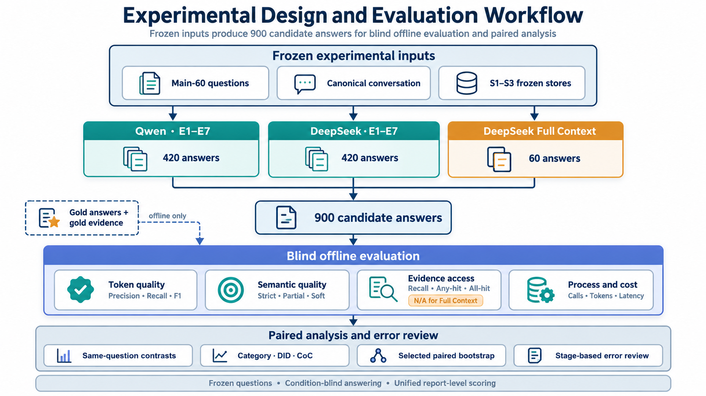

# Chapter 4 Experimental Design and Evaluation Methodology

Chapter 3 defined the memory representations, retrieval systems, EvidenceBundle interface, Answerer, dual-source fusion mechanism, and Full Context path. This chapter explains how those components are instantiated as a controlled experiment. It defines the frozen test set, experimental matrix, model roles, controlled conditions, evaluation metrics, paired analysis, and error-review method.

The chapter separates design from outcome interpretation. It specifies which comparisons are valid and what each comparison can identify. It does not report final scores or select a winning condition. Those results are presented in Chapter 5.

## 4.1 Research Questions, Variables, and Identification Strategy

### 4.1.1 Mapping Research Questions to Experimental Comparisons

The six research questions introduced in Chapter 1 require different experimental evidence. RQ1 concerns storage, retrieval, and their interaction. RQ2 asks whether the same architectural effects remain stable across backbone models. RQ3 examines dual-source fusion. RQ4 compares selective retrieval with Full Context. RQ5 locates likely failures along the information path. RQ6 combines quality, stability, cost, and maintenance considerations.

No single condition answers all six questions. The study therefore assigns each research question a defined comparison family. This mapping prevents an overall condition ranking from replacing the analysis required by each question.

**Table 4.1. Mapping from research questions to experimental comparisons and evidence.**

| Research question | Main experimental material | Principal comparisons | Main evidence |
|---|---|---|---|
| RQ1: storage and retrieval effects | E1–E6 | E3−E1, E4−E2, E2−E1, E4−E3, E6−E5, and the storage–retrieval interaction | Paired answer-quality differences, evidence coverage, and retrieval traces |
| RQ2: cross-backbone stability | Qwen and DeepSeek E1–E7 | The same condition contrast under both backbone models | Effect direction, magnitude, question-level agreement, and contrast-of-contrasts |
| RQ3: dual-source fusion | E2, E6, and E7 | E7−E2 and E7−E6 | Repair, preserve, harm, unresolved cases, evidence overlap, and cost |
| RQ4: Full Context versus selective retrieval | DeepSeek selective conditions and DeepSeek-family Full Context | Paired Full Context comparisons, with the raw-memory conditions as the principal diagnostic family | Answer quality, context size, latency, and paired success or failure states |
| RQ5: failure location | Stores, retrieval traces, EvidenceBundles, candidate answers, and evaluation outputs | Stage-based review within and across conditions | Storage fidelity, evidence coverage, budget records, answer utilisation, and manual cases |
| RQ6: practical choice | All formal conditions | Quality–cost and stability comparisons | Answer quality, calls, tokens, latency, construction cost, recovery cost, and maintenance implications |

The comparisons in Table 4.1 are paired by question whenever both conditions produce an answer for the same Main-60 item. The pair, rather than the aggregate condition mean alone, is the basic comparative unit.

Figure 4.1 summarises the complete experimental and evaluation workflow. It also makes the evaluation boundary explicit: gold answers and gold evidence enter only after candidate-answer generation.



*Figure 4.1. Experimental design and evaluation workflow. Frozen inputs are processed through the Qwen E1–E7 matrix, the DeepSeek E1–E7 matrix, and the DeepSeek Full Context path. Their 900 candidate answers then enter condition-blind offline evaluation, paired analysis, and stage-based error review. Gold answers and gold evidence are restricted to offline evaluation.*

### 4.1.2 Independent, Dependent, and Controlled Variables

The experiment varies five main factors. The first is the **memory representation**: S1, S2, or S3. The second is the **retrieval system**: R1, R2, or R3, subject to the compatible pairings defined in Chapter 3. The third is the **backbone model** used by the Retrieval Agent and Answerer. The fourth is the **evidence-access regime**, which distinguishes selective retrieval from Full Context. The fifth is **evidence composition**, which distinguishes a single EvidenceBundle from E7 dual-source fusion.

The dependent variables cover four levels. Answer-level lexical measures are token Precision, Recall, and F1. Answer-level semantic measures are Strict Accuracy, Partial Rate, and Soft Semantic Score. Evidence-level measures are Evidence Recall, Any-hit, and All-hit. Process measures include calls, tokens, latency, retrieval rounds or actions, failed attempts, recovery work, and construction cost.

The principal controls are the unified Main-60 test set, its fixed order, the canonical conversation, frozen S1–S3 snapshots, condition definitions, the EvidenceBundle contract, the Answerer contract, and the offline evaluation rules. These controls are applied wherever they are meaningful. Full Context is not subject to a selective-evidence budget because doing so would change it into a truncated-context condition.

### 4.1.3 Identifiable and Non-Identifiable Effects

The raw-memory conditions provide the cleanest component comparisons. S1 and S2 contain the same raw session bodies. E3−E1 and E4−E2 therefore examine directory organisation under R1 and R2, respectively. E2−E1 and E4−E3 compare the two retrieval systems while holding the raw store fixed. Together, E1–E4 support a storage–retrieval interaction analysis.

These contrasts still have explicit limits. R1 and R2 are complete retrieval systems with different observation and action interfaces. Their difference cannot be reduced to one ranking algorithm. In E2 and E4, directory names do not enter the initial lexical score, but returned provenance paths may affect a later Retrieval Agent action. E4−E2 can therefore capture adaptive use of folder cues, not a direct effect on first-stage BM25 scoring.

E5 and E6 use the same frozen S3 store. E6−E5 compares a general filesystem retriever with retrieval adapted to curated facts and topic groups. Comparisons between S3 and a raw store are broader. S3 changes wording, information granularity, organisation, and provenance presentation together. A raw-versus-curated difference is therefore a complete-system difference rather than a single-component effect.

E7 evaluates fusion. It reuses the completed E2 and E6 EvidenceBundles and performs no new retrieval. Its comparison with either parent tests whether a second evidence source repairs, preserves, or harms the answer. It does not estimate the value of a third retrieval algorithm.

The backbone comparison also changes more than one role. Within an E1–E7 pipeline, the same backbone model serves as both Retrieval Agent and Answerer. A Qwen–DeepSeek difference is therefore an end-to-end query-time pipeline difference. It does not isolate retrieval capability from answer-generation capability.

Full Context is diagnostic. It removes explicit retrieval and expands the information visible to the Answerer. It also changes input scale. It is not a strict one-factor ablation, an eighth E-condition, or an oracle. In addition, Full Context uses a later served identifier within the same DeepSeek model family. Comparisons with the DeepSeek selective conditions must therefore be interpreted as strong descriptive diagnostics rather than strict single-factor causal estimates.

### 4.1.4 Primary and Exploratory Analyses

The primary analyses use all 60 questions and retain same-question pairing. They cover the raw-memory storage and retrieval contrasts, the S3 access contrast, the E7 parent comparisons, matched architectural effects across backbone models, and the Full Context diagnostic comparisons. The analysis emphasises effect direction, effect magnitude, and the distribution of question-level changes.

Category-level analyses use the four non-adversarial LoCoMo categories. They are exploratory mechanism analyses. They indicate where an effect may be concentrated, but they do not replace the full-set result. Correlation analyses, anomaly inspection, and individual cases are also exploratory.

The term **primary comparison** is used to describe analytical priority. It does not imply that the full report was preregistered before every run. Claims in Chapter 5 must therefore distinguish frozen design choices from later exploratory interpretation.

## 4.2 Dataset and the Frozen Main-60 Test Set

### 4.2.1 LoCoMo Source and Conversation Scope

The experiment uses the question-answering material from LoCoMo [1]. The frozen source file was obtained from the official LoCoMo repository at commit `cbfbc1dba6bc53d00625212a0f22d55ffee7c1fc` and canonicalised under the local data-contract version `locomo-canonical-v1`. The study focuses on the released conversation identified locally as `conv-50`. This conversation contains 30 ordered sessions and 568 source turns. The source preserves speaker identity, session order, dates, dialogue text, and the released image captions where present.

The study does not rerun a vision model. Existing captions are treated as part of the released textual record. All storage representations and retrieval indices originate from the same canonicalised conversation described in Chapter 3.

Using one conversation supports detailed provenance checks and exact same-question comparisons. It also limits external validity. The results describe controlled variation within this conversation and question set. They do not estimate variation across LoCoMo conversations, users, or datasets.

The source-file fingerprint, licence record, ordered question identifiers, source manifest, and evidence-eligibility fields are recorded in Appendix B.

### 4.2.2 Composition of Main-60

Main-60 is one frozen test set of 60 questions. It contains only the four non-adversarial categories used in this study. The fixed distribution is shown in Table 4.2.

**Table 4.2. Composition and evidence eligibility of Main-60.**

| Category | Label used in this report | Questions | Evidence-eligible questions | Role in analysis |
|---|---|---:|---:|---|
| C1 | Multi-hop | 13 | 13 | Requires information from more than one part of the history |
| C2 | Temporal | 13 | 13 | Requires time, order, update, or state tracking |
| C3 | Open-domain | 7 | 5 | Combines dialogue information with wider knowledge or inference |
| C4 | Single-hop | 27 | 27 | Uses a more localised fact or relation |
| **Total** | **Unified Main-60** | **60** | **58** | **Primary full-set analysis unit** |

The question order is fixed across conditions and backbone models. Selection did not use candidate answers, evaluation scores, or model outputs. The 60 questions are analysed as one set. The report does not divide its main results by when a question was added to the experimental suite.

The category counts are unequal. C3 contains only seven questions. Category comparisons are therefore descriptive and should be interpreted with particular care for small groups.

### 4.2.3 Gold Answers and Gold Evidence

Each Main-60 question has a reference answer used for offline answer evaluation. LoCoMo also supplies source-turn annotations for many questions [1]. The two forms of gold information have different roles. The reference answer supports token and semantic evaluation. The source identifiers support evidence-access evaluation.

Fifty-eight Main-60 questions have usable annotated evidence for the evidence metrics. Two questions do not. The denominator for Evidence Recall, Any-hit, and All-hit is therefore 58, not 60. This eligibility rule is fixed before condition-level evidence aggregation.

Annotated source turns are evidence locations, not complete reasoning chains. A valid answer may use an alternative supporting passage, especially for open-domain questions. Evidence measures are therefore diagnostic indicators of annotated-source coverage. They are not a complete definition of retrieval correctness.

Gold answers, gold evidence, question categories, and evaluation labels are unavailable to the online memory pipeline. They are attached only after candidate-answer generation. The Retrieval Agent, deterministic retrieval backend, fusion procedure, and Answerer cannot use them.

## 4.3 Experimental Matrix and Core Comparisons

### 4.3.1 Complete Experimental Matrix

The formal study contains three answer sets. Qwen produces one answer for every Main-60 question under E1–E7. DeepSeek produces the same E1–E7 matrix. A DeepSeek-family Full Context path produces one further answer per question. The complete scale is shown in Table 4.3.

**Table 4.3. Formal experimental matrix.**

| Answer set | Conditions or path | Questions per condition | Candidate answers | Query-time model scope |
|---|---|---:|---:|---|
| Model 1 | Qwen E1–E7 | 60 | 420 | Qwen Retrieval Agent and Qwen Answerer |
| Model 2 | DeepSeek E1–E7 | 60 | 420 | DeepSeek Retrieval Agent and DeepSeek Answerer |
| Diagnostic baseline | DeepSeek-family Full Context | 60 | 60 | DeepSeek-family Answerer; no Retrieval Agent |
| **Total** | **Two E1–E7 matrices plus Full Context** | — | **900** | — |

The 900 answers are not 900 independent test questions. They are repeated observations over the same 60 questions. Statistical comparisons must preserve this structure.

Every E1–E7 answer is associated with its storage path, retrieval trace, EvidenceBundle, Answerer record, and process measurements. Full Context has no retrieval trace. It records the complete source input, Answerer output, and applicable process measurements.

### 4.3.2 E1–E4: Controlled Storage–Retrieval Comparisons

E1–E4 form the controlled raw-memory core. As defined in Table 3.5, E1 and E2 use S1 with R1 and R2, respectively, while E3 and E4 use S2 with the same two retrieval systems.

The storage-organisation contrasts are E3−E1 and E4−E2. The retrieval-system contrasts are E2−E1 and E4−E3. The same four cells also support a difference-in-differences description of whether directory organisation affects R1 and R2 differently.

For a per-question metric $m_i$, the storage–retrieval interaction is defined as:

$$
DID_i^{(m)}=
\left(m_i(E4)-m_i(E2)\right)
-
\left(m_i(E3)-m_i(E1)\right).
$$

The raw interaction is the mean of these paired question-level values. For cross-metric directional interpretation, it is oriented using the metric-direction term $o_m$ defined in Section 4.7.2:

$$
DID_{i,+}^{(m)}=o_m\,DID_i^{(m)}.
$$

A positive oriented value means that the S1-to-S2 change is more favourable under R2 than under R1. The interaction does not identify which internal R2 action caused the difference.

### 4.3.3 E5–E6: Curated-Memory Systems

E5 and E6 share the same frozen S3 Agent-Curated Memory. E5 uses R1, while E6 uses R3. The contrast E6−E5 therefore compares two access methods on one curated representation.

This contrast is narrower than a raw-versus-curated comparison, but it is still a complete retrieval-system comparison. R1 navigates files and sections through filesystem tools. R3 ranks curated facts and topic groups, expands local context, and uses topic-level seen-state. Their output is standardised only at the EvidenceBundle boundary.

Comparisons between E5 or E6 and E1–E4 are retained as complete-system comparisons. They may show whether a curated-memory path is useful as deployed. They cannot isolate the effects of summarisation, fact consolidation, directory structure, or provenance formatting.

### 4.3.4 E7: Dual-Source Fusion

E7 reuses the completed E2 and E6 EvidenceBundles for the same question. E2 supplies selected raw-dialogue evidence. E6 supplies selected curated-memory evidence. Fusion validates the parent identities, removes exact provenance-aware duplicates, preserves within-source order, and interleaves the two evidence streams.

The two principal comparisons are E7−E2 and E7−E6. They test whether adding the second evidence source repairs an error, preserves a correct answer, introduces harm, or leaves an error unresolved. E7 does not make a new search call and does not generate an intermediate summary.

Its cost has two interpretations. The recorded E7 operation measures the post-retrieval fusion and fused Answerer call because the parent bundles already exist in the experiment. A deployable online E7 system would need to execute both parent retrieval paths before the fused Answerer call. Chapter 5 reports these two cost views separately.

### 4.3.5 Full Context Diagnostic

For each question, Full Context supplies all 30 raw S1 sessions in fixed chronological order. It performs no explicit retrieval, filtering, summarisation, or evidence reordering. It also does not apply the selective EvidenceBundle limit.

Full Context is compared with the DeepSeek selective conditions on the same questions. The raw-memory E1–E4 family provides the principal diagnostic anchor because it avoids the additional content transformation introduced by S3. Results against E5–E7 are also reported, but they answer broader system-level questions.

Full Context has complete source visibility by construction, but this property is not Evidence Recall because no selection process exists. Section 4.6.3 defines the resulting metric-applicability rule.

The diagnostic comparison is bidirectional. A Full Context success paired with a selective-retrieval failure is consistent with retrieval omission or evidence-budget loss. A selective-retrieval success paired with a Full Context failure is consistent with a benefit from evidence selection or reduced noise. Neither pattern establishes a cause without trace and case review.

## 4.4 Models and Evaluation Roles

### 4.4.1 Backbone Models and Query-Time Roles

The experiment uses two pipelines with different backbone models for E1–E7. Model 1 uses a Qwen served model. Model 2 uses a DeepSeek served model. Within each pipeline, the same backbone model performs both Retrieval Agent and Answerer roles. The prompts, stores, condition graph, EvidenceBundle interface, and evaluation rules remain fixed.

Full Context uses the DeepSeek V4.1 Flash family but a later served identifier. It contains only the Answerer role because explicit retrieval is absent. Table 4.4 records the model identities returned by the service.

**Table 4.4. Backbone models and evaluation roles.**

| Report role | Requested service alias | Recorded served identity | Applicable conditions | Role in the pipeline |
|---|---|---|---|---|
| Model 1: Qwen | `coding` | `qwen3.8:27b` | E1–E7 | Retrieval Agent and Answerer |
| Model 2: DeepSeek | `x-test-2` | `deepseek-v4.1-flash` | E1–E7 | Retrieval Agent and Answerer |
| DeepSeek-family Full Context | `x-test-2` | `deepseek-v4.1-flash-1017` | Full Context | Answerer only |
| Independent LLM judge | `x-test-1` | `glm-5.3-flash` | All 900 candidate answers | Offline semantic evaluator |

The served identities are deployment records, not independently verified descriptions of model weights or training data. The Full Context comparison is described at the model-family level because its served identity is not identical to that of Model 2 E1–E7.

Detailed model metadata and fixed configuration values belong in Appendix F.

### 4.4.2 Independent LLM Judge

Semantic evaluation uses one independent LLM judge from a different model family. The judge receives only the question, reference answer, and candidate answer. It does not receive the condition identifier, backbone model, storage representation, retrieval system, trace, EvidenceBundle, cost, token score, or prior judgement.

The judge applies one fixed three-label rubric. A response is `correct` when it contains all required information and has no material contradiction. It is `partial` when it contains a relevant but incomplete answer, or when correct material is mixed with a material unsupported claim. It is `incorrect` when the required answer is missing, contradicted, or replaced by a substantively wrong response.

One judgement produces all three semantic measures defined in Section 4.6.2. The study does not use one model for strict scoring and another for partial scoring. The LLM judge supplements deterministic token evaluation because semantic equivalence may not preserve lexical overlap. It is not treated as error-free ground truth, since LLM-based evaluation can exhibit position, verbosity, and reasoning biases [8].

The complete judge prompt, rubric, output schema, and prompt identity belong in Appendix A. Judge identity, blindness controls, parsing rules, and evaluation configuration belong in Appendices F and G.

## 4.5 Controlled Experimental Conditions

Fair comparison requires both shared controls and explicit exceptions. Table 4.5 separates factors that are held fixed, deliberately varied, or not applicable.

**Table 4.5. Held-fixed, varied, and non-applicable experimental factors.**

| Factor | Held-fixed component | Intended variation | Non-applicable or bounded exception |
|---|---|---|---|
| Questions | Unified Main-60 membership and order | None | None |
| Source conversation | Canonical `conv-50` records | None | None |
| Memory stores | Frozen S1–S3 snapshots across query-time runs | S1, S2, or S3 according to condition | Full Context reads complete S1 session bodies rather than a selective store path |
| Retrieval | Frozen R1–R3 definitions and condition pairing | Retrieval system according to E1–E6 | E7 reuses parent bundles; Full Context has no retriever |
| Evidence input | EvidenceItem schema, provenance validation, deterministic ordering, and shared renderer | Retrieved content and E7 source composition | Full Context is not subject to the selective-evidence limit |
| Answer generation | Shared Answerer objective and structured output contract | Backbone model and supplied evidence | Full Context uses the same objective with complete raw history |
| Backbone model | One model is used consistently within each E1–E7 pipeline | Qwen versus DeepSeek | Full Context uses only the DeepSeek family |
| Evaluation | Frozen reference data, metric definitions, eligibility rules, and LLM judge rubric | None | Retrieval metrics are `N/A` for Full Context |

Selective conditions use the fixed evidence budget and retriever-specific search limits introduced in Chapter 3. These values were frozen before formal evaluation and were not tuned from Main-60 outcomes. The same condition definitions are used under Qwen and DeepSeek.

The controls do not make every comparison a single-factor experiment. S3 changes several representation properties together. R1, R2, and R3 expose different retrieval mechanisms. Changing the backbone model changes both retrieval and answering. Full Context changes the access mechanism and context scale. These limits are part of the interpretation, not implementation noise.

Exact budgets, caps, decoding settings, model identities, and condition contracts belong in Appendix F. Complete prompts belong in Appendix A. Local process-management details are not part of the scientific comparison and are omitted from the report.

## 4.6 Evaluation Metrics and Cost Accounting

The evaluation uses complementary answer, evidence, and process measures. Each metric has a defined unit, denominator, aggregation rule, and applicability range. No single score is used as a complete measure of system quality.

### 4.6.1 Token Precision, Recall, and F1

Token evaluation follows the category-aware LoCoMo scoring basis [1], [14]. Category-specific alignment is performed where required. Each aligned candidate–reference pair is then normalised before token comparison. The implementation converts text to lowercase, removes punctuation and commas, removes the articles and conjunctions `a`, `an`, `the`, and `and`, collapses whitespace, and applies Porter stemming.

All 900 candidate answers are rescored offline with this single evaluator before report-level aggregation. Scores emitted by individual generation runners are retained only as execution diagnostics and are not mixed into the reported aggregates. This common rescoring step is required for direct Precision and Recall comparisons between E1–E7 and Full Context.

Let $P_i$ be the normalised candidate-token multiset for question $i$, and let $G_i$ be the aligned reference-token multiset. Let $c_i$ be their multiset overlap count. For the ordinary token comparison, per-question Precision and Recall are:

$$
\operatorname{Precision}_i=
\frac{c_i}{|P_i|},
\qquad
\operatorname{Recall}_i=
\frac{c_i}{|G_i|}.
$$

If either aligned multiset is empty, Precision and Recall are both defined as zero for that comparison. This rule prevents division by zero and is applied before F1 is calculated.

The per-question F1 score is:

$$
\operatorname{F1}_i=
\begin{cases}
\dfrac{2\operatorname{Precision}_i\operatorname{Recall}_i}
{\operatorname{Precision}_i+\operatorname{Recall}_i},
& \operatorname{Precision}_i+\operatorname{Recall}_i>0,\\[6pt]
0,
& \text{otherwise}.
\end{cases}
$$

The implementation retains LoCoMo's category-aware alignment. For C1, let $g_{ik}$ be reference item $k$ and let $p_{ij}$ be candidate item $j$, after splitting both strings on commas. Each reference item is matched to the candidate item that gives the highest item-level F1:

$$
j^*(k)=
\operatorname*{arg\,max}_{j}
\operatorname{F1}(p_{ij},g_{ik}).
$$

The question-level C1 measures average the matched item-level measures:

$$
m_i=
\frac{1}{K_i}
\sum_{k=1}^{K_i}
m\!\left(p_{i,j^*(k)},g_{ik}\right),
\qquad
m\in\{\operatorname{Precision},\operatorname{Recall},\operatorname{F1}\}.
$$

If no valid reference item remains after parsing, all three C1 measures are defined as zero.

For C3, only the part of the reference before the first semicolon is used. C2, C3, and C4 otherwise use the ordinary normalised token comparison. Exact parsing and edge-case rules are recorded in Appendix G.

For any per-question metric $m_i$, the condition-level macro-average is:

$$
\overline{m}=
\frac{1}{N}
\sum_{i=1}^{N}m_i.
$$

Thus, reported aggregate F1 is the mean of the 60 per-question F1 values. It is not recomputed from aggregate Precision and aggregate Recall.

Precision and Recall are project-defined diagnostics on the same matching basis. Precision helps identify additional or non-matching answer text. Recall helps identify omitted reference content. F1 provides a balanced lexical score and supports alignment with LoCoMo-style evaluation. All three remain sensitive to wording and answer length.

### 4.6.2 LLM Judge Metrics

Let the LLM judge label for question $i$ be:

$$
y_i\in\{\texttt{correct},\texttt{partial},\texttt{incorrect}\}.
$$

Strict Accuracy gives credit only to `correct` responses:

$$
\operatorname{StrictAccuracy}=
\frac{1}{N}
\sum_{i=1}^{N}
\mathbb{I}(y_i=\texttt{correct}).
$$

Partial Rate reports the proportion of answers labelled `partial`:

$$
\operatorname{PartialRate}=
\frac{1}{N}
\sum_{i=1}^{N}
\mathbb{I}(y_i=\texttt{partial}).
$$

Soft Semantic Score assigns full credit to `correct`, half credit to `partial`, and zero credit to `incorrect`:

$$
s_i^{\mathrm{soft}}=
\begin{cases}
1, & y_i=\texttt{correct},\\
0.5, & y_i=\texttt{partial},\\
0, & y_i=\texttt{incorrect},
\end{cases}
$$

and:

$$
\operatorname{SoftSemanticScore}=
\frac{1}{N}
\sum_{i=1}^{N}s_i^{\mathrm{soft}}.
$$

Partial Rate is descriptive. A high Partial Rate is not necessarily desirable because it may reflect movement from `incorrect` to `partial` or from `correct` to `partial`. It must be interpreted with Strict Accuracy, Soft Semantic Score, and label-transition counts.

The semantic measures and token measures answer different questions. A semantically correct paraphrase may receive a low token score. A response may also repeat reference terms while expressing a wrong relation. Chapter 5 therefore reports their agreement and disagreement rather than treating one family as the ground truth for the other.

### 4.6.3 Evidence-Access Metrics

Evidence evaluation compares annotated gold source turns with the canonical source identifiers linked to the retrieved EvidenceItems. Let $G_i^{E}$ be the set of eligible annotated gold source identifiers for question $i$. Let $R_i^{E}$ be the union of canonical source identifiers represented in its EvidenceBundle.

Per-question Evidence Recall is:

$$
\operatorname{EvidenceRecall}_i=
\frac{|G_i^{E}\cap R_i^{E}|}{|G_i^{E}|}.
$$

Any-hit records whether at least one annotated source is present:

$$
\operatorname{AnyHit}_i=
\mathbb{I}\!\left(|G_i^{E}\cap R_i^{E}|>0\right).
$$

All-hit records whether every annotated source is present:

$$
\operatorname{AllHit}_i=
\mathbb{I}\!\left(G_i^{E}\subseteq R_i^{E}\right).
$$

Condition-level evidence metrics are macro-averaged over the 58 eligible questions. The underlying set operation removes repeated canonical identifiers. It does not treat duplicate evidence items as additional recall.

Evidence Recall measures source coverage rather than evidence precision or downstream use. A bundle can cover all annotated sources and still contain distracting material. The Answerer may also fail despite All-hit, or answer correctly from valid support not listed in the annotations. Evidence metrics are therefore used to diagnose access, not to replace answer evaluation.

Full Context receives the whole source history and does not perform retrieval. Its Evidence Recall, Any-hit, and All-hit values are `N/A`. Complete visibility by construction must not be reported as perfect retrieval.

### 4.6.4 Process and Efficiency Metrics

Process records distinguish retrieval, answering, fusion, recovery, and evaluation. For each selective answer, the study records Retrieval Agent model calls, filesystem or orchestration calls where applicable, input tokens, output tokens, total tokens, elapsed time, retrieval rounds or actions, failed attempts, and format-repair or retry activity. The Answerer has its own call and token record.

The accounting separates four cost classes:

1. **Memory-construction cost:** one-time work required to create S2 or S3 from the canonical source.
2. **Query-time cost:** retrieval, evidence packaging, and Answerer work required for one question.
3. **Failure and recovery cost:** failed requests, retries, protocol correction, and format repair.
4. **Evaluation-only cost:** token and call cost of the independent LLM judge.

Calls, tokens, monetary charges, and latency are not added into one synthetic scalar. Let $d$ denote one additive cost dimension, such as model calls, input tokens, output tokens, total tokens, or monetary charge. For condition $c$ and question $i$, each dimension is accounted for separately:

$$
C_{i,c,d}^{\mathrm{query}}=
C_{i,c,d}^{\mathrm{retrieval}}
+C_{i,c,d}^{\mathrm{packaging}}
+C_{i,c,d}^{\mathrm{answering}}
+C_{i,c,d}^{\mathrm{recovery}}.
$$

The packaging term covers EvidenceBundle validation, ordering, merging, and budget enforcement. These operations are deterministic. Their value is therefore zero for model-call, model-token, and API-charge dimensions unless a deployment records a separate non-zero charge. Their wall-clock contribution remains part of the observed latency discussed below.

Judge cost is excluded from deployment query cost:

$$
C_{i,c,d}^{\mathrm{recorded}}=
C_{i,c,d}^{\mathrm{query}}
+C_{i,c,d}^{\mathrm{judge}},
$$

with the query and judge components reported separately for every dimension.

For a store that requires one-time construction and is queried $Q$ times, an amortised view is:

$$
C_{c,d}(Q)=
C_{c,d}^{\mathrm{construction}}
+Q\,\overline{C_{c,d}^{\mathrm{query}}}.
$$

This expression is used for scenario analysis rather than as a claim about a universal workload.

E7 requires an additional distinction. Its experiment-time record reuses two completed parent bundles. A realistic online E7 cost includes both parent retrieval paths and one fused Answerer call:

$$
C_{i,E7,d}^{\mathrm{online}}=
C_{i,E2,d}^{\mathrm{retrieval}}
+C_{i,E2,d}^{\mathrm{packaging}}
+C_{i,E6,d}^{\mathrm{retrieval}}
+C_{i,E6,d}^{\mathrm{packaging}}
+C_{i,E7,d}^{\mathrm{fusion}}
+C_{i,E7,d}^{\mathrm{answering}}
+C_{i,E2,d}^{\mathrm{recovery}}
+C_{i,E6,d}^{\mathrm{recovery}}
+C_{i,E7,d}^{\mathrm{recovery}}.
$$

The fusion term covers deterministic deduplication and interleaving of the two parent bundles. As with packaging, it is zero for model-only cost dimensions unless separately charged. The parent Answerer calls are not required to construct a deployed E7 answer. They remain part of the experiment because E2 and E6 are independently evaluated conditions.

Latency is reported as an observed operational measure rather than inserted into the additive equations above. For a hypothetical online E7 deployment, latency depends on whether the two parent retrieval paths run sequentially or in parallel. Any scenario estimate states that scheduling assumption explicitly. Small observed latency differences may also reflect network and remote-service variation, so they are not automatically attributed to the architecture.

### 4.6.5 Metric Aggregation and Applicability

Table 4.6 summarises the calculation unit and interpretation of each metric family.

**Table 4.6. Evaluation metrics, aggregation, and applicability.**

| Metric family | Per-question unit | Aggregate | Eligible denominator | Applicable paths | Analysis status | Main role |
|---|---|---|---:|---|---|---|
| Token Precision | Normalised candidate-reference token overlap | Macro mean | 60 | E1–E7 and Full Context | Diagnostic answer metric | Lexical concision and extra text |
| Token Recall | Normalised candidate-reference token overlap | Macro mean | 60 | E1–E7 and Full Context | Diagnostic answer metric | Lexical answer coverage |
| Token F1 | Category-aware per-question F1 from matched token overlap | Macro mean | 60 | E1–E7 and Full Context | Primary lexical metric | LoCoMo-aligned lexical answer quality |
| Strict Accuracy | `correct` indicator | Mean | 60 | E1–E7 and Full Context | Primary semantic metric | Complete semantic correctness |
| Partial Rate | `partial` indicator | Mean | 60 | E1–E7 and Full Context | Diagnostic semantic metric | Semantic label distribution |
| Soft Semantic Score | 1, 0.5, or 0 | Mean | 60 | E1–E7 and Full Context | Primary graded semantic metric | Graded semantic quality |
| Evidence Recall | Fraction of annotated source IDs retrieved | Macro mean | 58 | E1–E7 EvidenceBundles | Diagnostic evidence metric | Annotated-source coverage |
| Any-hit | At least one annotated source retrieved | Mean | 58 | E1–E7 EvidenceBundles | Diagnostic evidence metric | Minimum evidence access |
| All-hit | Every annotated source retrieved | Mean | 58 | E1–E7 EvidenceBundles | Diagnostic evidence metric | Complete annotated-source access |
| Calls, tokens, latency, rounds, and actions | Recorded process fields | Total, mean, median, or distribution as appropriate | All completed records with field availability | Path-dependent | Process and cost measure | Efficiency and process diagnosis |
| Memory construction | Store-level records | One-time total and amortised scenarios | Store or workload level | Relevant storage systems | Process and cost measure | Deployment trade-off |

The main answer metrics are reported for every answer set. Evidence measures are reported for eligible questions with question-selected EvidenceBundles, including E7's fused parent bundles. They are `N/A` for Full Context. Process fields are not forced into one common unit when their mechanisms differ. An R1 round and an R2 action, for example, are described separately rather than treated as equivalent operations. Memory-construction effort is measured where records are available. Long-term maintenance is outside the executed experiment, so maintenance consequences are discussed qualitatively rather than reported as measured cost.

## 4.7 Statistical Analysis Plan

The analysis is primarily descriptive and paired. Main-60 contains the same questions under each compared condition. Preserving this pairing provides more useful evidence than treating condition means as unrelated samples. Confidence intervals and tests support selected comparisons; they do not organise the entire results chapter.

### 4.7.1 Unit of Analysis and Paired Design

The primary analysis unit is `question_id`. Let $m_i(A)$ and $m_i(B)$ be the value of metric $m$ for question $i$ under conditions $A$ and $B$. The paired difference is:

$$
d_i^{(m)}(A,B)=m_i(A)-m_i(B).
$$

The average paired effect is:

$$
\overline{d}^{(m)}(A,B)=
\frac{1}{N}
\sum_{i=1}^{N}d_i^{(m)}(A,B).
$$

The median paired difference is reported beside the mean. The mean describes the average signed change. The median indicates whether the typical question moves in the same direction. Both are needed because a small number of large changes can shift the mean.

Architecture comparisons pair answers with the same question and backbone model. Backbone comparisons pair the same question and E-condition across Qwen and DeepSeek. E7 comparisons pair E7 with E2 or E6 for the same question and backbone. Full Context comparisons pair its answer with the selected DeepSeek condition for the same question.

### 4.7.2 Overall Paired Differences and Win/Tie/Loss

For each main comparison, metric direction is fixed before assigning wins and losses. Let $o_m=1$ for higher-is-better metrics, such as F1 or Strict Accuracy, and let $o_m=-1$ for lower-is-better measures, such as calls, tokens, latency, or cost. The oriented difference is:

$$
d_{i,+}^{(m)}(A,B)=o_m\,d_i^{(m)}(A,B).
$$

A question is then a win, tie, or loss according to the sign of the oriented difference:

$$
\operatorname{state}_i(A,B)=
\begin{cases}
\text{win}, & d_{i,+}^{(m)}(A,B)>0,\\
\text{tie}, & d_{i,+}^{(m)}(A,B)=0,\\
\text{loss}, & d_{i,+}^{(m)}(A,B)<0.
\end{cases}
$$

The report presents the mean difference, median difference, win/tie/loss counts, and the distribution of $d_i$. This combination distinguishes broad improvement from an average driven by a few large gains. It also exposes systems that repair some questions while harming others.

Win/tie/loss is metric-specific. A condition may win on Recall and lose on Precision for the same question. Semantic label transitions are analysed separately in Section 4.7.6.

### 4.7.3 Category-Level Analysis

The paired analysis is repeated descriptively for C1 multi-hop, C2 temporal, C3 open-domain, and C4 single-hop questions. The same estimators are used within each category, but category results are not treated as independent replications.

Category analysis supports mechanism interpretation. A retrieval change may primarily affect multi-hop evidence coverage. A curated representation may help temporal consolidation but lose local wording. Full Context may repair dispersed evidence while adding noise for simple questions.

The category groups are small and unequal. C3 contains seven questions. The report therefore emphasises effect direction, paired cases, and consistency with trace evidence rather than standalone category-level significance claims.

### 4.7.4 Storage–Retrieval Interaction and Backbone Stability

The per-question storage–retrieval interaction for metric $m$ was defined in Section 4.3.2. Its aggregate form is:

$$
\overline{DID}^{(m)}=
\frac{1}{N}
\sum_{i=1}^{N}
\left[
\left(m_i(E4)-m_i(E2)\right)
-
\left(m_i(E3)-m_i(E1)\right)
\right].
$$

For a direction-of-benefit summary, the report also uses:

$$
\overline{DID}_{+}^{(m)}=
o_m\,\overline{DID}^{(m)}.
$$

This estimator asks whether the effect of changing from S1 to S2 differs between R1 and R2. It is reported with the two underlying storage contrasts. A DID value without those component effects can be misleading.

Backbone stability concerns the same architectural contrast under Qwen and DeepSeek. For conditions $A$ and $B$, let:

$$
\Delta_Q^{(m)}(A,B)=
\overline{m_Q(A)-m_Q(B)},
$$

and:

$$
\Delta_D^{(m)}(A,B)=
\overline{m_D(A)-m_D(B)}.
$$

The contrast-of-contrasts is:

$$
CoC^{(m)}(A,B)=
\Delta_D^{(m)}(A,B)
-
\Delta_Q^{(m)}(A,B).
$$

Stability is assessed from effect direction, magnitude, paired win/tie/loss patterns, and the contrast-of-contrasts. A result that crosses an arbitrary significance threshold under one backbone but not the other is not, by itself, evidence of model dependence. The difference between the effects must be examined directly.

### 4.7.5 Auxiliary Paired Bootstrap Confidence Intervals

Paired bootstrap confidence intervals are used only for a limited set of central contrasts. In the implemented analysis, they are reported for the main raw-memory storage and retrieval comparisons. E7 and the principal Full Context comparisons remain paired central analyses, but their main evidence consists of descriptive paired effects and Strict-label transitions rather than additional bootstrap intervals.

For one bootstrap replicate, the analysis samples $N$ question identifiers with replacement from the comparison set. All condition values associated with a sampled question move together. The statistic is then recomputed on the paired sample. If $\widehat{\delta}^{*(1)},\ldots,\widehat{\delta}^{*(B)}$ are the bootstrap estimates, the percentile interval is:

$$
CI_{95\%}=
\left[
Q_{0.025}\!\left(\widehat{\delta}^{*}\right),
Q_{0.975}\!\left(\widehat{\delta}^{*}\right)
\right].
$$

The interval describes resampling stability across the 60 observed Main-60 question units. It does not estimate variation across conversations because the study contains one conversation. Bootstrap results are supporting evidence. They do not replace the paired distributions, category patterns, or manual review.

The number of replicates, random seed, missing-record policy, and implementation details belong in Appendix H.

### 4.7.6 Strict-Label Transitions

Selected semantic comparisons use question-level transitions between Strict outcomes. Let $s_i(A)$ equal one when condition $A$ is labelled `correct` and zero otherwise. Four transition counts are reported:

$$
n_{ab}=\sum_{i=1}^{N}
\mathbb{I}\!\left(s_i(B)=a\ \land\ s_i(A)=b\right),
\qquad a,b\in\{0,1\}.
$$

Here, $B$ is the baseline and $A$ is the target condition. Therefore, $n_{01}$ is an incorrect-to-correct gain and $n_{10}$ is a correct-to-incorrect harm. The counts $n_{00}$ and $n_{11}$ represent unchanged incorrect and unchanged correct outcomes.

These transitions are central to E7 and Full Context diagnosis. They show whether a higher mean Strict Accuracy reflects a broad excess of repairs, a small net excess of repairs, or larger offsetting numbers of gains and harms. For a small number of central binary comparisons, an exact McNemar test may be reported using the discordant counts $n_{01}$ and $n_{10}$. It remains supplementary.

### 4.7.7 Multiple Comparisons and Interpretation Boundaries

The study does not treat every combination of condition, metric, category, and backbone as an independent confirmatory test. Primary comparison families are defined by the research questions. Category, correlation, anomaly, and case analyses are exploratory.

Interpretation emphasises direction, magnitude, distribution, and cross-backbone consistency. The report does not rank systems by a large set of unadjusted $p$-values. If a multiple-comparison correction is applied to a formal test family, that family and procedure are stated explicitly in Appendix H.

**Table 4.7. Principal comparison families and analysis methods.**

| Analytical purpose | Main contrasts | Primary unit | Main summaries | Supporting evidence |
|---|---|---|---|---|
| Directory organisation | E3−E1 and E4−E2 | Question | Mean and median paired differences; win/tie/loss | Evidence coverage, traces, and selected bootstrap intervals |
| Retrieval system | E2−E1 and E4−E3 | Question | Mean and median paired differences; win/tie/loss | Evidence coverage, calls, tokens, and traces |
| Storage–retrieval interaction | $(E4-E2)-(E3-E1)$ | Question | DID and component contrasts | Category patterns and selected bootstrap interval |
| Curated-memory access | E6−E5 | Question | Paired differences and label transitions | Fact/topic retrieval traces and cost |
| Backbone stability | Matched contrast under Qwen and DeepSeek | Question | Effect direction, magnitude, and contrast-of-contrasts | Question-level agreement and disagreement cases |
| Dual-source fusion | E7−E2 and E7−E6 | Question | Paired differences and Strict transitions | Repair/harm review, evidence overlap, and online cost |
| Full Context diagnosis | Full Context versus DeepSeek selective conditions | Question | Paired differences and Strict transitions | Context scale, evidence state, latency, and manual review |

## 4.8 Error Analysis Method

Answer scores show whether a candidate differs from the reference. They do not identify where information was lost or misused. The error analysis therefore follows the complete information path defined in Chapter 3.

### 4.8.1 Error Categories

The coding scheme is stage-based. A case is assigned to the earliest well-supported failure stage when the available records permit that decision. Cases with interacting causes may receive a mixed label. Cases without enough evidence remain indeterminate.

**Table 4.8. High-level error taxonomy.**

| Error category | Operational question | Main evidence inspected |
|---|---|---|
| Storage omission or distortion | Was the required information absent, altered, stale, or incorrectly combined in the declared store? | Canonical source, S1/S2/S3 contents, and provenance locators |
| Retrieval failure | Was the required information present in the store but absent from the retrieved observations or selected evidence? | Store content, retrieval trace, ranked results, and EvidenceBundle |
| Incomplete multi-hop evidence | Was only part of the required annotated or inferential evidence retrieved? | Gold sources, retrieved source set, local context, and question requirements |
| Evidence-budget or packaging loss | Did relevant material appear upstream but disappear during selection, merging, ordering, or budget application? | Retrieval observations, accepted notes, merge records, and budget records |
| Answerer utilisation failure | Did the EvidenceBundle contain sufficient support while the candidate answer remained wrong or incomplete? | EvidenceBundle, candidate answer, citations, and reference answer |
| Fusion interference | Did E7 become worse after adding the second parent evidence source? | E2/E6 parent bundles, fused order, duplicate handling, and E7 answer |
| Long-context utilisation failure | Did Full Context fail despite complete visibility, especially where selective evidence succeeded? | Full Context input, paired selective evidence, answer, and source locations |
| Lexical–semantic evaluation disagreement | Did token and semantic measures disagree because of paraphrase, verbosity, omitted qualifiers, or keyword overlap? | Candidate, reference, token breakdown, and LLM judge label |
| Mixed or indeterminate | Are several stages implicated, or is the record insufficient for one supported attribution? | Complete case record and reviewer notes |

Evidence coverage alone does not assign an error label. Low Evidence Recall with a wrong answer supports a retrieval hypothesis, but an alternative valid passage may exist. All-hit with a wrong answer supports an utilisation hypothesis, but the annotated source may still be insufficient for the full reasoning chain. Each attribution therefore requires inspection of the relevant artefacts.

Figure 4.3 presents the core decision sequence for selective-retrieval conditions. It is deliberately concise. E7 additionally requires a fusion-interference check, while Full Context bypasses the retrieval, EvidenceBundle, and evidence-budget stages and instead receives a long-context utilisation check. These condition-specific branches follow the definitions in Table 4.8.

```text
Does the required information exist in the declared store?
        ├── No  → Storage omission or distortion
        └── Yes
              ↓
Was it reached by the retrieval process?
        ├── No  → Retrieval failure
        └── Yes
              ↓
Did it survive selection, fusion, and the evidence budget?
        ├── No  → Packaging or budget loss
        └── Yes
              ↓
Was the final EvidenceBundle sufficient?
        ├── No  → Incomplete evidence
        └── Yes
              ↓
Did the Answerer use it correctly?
        ├── No  → Answerer utilisation failure
        └── Yes
              ↓
Do token and semantic scores disagree?
        ├── Yes → Evaluation disagreement review
        └── No  → Mixed / indeterminate review
```

*Figure 4.3. Stage-based error-attribution decision flow.*

The abbreviated labels in Figure 4.3 map to the taxonomy in Table 4.8: `Incomplete evidence` includes incomplete multi-hop evidence; `Packaging or budget loss` denotes evidence-budget or packaging loss; and `Evaluation disagreement review` denotes lexical–semantic evaluation disagreement. If the Answerer uses sufficient evidence correctly and the evaluation families agree, the case exits the error flow with no attributable error. `Mixed / indeterminate` is reserved for unresolved erroneous cases, interacting causes, or insufficient records.

### 4.8.2 Review Procedure

Manual review proceeds in a fixed order:

1. Read the question and reference answer.
2. Locate the annotated source turns, when available.
3. Check whether the required information exists in the declared memory representation.
4. Inspect the retrieval trace and returned observations, where applicable.
5. Inspect selected EvidenceItems, merging, order, and budget outcomes, where applicable. For Full Context, verify complete and chronological context assembly instead.
6. Compare the evidence input—an EvidenceBundle or the complete Full Context input—with the candidate answer and citations.
7. Inspect token scores, the LLM judge label, and any disagreement between them.
8. Assign a primary error category, a secondary category when justified, or `indeterminate`.

The review sample covers both backbone models, all condition families, and all question categories. It includes evidence–answer mismatches, E7 repairs and harms, Full Context repairs and failures, and token–semantic scoring disagreements. Cases are selected to explain aggregate patterns and important counterexamples. They are not presented as a random estimate of population-wide error frequencies unless a separate random-sampling procedure is applied.

The complete codebook records inclusion rules, exclusion rules, required artefacts, and decision examples. Reviewers must preserve uncertain cases rather than force one cause. Any agreement or adjudication statistic is reported only if more than one reviewer independently applies the codebook.

Chapter 5 reports the observed error distribution and representative cases. The complete statistical settings and error-analysis protocol belong in Appendix H. Extended per-question results and the full casebook belong in Appendix I.

This protocol links each research question to a controlled comparison, an applicable metric set, and an explicit interpretation boundary. It produces the answer, evidence, process, and review records analysed in Chapter 5.
