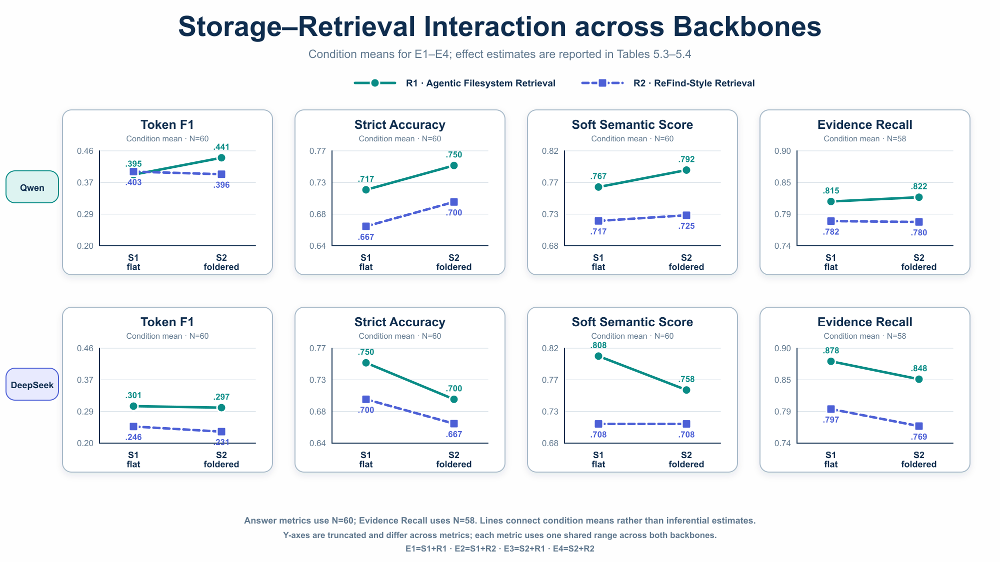
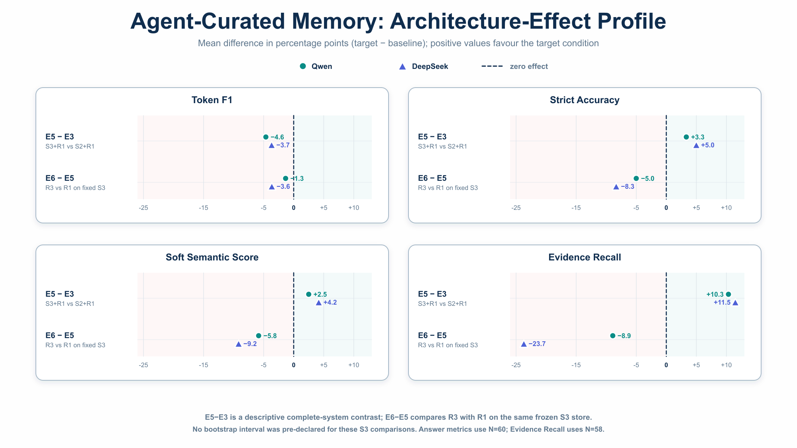

# Chapter 5 Results and Analysis

## 5.1 Analysis Scope and Research Questions

Chapter 3 defined the storage representations, retrieval systems, EvidenceBundle interface, and shared Answerer contract. Chapter 4 then specified the unified Main-60 test set and evaluation protocol. This chapter reports what the experiments show. It analyses the same 60 questions under seven selective evidence-access conditions for each of two backbone models, Qwen and DeepSeek, together with one DeepSeek-family Full Context diagnostic path.

Table 5.1 restates the condition mapping so that the experimental labels can be read without returning to Chapter 3. S1 is the flat raw-session store, S2 is the foldered raw-session store, and S3 is Agent-Curated Memory. R1 is Agentic Filesystem Retrieval, R2 is ReFind-style raw-chat retrieval, and R3 is retrieval adapted to the structure of S3.

**Table 5.1. Experimental conditions used in Chapter 5.** Full Context is a separate diagnostic path rather than E8.

| Condition | Evidence source | Retrieval or processing path | Analytical role |
|---|---|---|---|
| E1 | S1 | R1 | Flat raw-session filesystem baseline |
| E2 | S1 | R2 | ReFind-style raw-chat retrieval on S1 |
| E3 | S2 | R1 | Effect of folder organisation under R1 |
| E4 | S2 | R2 | Foldered raw sessions combined with R2 |
| E5 | S3 | R1 | Agent-Curated Memory accessed as a filesystem |
| E6 | S3 | R3 | Retrieval adapted to Agent-Curated Memory |
| E7 | E2 and E6 EvidenceBundles | Fixed deduplication and interleaving, followed by the shared Answerer | Dual-source complementarity and interference; no new retrieval |
| Full Context | All 30 S1 raw sessions | Complete chronological context processed under the shared Answerer contract | DeepSeek-family diagnostic comparison without selective retrieval or a 16,000-character EvidenceBundle; not an exact served-model ablation |

The six research questions form a four-stage argument. RQ1 and RQ2 identify the architecture effects and test whether their directions persist across backbone pipelines. RQ3 and RQ4 examine the benefits and limits of expanding evidence access through dual-source fusion and Full Context. RQ5 traces non-Correct paths through the information chain to identify the main confirmed bottlenecks. RQ6 then combines quality, online cost, construction cost, recovery burden, and existing memory assets to support conditional system selection. Table 5.2 provides the chapter-level roadmap. Each section follows the same sequence: research question, direct answer, main evidence, interpretation, and boundary.

**Table 5.2. Research questions and their locations in Chapter 5.**

| Research question | Main question | Section |
|---|---|---|
| RQ1 | How should memory representation and retrieval be paired to support effective selective access? | 5.2 |
| RQ2 | Which architectural effects remain stable across Qwen and DeepSeek, and which depend on the backbone model? | 5.3 |
| RQ3 | Does E7 convert the complementary E2 and E6 access paths into better answers while preserving parent-correct outcomes? | 5.4 |
| RQ4 | Does complete context visibility outperform selective evidence access, or do the two access regimes provide different advantages? | 5.5 |
| RQ5 | Across the non-Correct answer paths, where is the earliest evidence-supported break, and which stage is the largest confirmed system-internal bottleneck? | 5.6 |
| RQ6 | Given the backbone and available memory assets, which condition offers the most useful balance between answer quality, query cost, construction cost, and recovery burden? | 5.7 |

Strict Accuracy and Soft Semantic Score are the primary answer-quality measures. Partial Rate supports interpretation of the semantic labels, while Token Precision, Token Recall, Token F1, and normalised answer length diagnose lexical overlap and answer style. These answer measures use all 60 questions. Evidence Recall and gold-source coverage evaluate selective evidence access over the 58 questions with valid source-turn annotations; diagnostics that do not require gold annotations, such as source-ID overlap, use all 60 questions. Full Context has no retrieval-level Evidence Recall because it bypasses selective evidence construction. RQ6 reports successful-query tokens and model calls separately from construction and recovery costs. All condition comparisons reuse the same Main-60 questions and are interpreted as paired comparisons rather than independent samples.

At a high level, architecture quality depends on the match among storage representation, retrieval path, and backbone model, with R1 providing the most consistent quality-oriented access in the tested systems. Expanding evidence access through E7 or Full Context creates additional opportunities but does not guarantee correct evidence utilisation. No condition is globally optimal: the practical choice depends on the quality target, online budget, and whether S2 or S3 already exists.

## 5.2 RQ1: Matching Memory Representation with Retrieval

**Research question.** Section 5.2 addresses RQ1:

> **How should memory representation and retrieval be paired to support effective selective access?**

This question treats storage and retrieval as a coupled design problem. A representation may organise information into useful topics, paths, and evidence units, but those affordances affect the final answer only if the retrieval system can exploit them. The analysis therefore proceeds through three linked questions. First, does reorganising the same raw conversation content improve performance? Second, which retrieval path most effectively converts stored information into answer-relevant evidence? Third, when paired with the stronger observed retrieval path, does Agent-Curated Memory improve end-to-end quality?

**Direct answer.** Folder organisation does not produce an automatic or general gain: its clearest positive effect appears for Qwen with R1 and is concentrated on temporal questions. Across the tested raw and curated stores, R1 is the more consistent quality-oriented access path, whereas R2 and R3 use less recorded query-time effort but return weaker annotated-evidence coverage and semantic outcomes. When S3 is accessed through R1, it improves semantic quality and Evidence Recall relative to foldered raw sessions, but lowers Token F1. The central result is therefore that the effective unit of design is the **storage–retrieval pairing**, rather than either component in isolation.

All differences below are target minus baseline. Token F1, Strict Accuracy, and Soft Semantic Score use all 60 Main-60 questions. Evidence Recall and mean EvidenceBundle length use the 58 questions with valid source-turn annotations. The other two questions are open-domain questions without annotated source-turn IDs; they remain in all answer-quality calculations. The annotations identify valid evidence locations but are not guaranteed to constitute a minimal or exhaustive proof set. E7 is excluded because its fusion effect is analysed under RQ3. Formal cross-backbone stability is addressed in RQ2, detailed failure attribution in RQ5, and the final quality–cost decision in RQ6.

### 5.2.1 Does Storage Organisation Help When the Raw Information Is Unchanged?

**Research question.** The first analysis asks whether changing S1 flat raw sessions into S2 foldered raw sessions helps when the underlying conversation content remains raw. The primary comparison is E3−E1, which holds R1 fixed. E4−E2 is retained only as an auxiliary comparison because R2 does not receive the same form of directory access as R1.

**Direct answer.** The results do not support a general directory advantage. Folder organisation produces a positive answer-quality profile only for Qwen with R1. This pattern is not reproduced by DeepSeek, and the effects observed under R2 are small and inconsistent. Directory structure is therefore a navigation resource that a particular retrieval–backbone pairing may exploit, not an automatic source of improvement.

Table 5.3 reports the primary E3−E1 comparison under R1 and the auxiliary E4−E2 path-cue comparison under R2.

**Table 5.3. Effects of storage organisation on answer quality and annotated-evidence coverage.** Values are target minus baseline. Answer metrics use N = 60; Evidence Recall uses N = 58. Bracketed values are 95% paired-bootstrap intervals.

| Backbone | Contrast | Analytical role | ΔToken F1 [95% interval] | ΔStrict [95% interval] | ΔSoft | ΔEvidence Recall |
|---|---|---|---:|---:|---:|---:|
| Qwen | E3−E1 | Primary R1 comparison | +0.0462 [−0.0160, +0.1109] | +0.0333 [−0.0500, +0.1171] | +0.0250 | +0.0072 |
| DeepSeek | E3−E1 | Primary R1 comparison | −0.0041 [−0.0499, +0.0431] | −0.0500 [−0.1333, +0.0167] | −0.0500 | −0.0302 |
| Qwen | E4−E2 | Auxiliary R2 path-cue comparison | −0.0071 [−0.0678, +0.0533] | +0.0333 [−0.0500, +0.1333] | +0.0083 | −0.0014 |
| DeepSeek | E4−E2 | Auxiliary R2 path-cue comparison | −0.0141 [−0.0742, +0.0471] | −0.0333 [−0.1000, +0.0333] | 0.0000 | −0.0287 |

For Qwen, E3−E1 increases Token F1 by 0.0462, Strict Accuracy by 0.0333, and Soft Semantic Score by 0.0250. Token F1 improves on 19 questions, is unchanged on 30, and declines on 11. Strict correctness records five repairs and three harms, giving a net increase of two correct answers. The corresponding DeepSeek effects are −0.0041, −0.0500, and −0.0500. The Qwen result is therefore a positive observed signal for one retrieval–backbone pairing, rather than a storage effect that generalises across both pipelines. The paired intervals also show that none of the storage effects is statistically resolved in Main-60.

Figure 5.1 visualises the corresponding E1–E4 condition means. Within each backbone, the R1 line connects E1 to E3 and the R2 line connects E2 to E4. The slopes therefore show descriptive changes from S1 to S2 under each retrieval path; they are not inferential interaction estimates.

*Figure 5.1. Storage–retrieval interaction across backbones. The panels report Token F1, Strict Accuracy, Soft Semantic Score, and Evidence Recall for E1–E4. Answer metrics use N = 60 and Evidence Recall uses N = 58. The y-axes are truncated and differ across metrics, while each metric retains one common range across the two backbones. The related storage and retrieval contrasts are reported in Tables 5.3–5.4.*

The category results further localise the Qwen signal. On the 13 temporal questions, E3−E1 increases Token F1 by 0.1994, Strict Accuracy by 0.3077, and Soft Semantic Score by 0.1923. Evidence Recall nevertheless decreases by 0.0385 within the same category. The aggregate benefit is therefore concentrated on temporal questions and is not explained by broader coverage of the annotated source turns.

This pattern is consistent with directory structure improving how R1 navigates or interprets already sufficient evidence. Folder and path cues can provide a more informative search entry point, reduce the apparent search space, or help preserve relationships among time-related statements. They need not increase the number of annotated turns retrieved to improve the final answer. These are architecture-level explanations consistent with the observed metrics; trace-level attribution is deferred to RQ5.

E4−E2 requires a narrower interpretation. E2 and E4 use the same raw-exchange index, and folder names do not enter R2’s first-stage lexical ranking. The S2 relative path becomes visible mainly through provenance observations and may influence later query actions. E4−E2 therefore tests the auxiliary effect of exposing folder/path cues within the current R2 pipeline, not the full directory-navigation effect tested by E3−E1. Its mixed answer effects and near-zero Evidence Recall changes show no stable benefit from this limited exposure.

The difference-in-differences analysis does not strengthen the claim. The interaction, DID = (E4−E2)−(E3−E1), has Token F1 estimates of −0.0533 for Qwen and −0.0100 for DeepSeek. All paired-bootstrap intervals for the Token F1, Strict Accuracy, and Soft Semantic Score interactions span zero. Moreover, R1 and R2 do not receive equivalent access to S2’s directory information, so the DID is an interface-level descriptive comparison rather than a symmetric test of folder navigation. The bounded conclusion is that folder organisation can help a particular retrieval–backbone combination, especially Qwen+R1 on temporal questions, but Main-60 does not establish a universal benefit from directory structure.

### 5.2.2 Which Retrieval Path Converts Stored Information into Useful Evidence?

**Research question.** The second analysis holds the representation fixed and asks which retrieval path more effectively identifies and retains the evidence required by the Answerer. It compares R2 with R1 on S1 and S2, and R3 with R1 on the frozen S3 store.

**Direct answer.** Across these comparisons, R1 is the more consistent quality-oriented path. R2 and R3 use fewer recorded query-time model calls and tokens, but this efficiency is accompanied by lower Evidence Recall and weaker semantic outcomes. The key distinction is therefore not how much text a retriever returns, but whether the resulting EvidenceBundle contains the decisive evidence in a usable form.

Table 5.4 reports the retrieval-path effects while holding each storage representation fixed.

**Table 5.4. Retrieval-path effects on fixed storage representations.** Values are target minus baseline. E2−E1 and E4−E3 compare R2 with R1; E6−E5 compares R3 with R1. Answer metrics use N = 60; Evidence Recall and bundle length use N = 58.

| Storage | Backbone | Contrast | ΔToken F1 | ΔStrict | ΔSoft | ΔEvidence Recall | ΔBundle characters |
|---|---|---|---:|---:|---:|---:|---:|
| S1 | Qwen | E2−E1 | +0.0082 | −0.0500 | −0.0500 | −0.0330 | +4,040.8 |
| S1 | DeepSeek | E2−E1 | −0.0557 | −0.0500 | −0.1000 | −0.0805 | +7,142.3 |
| S2 | Qwen | E4−E3 | −0.0451 | −0.0500 | −0.0667 | −0.0417 | +3,885.6 |
| S2 | DeepSeek | E4−E3 | −0.0657 | −0.0333 | −0.0500 | −0.0790 | +6,678.9 |
| S3 | Qwen | E6−E5 | −0.0135 | −0.0500 | −0.0583 | −0.0891 | +5,109.1 |
| S3 | DeepSeek | E6−E5 | −0.0364 | −0.0833 | −0.0917 | −0.2371 | +5,457.3 |

On S1, Qwen E2−E1 produces a small Token F1 increase of 0.0082, but Strict Accuracy and Soft Semantic Score both fall by 0.0500 and Evidence Recall falls by 0.0330. This is a lexical–semantic disagreement, not evidence that R2 improves overall answer quality. DeepSeek shows a clearer negative profile on the same store.

On S2, both backbones show lower Token F1, Strict Accuracy, Soft Semantic Score, and Evidence Recall under R2. This is the clearest raw-memory result: replacing R1 with R2 does not improve any of the four principal quality measures. On S3, R3 likewise remains below R1 across all four measures. The Evidence Recall decrease is especially large for DeepSeek at −0.2371. No paired-bootstrap interval was pre-declared for E6−E5, so this S3 result is descriptive of the observed Main-60 pipelines.

Bundle size moves in the opposite direction from evidence quality. R2 adds approximately 3,886–7,142 characters to the mean eligible EvidenceBundle, while R3 adds approximately 5,109–5,457 characters. Nevertheless, Evidence Recall declines in all six comparisons. More retrieved text therefore does not imply greater coverage of the annotated evidence, and neither property guarantees a better answer.

The process logs reveal a quality–efficiency trade-off. Across the four raw-memory comparisons, R2 reduces recorded model calls by 6.68–7.98 and total query-time model tokens by 121,809.1–183,717.1 per question. On S3, R3 reduces the corresponding totals by 3.22 calls and 244,976.5 tokens under Qwen, and by 3.90 calls and 339,242.3 tokens under DeepSeek. These totals include retrieval and answering, apply to successful-query records, and exclude separately reported failed-attempt and recovery costs.

The observed pattern is consistent with a difference in evidence selection rather than evidence volume. R1’s observation–action loop can inspect files, revise a search after observing partial results, follow a new path, and decide whether further evidence is needed. By contrast, the current R2 and R3 pipelines are more tightly constrained by initial query formulation, ranking, local expansion, action limits, and stopping decisions. A large bundle may consequently contain relevant but non-decisive material, reach the correct session while omitting an adjacent decisive turn, or increase the Answerer’s evidence-selection burden. RQ5 determines how often these mechanisms occur; RQ1 only establishes the aggregate architecture pattern.

These contrasts compare complete access systems. They do not isolate BM25, grep, query generation, local expansion, or any other individual component. R1 rounds and R2/R3 actions are also not commensurate units. The supported conclusion is therefore limited to the implemented Main-60 pipelines: R1 more consistently converts the tested representations into annotated evidence and answers with higher semantic quality, whereas the lower recorded query-time effort of R2 and R3 is not a quality-neutral substitution. Whether that reduction justifies the quality loss is considered in RQ6.

### 5.2.3 Does Curated Memory Add Value When Paired with Effective Retrieval?

**Research question.** The third analysis asks whether Agent-Curated Memory adds value when both representations are accessed through the stronger observed retrieval path. The principal comparison is E5−E3: E3 uses S2+R1, while E5 uses S3+R1.

**Direct answer.** The two backbones show the same directional profile. S3+R1 improves Strict Accuracy, Soft Semantic Score, and Evidence Recall, but lowers Token F1. Its benefit is therefore semantic and evidence-oriented rather than uniformly reflected by lexical overlap.

Table 5.5 reports the E5−E3 representation contrast under the shared R1 access path.

**Table 5.5. Effect of replacing foldered raw sessions with Agent-Curated Memory under R1.** E5−E3 is a descriptive complete-system representation contrast. Answer metrics use N = 60; Evidence Recall uses N = 58.

| Backbone | ΔToken Precision | ΔToken Recall | ΔToken F1 | ΔStrict | ΔSoft | ΔEvidence Recall | Mean normalised answer length, E3→E5 |
|---|---:|---:|---:|---:|---:|---:|---:|
| Qwen | −0.0436 | +0.0380 | −0.0463 | +0.0333 | +0.0250 | +0.1034 | 11.97→16.13 |
| DeepSeek | −0.0385 | +0.0566 | −0.0367 | +0.0500 | +0.0417 | +0.1149 | 21.72→29.17 |

Under Qwen, E5−E3 increases Strict Accuracy by 0.0333, Soft Semantic Score by 0.0250, and Evidence Recall by 0.1034, while Token F1 decreases by 0.0463. Under DeepSeek, the corresponding changes are +0.0500, +0.0417, +0.1149, and −0.0367. The agreement in direction across the two observed pipelines distinguishes this result from the conditional storage-organisation effect in Section 5.2.1.

Figure 5.2 places the representation contrast E5−E3 beside the same-store retrieval contrast E6−E5. It therefore separates the value observed for the complete S3+R1 path from the effect of replacing R1 with R3 on the frozen S3 store.

*Figure 5.2. Agent-Curated Memory storage–retrieval pairing profile. Values are mean target-minus-baseline differences in percentage points. E5−E3 is a descriptive complete-system representation contrast, whereas E6−E5 compares R3 with R1 on the same frozen S3 store. Answer metrics use N = 60 and Evidence Recall uses N = 58. No paired-bootstrap interval was pre-declared for these S3 comparisons.*

The lexical result can be decomposed into lower Token Precision and higher Token Recall. Mean normalised answer length increases from 11.97 to 16.13 tokens under Qwen, approximately 35%, and from 21.72 to 29.17 under DeepSeek, approximately 34%. This pattern is consistent with S3 co-locating related facts across sessions and allowing the Answerer to produce a more complete or differently worded response. Such answers can receive higher semantic scores while losing Token F1 because of additional explanation or reduced lexical precision. Answer length was not independently controlled, however, and should not be treated as the sole cause of the F1 decline.

Table 5.6 locates E5 within the complete E1–E6 RQ1 condition set.

**Table 5.6. Absolute condition means within the E1–E6 RQ1 scope.** Answer metrics use N = 60; Evidence Recall uses N = 58. Bold values are the highest value within each backbone panel, including ties.

*Panel A. Qwen.*

| Condition | Storage + retrieval | Token F1 | Strict Accuracy | Soft Semantic Score | Evidence Recall |
|---|---|---:|---:|---:|---:|
| E1 | S1 + R1 | 0.3949 | 0.7167 | 0.7667 | 0.8147 |
| E2 | S1 + R2 | 0.4031 | 0.6667 | 0.7167 | 0.7816 |
| E3 | S2 + R1 | **0.4411** | 0.7500 | 0.7917 | 0.8218 |
| E4 | S2 + R2 | 0.3960 | 0.7000 | 0.7250 | 0.7802 |
| E5 | S3 + R1 | 0.3948 | **0.7833** | **0.8167** | **0.9253** |
| E6 | S3 + R3 | 0.3813 | 0.7333 | 0.7583 | 0.8362 |

*Panel B. DeepSeek.*

| Condition | Storage + retrieval | Token F1 | Strict Accuracy | Soft Semantic Score | Evidence Recall |
|---|---|---:|---:|---:|---:|
| E1 | S1 + R1 | **0.3013** | **0.7500** | **0.8083** | 0.8779 |
| E2 | S1 + R2 | 0.2455 | 0.7000 | 0.7083 | 0.7974 |
| E3 | S2 + R1 | 0.2971 | 0.7000 | 0.7583 | 0.8477 |
| E4 | S2 + R2 | 0.2314 | 0.6667 | 0.7083 | 0.7687 |
| E5 | S3 + R1 | 0.2604 | **0.7500** | 0.8000 | **0.9626** |
| E6 | S3 + R3 | 0.2240 | 0.6667 | 0.7083 | 0.7256 |

Under Qwen, E5 has the highest Strict Accuracy, Soft Semantic Score, and Evidence Recall, whereas E3 has the highest Token F1. Under DeepSeek, E5 has the highest Evidence Recall and ties E1 for the highest Strict Accuracy, but E1 retains the highest Token F1 and Soft Semantic Score. E5 is therefore the strongest of the tested curated-memory paths and an important semantic/evidence leader, but it is not a universal winner across metrics and backbones. Its advantage over E6 also shows that S3’s value depends on how the representation is accessed.

E5−E3 should not be interpreted as a pure curation effect. Although R1 is held fixed, the move from S2 to S3 changes wording, granularity, organisation, deduplication, and provenance presentation together. No new paired-bootstrap interval was pre-declared for this descriptive S3 comparison. The defensible conclusion is that the complete S3+R1 representation–access path improves semantic quality and annotated-evidence coverage relative to S2+R1, while introducing a lexical-overlap trade-off. S3 construction cost and its effect on deployment choice are addressed in RQ6.

Taken together, RQ1 shows that memory structure does not improve performance automatically. Folder organisation provides a conditional benefit only when the retrieval path and backbone can exploit its navigation cues. Across the tested raw and curated representations, R1 more consistently converts stored information into annotated evidence and answers with higher semantic quality, whereas R2 and R3 mainly reduce recorded query-time effort and incur observable quality losses. When paired with R1, Agent-Curated Memory improves semantic quality and evidence coverage relative to foldered raw sessions, but lowers Token F1. The appropriate design target is therefore the storage–retrieval pairing rather than either component considered in isolation. RQ2 next tests which of these architecture patterns persist across the two backbone pipelines.

## 5.3 RQ2: Robustness across Backbone Models

**Research question.** Which findings from RQ1 remain directionally consistent across the Qwen and DeepSeek pipelines, and which depend on the backbone model?

The robustness analysis uses five main E1–E6 contrasts from RQ1. E4−E2 is excluded from the primary matrix because R2 does not use the S2 folder hierarchy as a symmetric navigation intervention. E7 appears only in the aggregate answer profile; its fusion effect is analysed in RQ3. Full Context is excluded because no matched Qwen run is available.

**Direct answer.** Three findings are directionally stable across the two tested pipelines. On S2, R1 produces higher answer quality and Evidence Recall than R2. On S3, R1 also outperforms the current R3 implementation. In addition, S3+R1 consistently trades lower Token F1 for higher semantic quality and Evidence Recall relative to S2+R1.

Other findings depend more strongly on the backbone. On S1, R2 lowers semantic quality and Evidence Recall under both backbones, but its Token F1 effect changes direction. The benefit of replacing S1 with S2 under R1 appears only in the Qwen pipeline.

The backbone comparison also reveals an important measurement distinction. Qwen has much higher Token F1, but the two pipelines have similar mean Strict Accuracy and Soft Semantic Score. The lexical gap therefore cannot be interpreted as an equally large semantic-quality gap. Strict Accuracy and Soft Semantic Score provide the primary quality interpretation below. Evidence Recall supports the evidence-access interpretation, while Token F1 is treated as a diagnostic lexical measure.

### 5.3.1 Which RQ1 Findings Remain Directionally Stable?

Table 5.7 reports the five principal architecture contrasts. Each value is the target-condition mean minus the baseline-condition mean. The classifications describe point-estimate directions across the two tested pipelines; they do not imply statistical significance or equal effect size.

**Table 5.7. Directional stability of the principal RQ1 architecture effects.** Answer metrics use N = 60. Evidence Recall uses the 58 evidence-eligible questions. Q/D denotes Qwen and DeepSeek.

| Contrast | Qwen ΔStrict / ΔSoft | DeepSeek ΔStrict / ΔSoft | ΔEvidence Recall, Q/D | ΔToken F1, Q/D | Interpretation |
|---|---:|---:|---:|---:|---|
| E4−E3 | −0.0500 / −0.0667 | −0.0333 / −0.0500 | −0.0417 / −0.0790 | −0.0451 / −0.0657 | Stable negative effect |
| E6−E5 | −0.0500 / −0.0583 | −0.0833 / −0.0917 | −0.0891 / −0.2371 | −0.0135 / −0.0364 | Stable negative effect |
| E5−E3 | +0.0333 / +0.0250 | +0.0500 / +0.0417 | +0.1034 / +0.1149 | −0.0463 / −0.0367 | Stable lexical–semantic trade-off |
| E2−E1 | −0.0500 / −0.0500 | −0.0500 / −0.1000 | −0.0330 / −0.0805 | +0.0082 / −0.0557 | Semantic and evidence effects stable; lexical effect backbone-dependent |
| E3−E1 | +0.0333 / +0.0250 | −0.0500 / −0.0500 | +0.0072 / −0.0302 | +0.0462 / −0.0041 | Backbone-dependent |

Three contrasts support stable conclusions. E4−E3 is negative across all reported metrics, so R1 provides higher answer quality and annotated-evidence coverage than R2 on the fixed S2 store. E6−E5 is also uniformly negative: on the frozen S3 store, the current R3 implementation remains below R1. E5−E3 reproduces the same trade-off in both pipelines: S3+R1 raises semantic quality and Evidence Recall but lowers Token F1. This last comparison is a complete-system representation contrast and does not isolate curation as its sole cause.

E2−E1 is only partly stable. On S1, R2 lowers Strict Accuracy, Soft Semantic Score, and Evidence Recall under both backbones. Its Token F1 rises slightly under Qwen and falls under DeepSeek. The semantic and evidence conclusions are therefore stable, whereas the lexical conclusion depends on the backbone.

E3−E1 is fully backbone-dependent. Replacing S1 with S2 under R1 improves the Qwen results but does not improve the DeepSeek results. Folder organisation should therefore be treated as a useful match for the tested Qwen+R1 pipeline, not as a general storage advantage.

Figure 5.3 visualises the five principal contrasts together with E4−E2 as a supplementary path-cue comparison.

*Figure 5.3. Cross-backbone stability of five primary architecture effects and one supplementary path-cue comparison. Each value is a target-minus-baseline mean difference over the same 60 questions, shown in percentage points. Circles denote Qwen and triangles denote DeepSeek. Each connector joins the two backbone estimates for one contrast; it is not a confidence interval or significance test. Table 5.7 reports the five primary RQ2 contrasts; E4−E2 is shown only as supplementary context.*

### 5.3.2 Why Does Token F1 Diverge More Than Semantic Quality?

Table 5.8 separates lexical overlap, semantic quality, and answer style. The values are equal-weight descriptive means across E1–E7. The seven conditions reuse the same 60 questions and must not be interpreted as 420 independent observations per backbone.

**Table 5.8. Cross-backbone measurement profile across E1–E7.**

| Metric | Qwen | DeepSeek |
|---|---:|---:|
| Token Precision | 0.3411 | 0.1957 |
| Token Recall | 0.6774 | 0.6884 |
| Token F1 | 0.3972 | 0.2636 |
| Strict Accuracy | 0.7262 | 0.7119 |
| Soft Semantic Score | 0.7619 | 0.7560 |
| Mean normalised answer length | 14.03 | 25.35 |

The clearest measured difference is answer style. DeepSeek answers are approximately 80.7% longer. Its mean Token Recall is slightly higher, but its Token Precision is lower by 0.1454. Extra explanation, qualification, and paraphrastic wording increase the number of candidate tokens without necessarily increasing overlap with a short reference answer. Because Token F1 combines Token Precision and Token Recall, the small Recall advantage cannot offset the much larger Precision deficit.

This pattern explains only part of the difference. In E1, E2, and E7, DeepSeek combines lower Token F1 with higher Token Recall and equal or higher Strict Accuracy, which is consistent with lexical under-credit for longer answers. In E3–E6, however, DeepSeek also has lower Token Recall and lower semantic scores. These conditions suggest additional differences in retrieval behaviour, evidence selection, or EvidenceBundle utilisation. RQ2 does not assign those differences to a specific component because the backbone controls both the Retrieval Agent and the Answerer. Their root causes are examined in RQ5.

### 5.3.3 Answer to RQ2 and Boundary

Retrieval-path ordering is more robust across the two tested backbone pipelines than the benefit of changing storage organisation. R1 remains the stronger quality-oriented access path on S2 and S3, and S3+R1 preserves the same lexical–semantic trade-off under both backbones. In contrast, the benefit of folder organisation under R1 is backbone-dependent.

This conclusion applies only to the two tested end-to-end pipelines. Because the backbone is changed for both retrieval and answering, the experiment cannot isolate which component produces a cross-backbone difference. Directional agreement also does not establish statistical significance, equal effect size, or a model-independent law.

RQ3 next examines whether the two complementary access paths can be combined without losing correct parent outcomes.

## 5.4 RQ3: Dual-Source Fusion

**Research question.** Does deterministic fusion of the E2 and E6 EvidenceBundles convert their complementary evidence into better answers without losing answers already solved by either parent?

E2 retrieves from raw dialogue through R2, whereas E6 retrieves from Agent-Curated Memory through R3. E7 reuses the two completed parent EvidenceBundles, performs no new retrieval, applies a fixed deterministic merge, and invokes the shared Answerer once. RQ3 therefore evaluates a fusion condition, not a third retriever.

**Direct answer.** E2 and E6 provide measurable answer-level and annotated-source-access complementarity. E7 expands Evidence Recall under both backbones, but the answer benefit differs. Under Qwen, E7 improves Strict Accuracy and Soft Semantic Score relative to E2, ties E6 on both semantic measures, and lowers Token F1 relative to both parents. Under DeepSeek, E7 improves Token Precision, Token Recall, Token F1, Strict Accuracy, Soft Semantic Score, and Evidence Recall relative to both parents.

The opportunity is not fully converted. E7's net Strict-correct count is three questions below the post-hoc parent oracle under Qwen and one question below under DeepSeek. It produces both Repair and Harm, so dual-source fusion is a conditional improvement rather than a universal replacement for either parent.

Figure 5.4 shows how the fixed E7 condition is constructed.

*Figure 5.4. Composition of the E7 dual-source fusion condition. E2 combines S1 Flat Raw Sessions with R2 ReFind-Style Raw-Chat Retrieval, whereas E6 combines S3 Agent-Curated Memory with R3 Curated-Memory Retrieval. E7 validates and deterministically fuses the two completed EvidenceBundles, performs no new query or retrieval, and invokes the shared Answerer once.*

The analysis contains 120 paired E2–E6–E7 triples: the same 60 questions under each backbone. Answer metrics and mean source-ID Jaccard use all 60 questions. Evidence Recall and gold-source coverage use the 58 evidence-eligible questions. All reported changes are descriptive paired effects; RQ3 introduces no additional significance test.

### 5.4.1 Main Evidence: Benefit, Opportunity, and Conversion

#### Observed Fusion Benefit

Table 5.9, Panel A reports E7 minus each parent. Positive values favour E7.

**Table 5.9. Dual-source fusion benefit, complementarity opportunity, and conversion outcomes.**

*Panel A. Paired E7-minus-parent effects.*

| Backbone | Parent | ΔToken Precision | ΔToken Recall | ΔToken F1 | ΔStrict | ΔSoft | ΔEvidence Recall |
|---|---|---:|---:|---:|---:|---:|---:|
| Qwen | E2 | −0.0425 | +0.0194 | −0.0340 | +0.0667 | +0.0417 | +0.1178 |
| Qwen | E6 | −0.0028 | −0.0131 | −0.0122 | 0.0000 | 0.0000 | +0.0632 |
| DeepSeek | E2 | +0.0408 | +0.0341 | +0.0398 | +0.0500 | +0.0917 | +0.0977 |
| DeepSeek | E6 | +0.0498 | +0.1280 | +0.0614 | +0.0833 | +0.0917 | +0.1695 |

The Qwen benefit is parent-dependent. Relative to E2, E7 gains four Strict-correct answers and raises Soft Semantic Score and Evidence Recall, but loses Token F1 because Token Precision falls more than Token Recall rises. Relative to E6, E7 expands annotated-source coverage without improving semantic quality, and its Token F1 is lower. The DeepSeek result is broader: every reported answer metric and Evidence Recall increases relative to both parents.

#### Complementarity Opportunity

Answer-level complementarity asks whether E2 and E6 solve different questions. Panel B shows that exactly one parent is Strict-correct on ten questions under each backbone.

*Panel B. Parent Strict-correctness profiles and descriptive oracle benchmark.*

| Backbone | Both correct | E2 only | E6 only | Neither | Exactly one parent | Parent oracle | E7 correct |
|---|---:|---:|---:|---:|---:|---:|---:|
| Qwen | 37 | 3 | 7 | 13 | 10 | 47 | 44 |
| DeepSeek | 36 | 6 | 4 | 14 | 10 | 46 | 45 |

Evidence-access complementarity asks whether the two paths reach different annotated locations. Panel C reports low source-ID overlap and unique gold-source coverage from both parents.

*Panel C. Evidence-source overlap and union coverage.*

| Backbone | E2 Evidence Recall | E6 Evidence Recall | Union/E7 Evidence Recall | Mean source-ID Jaccard | Questions with unique gold coverage from either parent | Union complete |
|---|---:|---:|---:|---:|---:|---:|
| Qwen | 0.7816 | 0.8362 | 0.8994 | 0.1956 | 14/58 | 49/58 |
| DeepSeek | 0.7974 | 0.7256 | 0.8951 | 0.1587 | 19/58 | 49/58 |

The answer sets and retrieved source-ID sets are therefore not redundant. However, source-ID Jaccard measures overlap in recorded locations, not textual or semantic similarity. Gold source IDs also identify annotated locations rather than a minimal or exhaustive reasoning chain.

#### Conversion of the Opportunity

The conversion analysis uses four mutually exclusive Strict-based states. **Repair** means that neither parent is Strict-correct but E7 is correct. **Preserve** means that at least one parent is correct and E7 remains correct. **Harm** means that at least one parent is correct but E7 is not. **Unresolved** means that neither parent nor E7 is correct. Partial and Incorrect judge labels are both non-correct under this definition.

*Panel D. Strict-based fusion outcomes.*

| Backbone | Repair | Preserve | Harm | Unresolved | Preserve/oracle-correct | Repair/neither-correct | Harm/oracle-correct | E7−oracle |
|---|---:|---:|---:|---:|---:|---:|---:|---:|
| Qwen | 1 | 43 | 4 | 12 | 43/47 (91.49%) | 1/13 (7.69%) | 4/47 (8.51%) | −3 |
| DeepSeek | 3 | 42 | 4 | 11 | 42/46 (91.30%) | 3/14 (21.43%) | 4/46 (8.70%) | −1 |

These counts satisfy three identities: E7 correct equals Preserve plus Repair; parent-oracle correct equals Preserve plus Harm; and the E7–oracle gap equals Repair minus Harm. Thus, Qwen yields 44 E7-correct and 47 oracle-correct questions, while DeepSeek yields 45 and 46. Among the ten exactly-one-parent-correct questions, E7 preserves six under Qwen and seven under DeepSeek.

Figure 5.5 visualises the conversion from parent-correctness profiles to the four E7 outcomes.

*Figure 5.5. Parent Strict-correctness profiles and E7 fusion outcomes. Each panel maps the 60 questions from the four E2/E6 correctness profiles to Repair, Preserve, Harm, or Unresolved. Flow widths and labels represent question counts. Outcomes use Strict Accuracy only. Harm identifies a possible-interference case and does not establish a causal failure mechanism.*

E7 preserves most oracle-correct questions and also repairs some questions missed by both parents. It does not preserve every available correct parent outcome. The oracle gap is therefore a conversion gap, not evidence that the parents lack complementarity.

### 5.4.2 Interpretation of the Observed Pattern

#### Why Fusion Has an Opportunity to Help

Low source-ID overlap, unique gold-source coverage, and the ten exactly-one-parent-correct questions under each backbone establish distinct access and success profiles. The raw-dialogue and curated-memory paths may expose different factual detail, temporal structure, or cross-session links. RQ3 does not verify these semantic roles; it shows only that the paths reach different recorded locations and solve partly different question sets.

#### Why Complementarity Does Not Guarantee a Correct Fused Answer

Higher coverage does not automatically become a correct answer. E7 fails to preserve some oracle-correct cases and repairs only a subset of the cases missed by both parents. Repetition, competing states, additional answer length, or Answerer evidence selection may contribute to this gap. These are candidate explanations rather than causal findings; trace-level attribution is deferred to RQ5.

#### Question-Type Heterogeneity

Three subgroup patterns are most informative:

- **DeepSeek temporal:** the 13 questions produce Repair/Preserve/Harm/Unresolved counts of 2/9/1/1. Token F1, Strict Accuracy, Soft Semantic Score, and Evidence Recall all increase relative to both parents.
- **Qwen multi-hop:** the 13 questions produce 1/9/0/3. Strict Accuracy and Soft Semantic Score increase relative to both parents, but Token F1 falls.
- **Qwen single-hop:** the 27 questions produce 0/21/3/3. This category contains three of the four Qwen Harm cases and no Repair, making it the strongest observed possible-interference signal.

These are exploratory subgroup patterns, not established question-type interactions. The complete category matrix is retained in the audit material. Open-domain contains only seven answer questions and five evidence-eligible questions, so it does not support an independent general claim.

### 5.4.3 Answer to RQ3 and Boundary

E2 and E6 provide measurable answer-level and annotated-source-access complementarity, and E7 converts part of that opportunity into broader evidence coverage and better answers. The Qwen benefit is limited and parent-dependent; the DeepSeek benefit is broader. E7 nevertheless remains below the post-hoc parent oracle and produces four Harm cases under each backbone. Dual-source fusion is therefore useful under specific backbone and question conditions, not uniformly superior.

This conclusion has seven boundaries:

- E7 performs no new retrieval and represents one fixed deterministic fusion design, not fusion methods in general.
- Answer metrics and source-ID overlap use 60 questions per backbone; Evidence Recall and gold-source coverage use 58 evidence-eligible questions.
- Repair and Harm use Strict Accuracy. Partial and Incorrect labels are both treated as non-correct.
- Source-ID Jaccard and gold source IDs measure annotated-location coverage, not semantic complementarity or conflict.
- The parent oracle is post-hoc and non-deployable. It is not a strict mathematical upper bound because E7 can repair questions missed by both parents.
- Each parent EvidenceBundle is limited to 16,000 characters, while the combined E7 input can reach 32,000 characters. The observed E7 effect therefore combines source diversity with greater total evidence capacity.
- RQ3 reports descriptive effects. Harm is possible interference rather than a proven causal mechanism; trace attribution is addressed in RQ5 and full dual-path cost in RQ6.

Section 5.5 next compares selective retrieval with Full Context as a separate diagnostic access condition.

## 5.5 RQ4: Full Context versus Selective Retrieval

**Research question.** Does complete context visibility outperform selective evidence access, or do the two access regimes provide different advantages?

Full Context supplies all 30 raw sessions to the Answerer in chronological order. It performs no question-dependent retrieval and does not construct an EvidenceBundle. E7 is the main selective comparison because it combines the E2 and E6 evidence paths; E1 and E5 provide additional quality-oriented anchors.

**Direct answer.** Full Context achieves the highest mean Strict Accuracy and Soft Semantic Score, but its advantage is small: it answers 46 of 60 questions correctly, compared with 45 for E1, E5, and E7. It has lower Token F1 than all three anchors, and its same-question comparison with E7 contains both Full Context-only and E7-only successes. Full Context therefore does not dominate selective retrieval. The observed pattern is a coverage–focus trade-off: complete visibility can help when relevant evidence is distributed across sessions, whereas selective retrieval can help when the answer depends on isolating a specific fact or temporal cue. Complete visibility recovers some questions missed by selective retrieval, but it does not remove long-context reasoning or evidence-utilisation errors.

All answer metrics use the same 60 questions. Full Context has no retrieval-level Evidence Recall because it has no retrieved source set; complete visibility must not be reported as Evidence Recall equal to one. The selective conditions used deepseek-v4.1-flash, whereas Full Context used deepseek-v4.1-flash-1017. The comparison is therefore a same-family diagnostic rather than a strict single-variable ablation.

### 5.5.1 Does Full Context Dominate Selective Retrieval?

Table 5.10 compares Full Context with the three main selective anchors. Strict Accuracy and Soft Semantic Score are the primary quality measures; Token F1 is retained as a lexical diagnostic.

**Table 5.10. Overall quality of Full Context and the principal selective anchors.** All metrics use the same 60 questions. Correct is the number of Strict-correct answers.

| Condition | Storage and access path | Correct | Strict | Soft | Token F1 |
|---|---|---:|---:|---:|---:|
| Full Context | Complete S1 raw history; no retrieval | **46/60** | **0.7667** | **0.8250** | 0.2445 |
| E1 | S1 + R1 | 45/60 | 0.7500 | 0.8083 | **0.3013** |
| E5 | S3 + R1 | 45/60 | 0.7500 | 0.8000 | 0.2604 |
| E7 | Fused E2 + E6 evidence | 45/60 | 0.7500 | 0.8000 | 0.2854 |

Full Context leads each anchor by only one Strict-correct answer. Its Soft advantage is also limited: +0.0167 relative to E1 and +0.0250 relative to E5 and E7. By contrast, its Token F1 is lower than all three selective anchors. The highest semantic mean therefore does not imply superiority on every quality measure.

The paired Full Context–E7 comparison gives the clearest test of dominance. Table 5.11 partitions the same 60 questions by Strict outcome.

**Table 5.11. Same-question Strict outcomes for Full Context and E7.** The four cells are mutually exclusive and sum to 60.

| Strict outcome | Questions |
|---|---:|
| Both correct | 42 |
| Full Context only | 4 |
| E7 only | 3 |
| Neither correct | 11 |

The net Full Context advantage is 4 − 3 = 1 question, which matches the aggregate Strict difference. More importantly, each regime solves questions missed by the other. Full Context therefore has the highest semantic mean without forming a one-way dominance relation. The lexical result points in the same direction: relative to E7, Full Context lowers Token F1 by 0.0408 even while increasing Strict Accuracy by 0.0167 and Soft Semantic Score by 0.0250. Token overlap and semantic quality capture different properties of the answer.

### 5.5.2 Why Does Neither Access Regime Dominate?

The results are consistent with one central explanation: complete coverage and selective focus address different information-access problems. Table 5.12 summarises the question-type asymmetry and the scale of the evidence or context payload supplied to the Answerer.

**Table 5.12. Question-type asymmetry and evidence/context payload.** Panel A reports descriptive Full Context–E7 results; the subgroup analysis is exploratory. Panel B reports evidence or raw-context characters supplied to the Answerer, not the complete prompt size or total online cost.

*Panel A. Category-specific semantic quality and Strict outcomes.*

| Category | N | Full Context Strict | E7 Strict | Full Context Soft | E7 Soft | Both / FC only / E7 only / Neither |
|---|---:|---:|---:|---:|---:|---:|
| Multi-hop | 13 | **0.8462** | 0.6923 | **0.8846** | 0.8077 | 8 / 3 / 1 / 1 |
| Temporal | 13 | 0.7692 | **0.8462** | 0.8077 | **0.8462** | 10 / 0 / 1 / 2 |
| Open-domain | 7 | **0.4286** | 0.2857 | **0.5000** | 0.2857 | 2 / 1 / 0 / 4 |
| Single-hop | 27 | 0.8148 | **0.8519** | 0.8889 | **0.9074** | 22 / 0 / 1 / 4 |

*Panel B. Evidence/context payload supplied to the Answerer.*

| Access regime | Payload (characters) | Share of Full Context |
|---|---:|---:|
| Full Context | 108,960.0 | 100.00% |
| E1 | 1,720.9 | 1.58% |
| E7 | 19,758.6 | 18.13% |

The coverage side is clearest for Multi-hop questions. Full Context is Strict-correct on 11 of 13 questions, compared with 9 for E7, and it produces three Full Context-only successes against one E7-only success. Its Soft Semantic Score also rises from 0.8077 to 0.8846. This pattern is consistent with complete visibility helping when an answer must combine facts distributed across sessions. It does not establish that retrieval omission caused every E7 error; case-level attribution is deferred to RQ5.

The focus side appears in the Temporal and Single-hop groups. Neither group contains a Full Context-only success, while each contains one E7-only success. E7 also has higher Strict and Soft scores in both groups. Selective evidence may reduce competition from unrelated dialogue, repeated events, similar entities, or different temporal states, thereby making a decisive attribute or time anchor easier to locate. The payload comparison shows the scale of this concentration: E7 exposes 18.13% of the Full Context characters, while E1 exposes 1.58%, yet both remain within one Strict-correct answer of Full Context overall. These values describe evidence concentration, not total prompt tokens or a deployment-cost ranking; cost is analysed in RQ6.

The Open-domain subgroup favours Full Context semantically, but it contains only seven questions and is retained as an exploratory observation. Across all categories, the results support a coverage–focus trade-off rather than a universal rule that either more context or less context is always better.

### 5.5.3 Answer to RQ4 and Boundary

Full Context provides a small average semantic advantage, but it is not uniformly superior to selective retrieval. Its clearest observed advantage appears when relevant evidence is dispersed across the conversation. Selective retrieval remains useful when the task requires precise localisation, temporal focus, or protection from competing information. Full Context is therefore a complementary evidence-access regime rather than an oracle or a replacement for retrieval.

Complete visibility also does not guarantee a correct answer. Full Context produces 46 Correct, seven Partial, and seven Incorrect judgements, leaving 14 non-Correct answers. RQ4 establishes only that these failures remain despite complete source visibility. Their detailed attribution to long-context processing, reasoning, or evidence utilisation is addressed in RQ5.

This conclusion has four boundaries:

- Full Context is not E8, a new storage representation, or an oracle; it is a diagnostic path that bypasses selective retrieval.
- Retrieval-level Evidence Recall is not applicable to Full Context.
- Full Context and E1–E7 use different DeepSeek served-model identifiers, and there is no Qwen Full Context run. The comparison is not a backbone-matched single-variable ablation.
- The experiment covers one fixed 30-session conversation. The observed patterns are consistent with coverage and focus mechanisms; they do not prove the cause of individual errors. Root-cause attribution is deferred to RQ5, and quality–cost selection to RQ6.

Section 5.6 next traces the remaining failures through storage, retrieval, packaging, Answerer utilisation, and long-context processing.

## 5.6 RQ5: Error Chain and Bottleneck Diagnosis

**Research question.** RQ5 asks: across the non-Correct answer paths, where is the earliest evidence-supported break in the information chain, and which stage is the largest confirmed system-internal bottleneck?

The analysis covers the 250 answers that were not labelled Correct among the 900 frozen answers. These comprise 205 E1--E6 selective-retrieval paths, 31 E7 paths, and 14 Full Context paths. The unit is one `backbone model x condition x question` path, so repeated questions across conditions are not independent observations. Each path receives one primary attribution at the earliest supported break. Later mechanisms may co-occur, while unsupported cases remain Mixed/Indeterminate.

**Direct answer.** Among the 123 confirmed system-internal failures, Answerer utilisation is the largest observed bottleneck, with 68 paths (55.3%). Retrieval is second, with 42 paths (34.1%). Packaging accounts for seven paths (5.7%), and long-context processing accounts for six (4.9%). No decisive store-specific omission is confirmed. This internal denominator excludes 53 paths whose primary attribution is Evaluation-sensitive and 74 Mixed/Indeterminate paths; the result is therefore a diagnosis of confirmed failures, not a claim that every error has one known cause.

**Table 5.13. Primary attribution under the two RQ5 diagnostic denominators.** The confirmed-internal denominator excludes Evaluation-sensitive and Mixed/Indeterminate paths. All six Fusion/long-context cases are Full Context long-context failures; no E7 path has fusion as its primary cause.

| Primary attribution | All non-Correct paths | Share of 250 | Confirmed internal failures | Share of 123 |
|---|---:|---:|---:|---:|
| Storage | 0 | 0.0% | 0 | 0.0% |
| Retrieval | 42 | 16.8% | 42 | 34.1% |
| Packaging/budget | 7 | 2.8% | 7 | 5.7% |
| Answerer utilisation | 68 | 27.2% | 68 | 55.3% |
| Fusion/long-context | 6 | 2.4% | 6 | 4.9% |
| Evaluation-sensitive | 53 | 21.2% | -- | -- |
| Mixed/Indeterminate | 74 | 29.6% | -- | -- |
| **Total** | **250** | **100.0%** | **123** | **100.0%** |

The 68 Answerer, seven Packaging, and six long-context attributions are supported directly by the final trace. The 42 Retrieval attributions are convergent diagnoses based on the observed break and matched-path evidence.

Figure 5.6 separates the full error population from the confirmed system-internal subset.

*Figure 5.6. Primary attribution of all 250 non-Correct paths (left) and the 123 confirmed system-internal failures after excluding 53 Evaluation-sensitive and 74 Mixed/Indeterminate paths (right). Counts describe error-path composition, not condition-level failure rates; all six Fusion/long-context cases are Full Context long-context failures.*

### 5.6.1 Where Does the Information Chain First Break?

The store audit finds differences in organisation rather than a decisive store-specific omission. S1 preserves the rendered session content verbatim but leaves cross-session composition to later stages. S2 preserves the same content and adds directory cues, although those cues do not always match the local answer-bearing topic. S3 improves thematic co-location and provenance, but a curated fact is not necessarily answer-sufficient. One shared source-scope limitation affects a single question: the common renderer omits image-search query metadata that contains a required detail. It recurs in 12 selective error paths and 14 paths overall. Because every store inherits this limitation and one E7 path succeeds despite it, the issue is retained as a co-occurring upstream limitation rather than a store-specific primary attribution. Thus, `Storage = 0` in Table 5.13 does not mean that every representation is perfectly lossless.

The next diagnostic follows official source locators through selective retrieval. Among the 191 evidence-eligible E1--E6 errors, 111 contain every annotated locator in the final EvidenceBundle. Seventy-three fail to carry a complete annotated set through final selection, and seven lose selected evidence at the bundle boundary.

**Table 5.14. Annotated-evidence state among the 191 evidence-eligible E1--E6 Strict-noncorrect paths.** Retrieval-stage attrition covers failure to reach, observe, completely observe, or select every official locator. Selected-to-bundle loss occurs after complete selection.

| Retriever | Eligible errors | Complete annotated bundle | Retrieval-stage attrition | Selected-to-bundle loss |
|---|---:|---:|---:|---:|
| R1 | 85 | 68 (80.0%) | 17 (20.0%) | 0 (0.0%) |
| R2 | 72 | 28 (38.9%) | 44 (61.1%) | 0 (0.0%) |
| R3 | 34 | 15 (44.1%) | 12 (35.3%) | 7 (20.6%) |
| **Overall** | **191** | **111 (58.1%)** | **73 (38.2%)** | **7 (3.7%)** |

Figure 5.7 makes the retriever-specific pattern explicit.

*Figure 5.7. Annotated-evidence states for 191 evidence-eligible E1--E6 Strict-noncorrect paths, normalised within retriever. These are diagnostic states, not primary causes; complete locator coverage does not imply semantically sufficient input. E7 and Full Context are excluded.*

These states locate evidence loss but do not assign its primary cause. Of the 73 selective retrieval-attrition paths, 41 receive Retrieval as the primary attribution; one inherited-parent break in E7 raises the integrated Retrieval count to 42. Likewise, the seven bundle-boundary cases overlap only three of the seven Packaging primaries. Four other Packaging primaries occur during incomplete selection; of the remaining four boundary cases, two retain sufficient alternative input and are attributed to the Answerer, while two remain Mixed/Indeterminate. Across primary and secondary labels, nine paths show demonstrated packaging loss.

Locator completeness also differs from semantic sufficiency. Of the 205 E1--E6 selective errors, 88 provide sufficient final input, 111 provide insufficient input, and six remain indeterminate. Among the 111 complete annotated bundles, only 63 are semantically sufficient; conversely, 19 of the 80 non-All-hit paths contain sufficient alternative support. Six further sufficient paths have no official locator and are excluded from Table 5.14. Official locators therefore diagnose evidence position, not a minimal or exhaustive proof set. Table 5.15 reports the corresponding final-input states.

**Table 5.15. Final-input sufficiency among the 205 E1--E6 Strict-noncorrect paths.** Shares use the error-conditioned selective-path denominator.

| Final-input state | Qwen | DeepSeek | Total | Share |
|---|---:|---:|---:|---:|
| Sufficient | 43 | 45 | 88 | 42.9% |
| Insufficient | 52 | 59 | 111 | 54.1% |
| Indeterminate | 4 | 2 | 6 | 2.9% |
| **Total** | **99** | **106** | **205** | **100.0%** |

Within the 88 sufficient-input errors, 56 contain an explicit Answerer failure: 36 misuse available evidence and 20 abstain despite adequate support. Adding nine E7 Answerer failures and three Full Context Answerer failures gives the 68 primary Answerer attributions in Table 5.13. This link between input sufficiency and final use supports the main RQ5 result: evidence acquisition remains important, but the largest confirmed residual bottleneck is the Answerer's use of available evidence.

Evaluation disagreement does not overturn this ordering. A directional diagnostic excludes nine evaluation-sensitive questions from 17 registered paired contrasts, reducing each comparison from 60 to 51 questions. Token F1 direction remains unchanged in all 17 contrasts, and Strict Accuracy direction remains unchanged in 15. Qwen E7 minus E6 changes from a tie to `+1/51`, while Full Context minus E5 changes from `+1/60` to `-1/51`. These small margins require qualification. The nine excluded questions and the 53 answer paths whose primary attribution is Evaluation-sensitive use different units and definitions and must not be interchanged.

### 5.6.2 Architecture-Specific Failure Signatures

The aggregate result masks different failure locations across access architectures. R1 errors are usually observed after complete annotated evidence has reached the EvidenceBundle. R2 errors concentrate before complete observation under the tested query, ranking, expansion, and four-action-cap design; reaching the cap is not itself an error label. R3 can reach the correct curated region yet fail to expose or retain every locator under the shared evidence budget. E7 performs no new retrieval and has no primary fusion failure, but fusion changes the evidence presentation received by the Answerer. Full Context bypasses selective retrieval and packaging, yet its remaining errors still include localisation and cross-event composition failures. Table 5.16 summarises these architecture-specific signatures.

**Table 5.16. Architecture-specific failure signatures.** Counts describe the composition of observed error paths, not component failure rates over all requests.

| Architecture | Main observed signature | Primary-cause evidence | Interpretation limit |
|---|---|---|---|
| R1 | 68/85 eligible errors already contain a complete annotated bundle | 34 Answerer and three Packaging primaries; no Retrieval primary | This does not imply that R1 never misses useful evidence |
| R2 | 44/72 eligible errors show retrieval-stage attrition | 33 Retrieval and one Packaging primary | The result applies to the tested query, ranking, expansion, and action-cap design |
| R3 | 12/34 eligible errors show retrieval attrition and 7/34 show bundle-boundary loss | Eight Retrieval and three Packaging primaries | Reaching a curated topic does not guarantee locator exposure or retention |
| E7 | Parent EvidenceBundles are reused without new retrieval | Nine Answerer and one inherited Retrieval primary; no Fusion primary | Harm is consistent with evidence competition but does not prove a fusion defect |
| Full Context | Every session is visible, but evidence must still be located and composed | Six Long-context and three Answerer primaries among 14 errors | The result does not establish a universal lost-in-the-middle mechanism |

Table 5.17 uses five representative traces to illustrate these signatures without reproducing question or answer text.

**Table 5.17. Representative trace-reviewed cases.** Each case reports the strongest supported attribution; later mechanisms may still co-occur.

| Path | Case | Trace evidence | Earliest supported break |
|---|---|---|---|
| R1 / Qwen E1 | q037 | A focused bundle contains the complete annotated evidence, but the answer returns only part of the required date | Answerer utilisation |
| R2 / Qwen E2 | q022 | Query and ranking fail to reach either annotated session before the action limit | Retrieval |
| R3 / Qwen E6 | q052 | The key fact is found, but the selected key item is removed by the evidence budget | Packaging/budget |
| E7 / Qwen | q051 | E2 is Correct and all parent items are preserved, but the fused input remains insufficient under the audit and E7 becomes non-Correct | Mixed/Indeterminate; possible evidence competition is not established as primary |
| Full Context / DeepSeek | q019 | All sessions are visible, but the answer combines only one of two required events | Long-context localisation and composition |

The traces support one mechanism-level conclusion. Improving search alone is most directly relevant to R2 and part of R3. For many R1 errors, and for confirmed E7 and Full Context errors with sufficient input, the remaining need is more reliable evidence selection, temporal or entity composition, and answer generation.

### 5.6.3 Answer to RQ5 and Boundary

RQ5 therefore has a conditional answer. Among the 123 confirmed system-internal failures, Answerer utilisation is the largest observed bottleneck, followed by retrieval. Packaging and long-context processing are smaller but directly supported. Within these confirmed attributions, supported breaks concentrate after store construction; no decisive store-specific omission is confirmed.

This conclusion has six boundaries. First, the counts are error-conditioned path compositions, not component failure rates over all requests. Second, the same question can recur across conditions and backbone models, so paths are not independent samples. Third, earliest-supported attribution prevents double-counting but does not exclude later co-occurring mechanisms. Fourth, official locators are not an exhaustive semantic rubric. Fifth, 53 Evaluation-sensitive and 74 Mixed/Indeterminate paths remain explicit rather than being forced into a system component. Finally, RQ5 diagnoses failure location; quality--cost selection remains the role of RQ6.

RQ6 therefore converts the quality evidence and failure burden into conditional system choices.

## 5.7 RQ6: Quality, Cost, and Practical System Choice

**Research question.** Which tested condition offers the most appropriate quality--cost trade-off after the backbone model, available memory assets, and quality target are specified? Strict Accuracy and Soft Semantic Score are the primary quality measures; Token F1 is a lexical diagnostic. Mean successful-query tokens are the primary online cost proxy, while model calls, construction, and recovery are reported separately. No composite utility score is formed because monetary price, latency, maintenance cost, and metric weights were not defined.

E7 online cost is reconstructed as E2 retrieval plus E6 retrieval plus one fused Answerer call. The two parent Answerer calls are excluded. LLM judge usage is evaluation-only and is also excluded.

**Direct answer.** There is no global winner. E2 defines the mean successful-query token floor. Under the stated semantic-quality and token priorities, E3 is the recommended Qwen balance, while E5 provides the highest Qwen semantic quality at much greater cost. For DeepSeek, E7 is the preferred selective balance when S3 already exists; otherwise, E1 is the simpler baseline without additional S2/S3 construction. Full Context is a competitive diagnostic or candidate escalation path under the tested setting, not a universal replacement for retrieval.

### 5.7.1 Online Quality--Cost Frontier

**Question.** Before construction and recovery are considered, which conditions occupy the useful online quality--cost frontier?

Table 5.18 reports answer quality and successful-query cost separately for the two backbone pipelines.

**Table 5.18. Answer quality and successful-query cost by backbone.** Each quality metric uses all 60 questions. Query cost includes retrieval and the Answerer but excludes construction, recovery, and LLM judge usage. In each E1--E7 panel, bold marks the best selective value, including ties. In Panel B, bold Full Context values separately identify diagnostic values that are better than every selective condition in the favourable direction.

*Panel A. Qwen E1--E7.*

| Condition | Token F1 | Strict Accuracy | Soft Semantic Score | Mean query tokens | Mean model calls |
|---|---:|---:|---:|---:|---:|
| E1 | 0.395 | 0.717 | 0.767 | 148,920 | 12.50 |
| E2 | 0.403 | 0.667 | 0.717 | **18,419** | 4.93 |
| E3 | **0.441** | 0.750 | 0.792 | 140,288 | 11.67 |
| E4 | 0.396 | 0.700 | 0.725 | 18,479 | 4.98 |
| E5 | 0.395 | **0.783** | **0.817** | 281,354 | 8.05 |
| E6 | 0.381 | 0.733 | 0.758 | 36,378 | **4.83** |
| E7 | 0.369 | 0.733 | 0.758 | 53,637 | 8.77 |

*Panel B. DeepSeek E1--E7 and the Full Context diagnostic point.* Full Context used `deepseek-v4.1-flash-1017`, whereas E1--E7 used `deepseek-v4.1-flash`; it is not an exact served-model ablation.

| Condition | Token F1 | Strict Accuracy | Soft Semantic Score | Mean query tokens | Mean model calls |
|---|---:|---:|---:|---:|---:|
| E1 | **0.301** | **0.750** | **0.808** | 201,030 | 12.98 |
| E2 | 0.246 | 0.700 | 0.708 | **17,313** | **5.00** |
| E3 | 0.297 | 0.700 | 0.758 | 189,646 | 12.70 |
| E4 | 0.231 | 0.667 | 0.708 | 17,458 | **5.00** |
| E5 | 0.260 | **0.750** | 0.800 | 374,700 | 8.90 |
| E6 | 0.224 | 0.667 | 0.708 | 35,457 | **5.00** |
| E7 | 0.285 | **0.750** | 0.800 | 51,581 | 9.00 |
| Full Context | 0.245 | **0.767** | **0.825** | 36,646 | **1.00** |

E2 uses 87.6% fewer query tokens than E1 under Qwen and 91.4% fewer under DeepSeek, but Strict Accuracy falls by 0.050 under both backbones. Soft Semantic Score falls by 0.050 under Qwen and 0.100 under DeepSeek. E2 is therefore a cost-first option, not a cost-free replacement.

For Qwen, E3 improves on E1 by 0.046 Token F1, 0.033 Strict, and 0.025 Soft while using 5.8% fewer query tokens. E5 reaches the highest Strict (0.783) and Soft (0.817), but uses about twice the query tokens of E3. E3 is the stronger balance; E5 is the semantic-quality maximum. E4 and E6 remain intermediate Soft-frontier points but do not change this scenario recommendation.

For DeepSeek, E7 matches E1's Strict Accuracy of 0.750, remains 0.008 lower on Soft and 0.016 lower on Token F1, and uses 74.3% fewer query tokens. It is therefore the stronger selective balance when S3 exists. Without S3, E1 remains the simpler quality baseline. Full Context records the highest DeepSeek-family Strict (0.767) and Soft (0.825), but its different served-model identifier prevents a strict dominance claim.

Figure 5.8 summarises the Soft Semantic Score frontier. Panel A is the exact Qwen E1--E7 comparison. Panel B deliberately adds Full Context to the DeepSeek conditions; it is therefore diagnostic and does not replace the selective-only result that E7 is Pareto-efficient within DeepSeek E1--E7.

*Figure 5.8. Soft Semantic Score versus mean successful-query tokens on a logarithmic cost axis. Teal points and the orange Full Context diamond lie on the frontier of their respective panels; pale points are dominated. Panel A compares Qwen E1--E7. Panel B adds Full Context as a mixed-served-model diagnostic point. Query cost excludes construction, formal failed attempts, and LLM judge evaluation; E7 cost comprises E2 retrieval, E6 retrieval, and one fused Answerer.*

### 5.7.2 Construction and Recovery Modifiers

**Question.** Do one-time construction and observed recovery burden change the online recommendation?

**Finding.** Yes. S2 can be amortised after modest reuse, whereas S3 requires substantially greater reuse or an external reason to value the asset.

S2 construction uses 395,749 tokens. Under Qwen, E3 crosses E1's cumulative token cost after 46 queries and is higher on all three quality measures. S3 construction uses 30,864,958 tokens. Under DeepSeek, E7 crosses E1 after 207 queries, but only Strict is equal; Soft and Token F1 remain slightly lower. E7 never becomes cheaper than E2 because both its construction and per-query costs are higher. S1 has no model-based construction cost, but deterministic normalisation cost was not measured.

The runs contain 41 formal failed attempts. Usage is known for 39 attempts, totalling 10,126,358 recovery tokens; two Qwen E5 DNS attempts have unknown usage. All observed attempts occur in R1 conditions E1, E3, and E5. This is an observed-run result, not a general R1 failure-rate estimate.

Construction and recovery therefore modify the online frontier. S2 is a modest structural investment. S3 is a reusable infrastructure asset and should not be treated as a free input to E5--E7.

### 5.7.3 Scenario-Based Recommendation and Answer to RQ6

Table 5.19 converts the quality and cost evidence into scenario-based recommendations.

**Table 5.19. Scenario-based system selection.** Recommendations use observed Main-60 quality and cost; they do not imply unmeasured latency or monetary advantages.

| Deployment objective | Recommended condition | Evidence | Main qualification |
|---|---|---|---|
| Minimum online token cost | E2 under either backbone | Lowest mean query tokens: 18,419 for Qwen; 17,313 for DeepSeek | Lower semantic quality than stronger R1 or fused paths |
| Recommended Qwen balanced frontier point | E3 | F1 0.441, Strict 0.750, Soft 0.792; 5.8% fewer query tokens than E1 | Requires S2; build amortises after 46 queries against E1 |
| Maximum Qwen semantic quality | E5 | Highest Qwen Strict (0.783) and Soft (0.817) | Very high S3 construction, query, and recovery cost |
| Recommended DeepSeek selective balance with existing S3 | E7 | Matches E1 Strict at 0.750 with 74.3% fewer query tokens | Requires S3 and two online retrieval paths |
| DeepSeek baseline without S2/S3 construction | E1 | Strict 0.750, Soft 0.808, F1 0.301; direct raw-source traceability | Deterministic normalisation cost was not measured; query and observed recovery cost are high |
| Diagnostic or candidate escalation assessment | Full Context | Complete visibility and competitive tested semantic quality | Different served model; no universal recovery or scaling claim |

The recommendations reflect different sources of work. R2 reduces calls and tokens through a constrained retrieval process, with a quality cost. S2 is a relatively inexpensive organisational asset. S3 is expensive, and E7 additionally executes both parent retrieval paths before one fused answer. Full Context removes retriever calls but transfers localisation and composition to a long Answerer input. RQ5 further shows that Answerer utilisation accounts for 68 of 123 confirmed internal failures, so additional retrieval complexity is not automatically the best next investment.

RQ6 therefore supports conditional routing rather than one global champion. Use E2 when online token cost dominates. Use E3 as the Qwen default once S2 can be reused. Use E5 only when maximum Qwen semantic quality justifies S3. For DeepSeek, use E7 when S3 already exists; otherwise use E1. Treat Full Context as a diagnostic or candidate escalation path under the tested setting.

These recommendations have four boundaries. Tokens are a cost proxy, not monetary price or latency, and LLM judge cost is excluded. S3 maintenance and update costs were not measured; known recovery tokens are a lower bound. Full Context uses a different served-model identifier and one fixed 30-session conversation. Pareto membership depends on the chosen quality metric, and token break-even does not imply quality equivalence.

## 5.8 Chapter Summary and Consolidated Answers to RQ1--RQ6

This chapter examined how memory representation, retrieval design, backbone model, evidence fusion, and complete-context access affect long-term memory question answering. Table 5.20 consolidates the final answer to each research question together with its strongest evidence and principal boundary.

### 5.8.1 Consolidated Answers to RQ1--RQ6

**Table 5.20. Consolidated answers to RQ1--RQ6.**

| RQ | Final answer | Anchor evidence and principal boundary |
|---|---|---|
| RQ1 | The effective design unit is the storage--retrieval pairing. Folder organisation is not automatically beneficial; R1 is the more consistent quality-oriented path, while S3+R1 improves semantic quality and Evidence Recall over S2+R1 at the cost of lower Token F1. | E3−E1 is positive only for Qwen, E4−E3 and E6−E5 are negative on the main semantic and evidence measures under both backbones, and E5−E3 shows the same lexical--semantic trade-off in both pipelines. Main-60 does not establish a universal directory benefit, and the complete-system contrasts do not isolate a single causal component. |
| RQ2 | Retrieval-path ordering is more stable across the two tested pipelines than the benefit of storage organisation. R1 remains stronger on S2 and S3, whereas the benefit of S2 under R1 is backbone-dependent. Qwen's much higher Token F1 does not correspond to an equally large semantic-quality advantage. | Of the five principal contrasts, three are directionally stable, E2−E1 is partly stable, and E3−E1 is backbone-dependent. Mean Token F1 is 0.3972 for Qwen and 0.2636 for DeepSeek, while Strict Accuracy is 0.7262 versus 0.7119 and Soft Semantic Score is 0.7619 versus 0.7560. Only two end-to-end pipelines were tested, and both the Retrieval Agent and Answerer changed with the backbone. |
| RQ3 | E2 and E6 provide measurable complementarity in answer outcomes and annotated-source access, and E7 converts part of that opportunity into better answers. The benefit is broader under DeepSeek but conditional under Qwen, and fusion does not preserve every correct parent outcome. | E7/union Evidence Recall reaches 0.8994 under Qwen and 0.8951 under DeepSeek. The parent oracle yields 47 and 46 correct answers, compared with 44 and 45 for E7, and each backbone has four Harm cases. E7 is a fixed deterministic fusion with no new retrieval; because it can use up to 32,000 evidence characters rather than 16,000 for either parent, its effect cannot be attributed to source diversity alone. |
| RQ4 | Full Context records the highest observed mean Strict Accuracy and Soft Semantic Score in the DeepSeek-family diagnostic comparison, but it does not dominate selective retrieval. The two access regimes express a coverage--focus trade-off. | Full Context reaches 46/60 Strict-correct answers, compared with 45/60 for E1, E5, and E7. Against E7, 42 questions are correct under both, four only under Full Context, three only under E7, and 11 under neither. Full Context uses a different served-model identifier, has no retrieval-level Evidence Recall, and is evaluated on one fixed 30-session conversation. |
| RQ5 | The largest confirmed internal bottleneck is Answerer utilisation, followed by retrieval; the dominant failure location nevertheless varies by architecture. | Among 123 confirmed system-internal failures, 68 (55.3%) are attributed to Answerer utilisation, 42 (34.1%) to retrieval, seven (5.7%) to packaging, and six (4.9%) to long-context processing. A further 53 paths are evaluation-sensitive and 74 are mixed or indeterminate. These are error-conditioned path counts, not general component failure rates. |
| RQ6 | No condition is best under every objective. System choice should depend on the backbone, existing memory assets, semantic-quality target, and online token budget. | E2 has the lowest successful-query token cost but lower semantic quality. E3 is the recommended Qwen balance. With an existing S3 store, DeepSeek E7 uses 74.3% fewer successful-query tokens than E1 while matching its Strict Accuracy, although its Soft score is 0.008 lower; without S3, E1 is the simpler quality baseline. Construction and recovery costs remain material, and Full Context is a diagnostic rather than an exact served-model ablation. |

### 5.8.2 Overall Synthesis and Transition

Three conclusions connect the six research questions.

First, architecture quality depends on the match among memory representation, retrieval path, and backbone model. R1 is the most consistent quality-oriented retrieval path in the tested systems, but neither folder organisation nor Agent-Curated Memory produces an automatic gain. Their value depends on whether the access path can exploit the available structure. Token F1 must also remain separate from semantic quality because the two backbone pipelines differ much more in lexical overlap than in Strict Accuracy or Soft Semantic Score.

Second, evidence access is not equivalent to evidence utilisation. E7 and Full Context expand access in different ways, yet neither converts every additional opportunity into a correct answer. Among confirmed internal failures, Answerer utilisation accounts for 55.3%, making it a larger observed bottleneck than retrieval. Improving retrieval alone is therefore insufficient; the system must also select, compose, and use available evidence reliably.

Third, deployment requires conditional selection rather than one global winner. E2 provides the online token floor but sacrifices semantic quality. E3 is the recommended Qwen balance once S2 can be reused. E5 is appropriate only when its higher Qwen semantic quality justifies S3, while DeepSeek E7 is attractive when S3 already exists. Otherwise, E1 remains the simpler DeepSeek quality baseline. Full Context is better treated as a diagnostic or candidate escalation path than as a universal replacement for selective retrieval.

The next chapter derives broader implications for evidence-controlled long-term memory system design. Chapter 7 then examines the limitations and validity threats that bound those implications.
