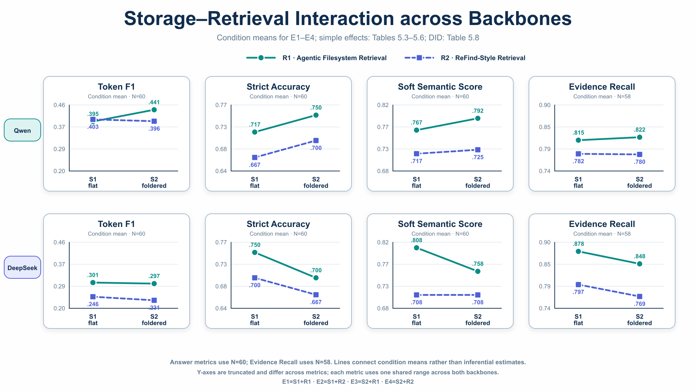
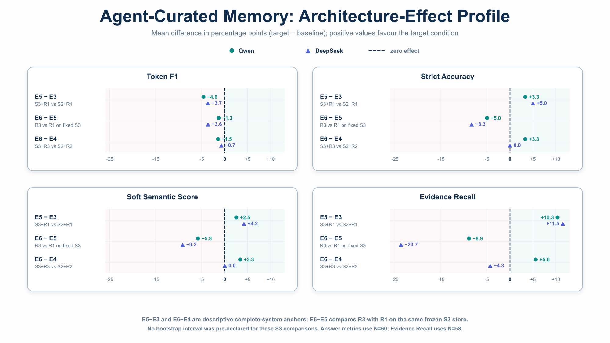
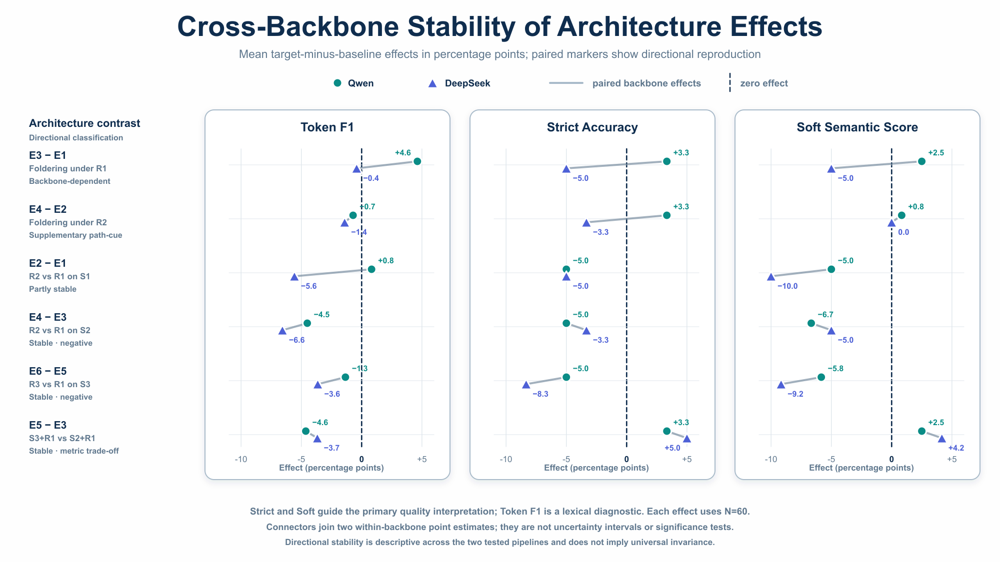
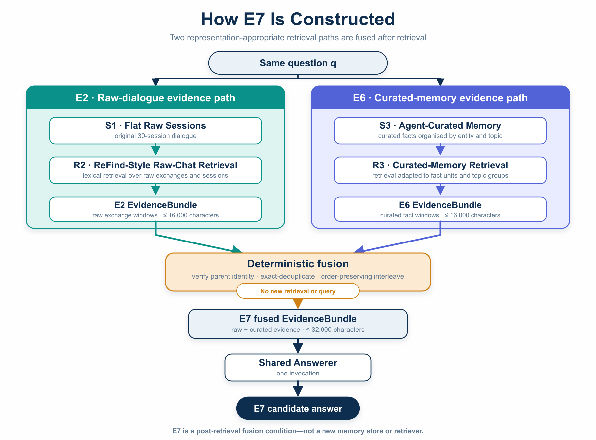
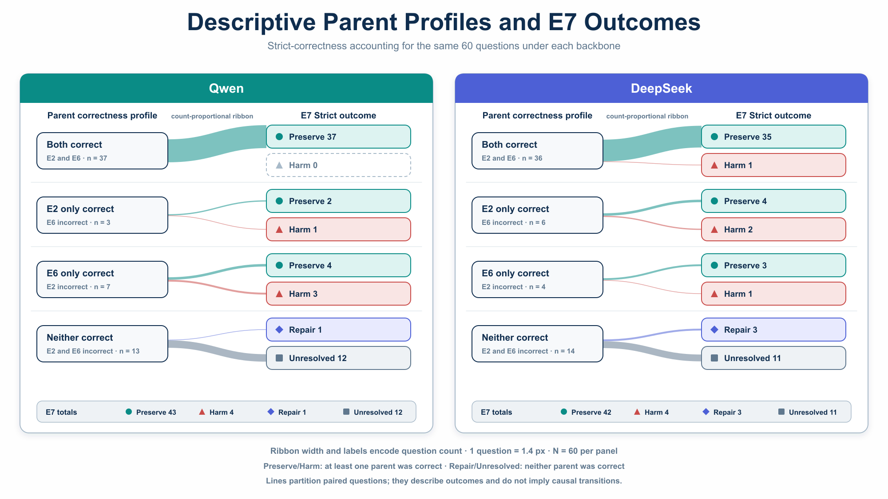
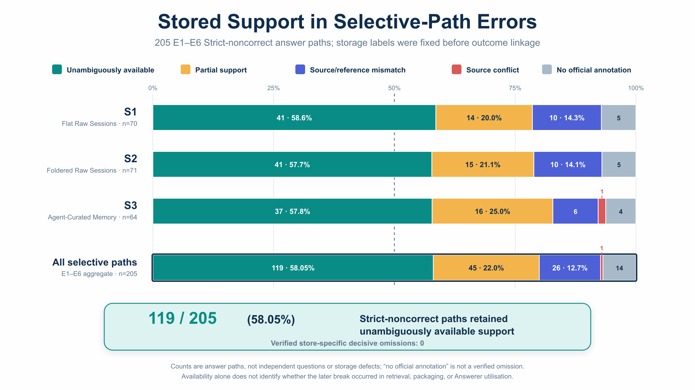
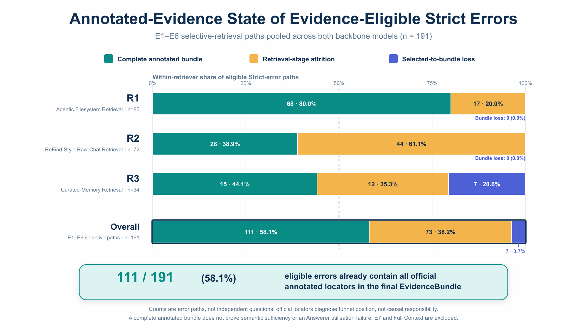
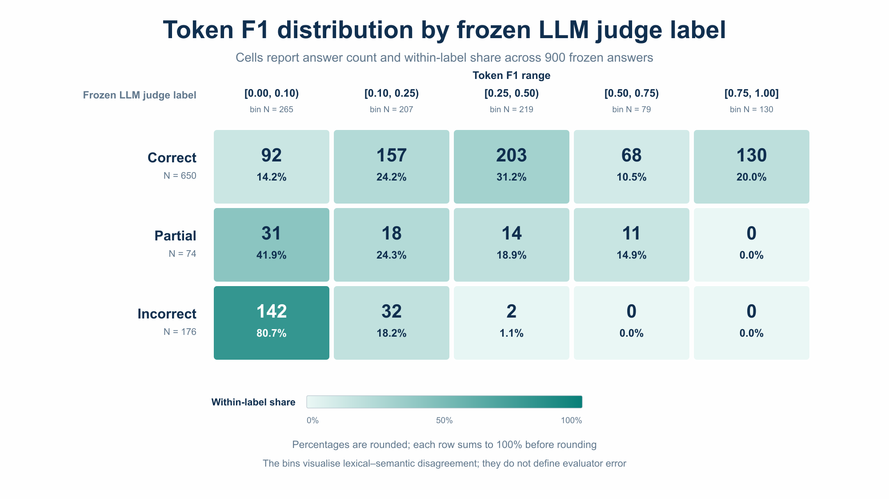
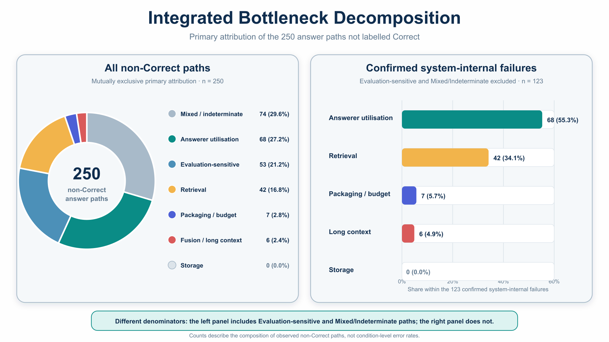
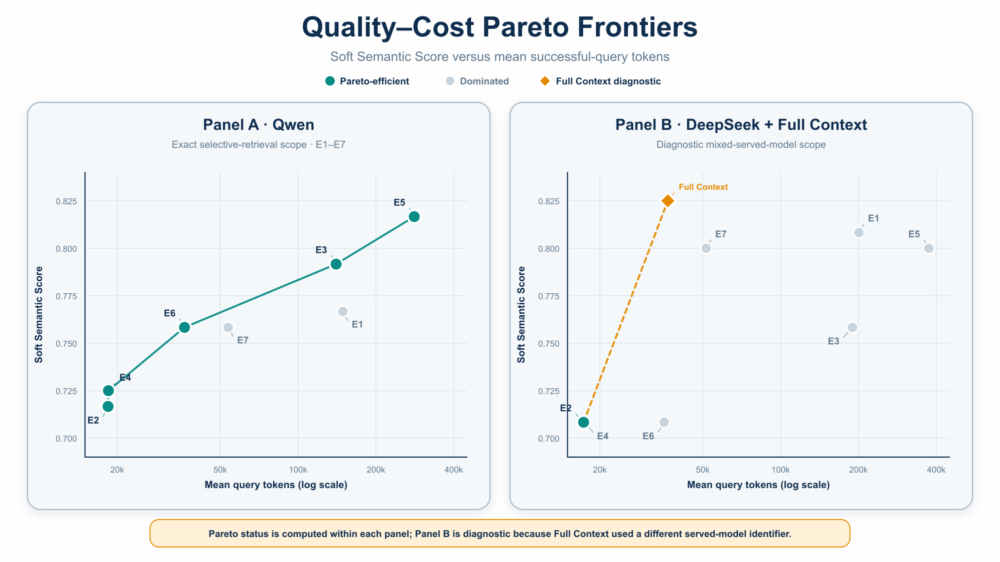

# Chapter 5 Results and Analysis

## 5.1 Analysis Scope and Research Questions

Chapter 3 defined the storage representations, retrieval systems, EvidenceBundle interface, and shared Answerer. Chapter 4 then specified the unified Main-60 test set and evaluation protocol. This chapter reports what the experiments show. It analyses 60 questions under seven selective evidence-access conditions for each of two backbone models, Qwen and DeepSeek, together with one DeepSeek-family Full Context diagnostic path.

Table 5.1 restates the condition mapping so that the experimental labels can be read without returning to Chapter 3. S1 is the flat raw-session store, S2 is the foldered raw-session store, and S3 is Agent-Curated Memory. R1 is Agentic Filesystem Retrieval, R2 is ReFind-style raw-chat retrieval, and R3 is retrieval adapted to the structure of S3.

**Table 5.1. Experimental conditions used in Chapter 5.** Full Context is a separate diagnostic path rather than E8.

| Condition | Evidence source | Retrieval or processing path | Analytical role |
|---|---|---|---|
| E1 | S1 | R1 | Flat raw-session filesystem baseline |
| E2 | S1 | R2 | Enhanced raw-chat retrieval on S1 |
| E3 | S2 | R1 | Effect of folder organisation under R1 |
| E4 | S2 | R2 | Foldered raw sessions combined with R2 |
| E5 | S3 | R1 | Agent-Curated Memory accessed as a filesystem |
| E6 | S3 | R3 | Retrieval adapted to Agent-Curated Memory |
| E7 | E2 and E6 EvidenceBundles | Fixed deduplication and interleaving, followed by the shared Answerer | Dual-source complementarity and interference; no new retrieval |
| Full Context | All 30 S1 raw sessions | Complete chronological context sent directly to the shared Answerer | Diagnostic comparison without selective retrieval or a 16,000-character EvidenceBundle |

The analysis is organised around six research questions. Table 5.2 provides the chapter-level roadmap. Each later section reports the relevant answer-quality, evidence-access, process, or cost evidence and states the boundary of the conclusion.

**Table 5.2. Research questions and their locations in Chapter 5.**

| Research question | Main question | Section |
|---|---|---|
| RQ1 | How do storage representation, retrieval design, and their interaction affect answer quality? | 5.2 |
| RQ2 | Which architectural effects remain stable across Qwen and DeepSeek, and which depend on the backbone model? | 5.3 |
| RQ3 | When does E7 dual-source fusion repair an answer, and when does it introduce interference? | 5.4 |
| RQ4 | Does Full Context outperform selective retrieval, and which failure mechanisms remain under complete visibility? | 5.5 |
| RQ5 | Where does the end-to-end pipeline fail: storage, retrieval, packaging, evidence utilisation, fusion or long-context processing, or evaluation? | 5.6 |
| RQ6 | Which condition offers the most useful balance between answer quality, construction cost, query cost, and operational reliability? | 5.7 |

Answer quality is reported through Precision, Recall, Token F1, Strict Accuracy, Partial Rate, and Soft Semantic Score. Evidence-access metrics apply to E1--E7 and use the 58 questions with valid source-turn annotations; all answer-quality metrics use the complete 60-question set. Full Context has no retrieval-level Evidence Recall because it bypasses selective evidence construction. The following sections present the detailed comparisons and mechanism analyses.

At a high level, the results show that system performance depends jointly on storage representation, retrieval design, and the backbone model; no single selective-retrieval condition dominates every metric. Dual-source fusion and Full Context provide benefits under different conditions, but neither eliminates evidence-utilisation errors. The preferred architecture therefore depends on both answer quality and operational cost.

## 5.2 Architecture Effects: Storage, Retrieval, and Their Interaction

Section 5.2 addresses RQ1: how do memory representation and retrieval design shape end-to-end answer quality? It asks three linked questions. First, does changing the storage layout help when the retrieval system is held fixed? Second, does changing the retrieval system help when the storage representation is held fixed? Third, do storage and retrieval interact, and how does Agent-Curated Memory behave as a complete system? Answering these questions separates the roles of storage, retrieval, and their combination before the report considers backbone robustness or evidence fusion.

The analysis uses six core effects: four raw-memory simple contrasts, one storage--retrieval interaction, and one access-system contrast on the frozen S3 store. It also uses two descriptive complete-system anchors. Every effect is estimated within one backbone model. E7 is not an RQ1 condition; its dual-source fusion effect is analysed under RQ3 in Section 5.4.1. Formal comparison of effect stability across backbone models is presented in Section 5.3.

All differences in this section are target minus baseline. Answer metrics use all 60 questions. Evidence metrics use the 58 questions with valid evidence annotations. The two excluded evidence cases are open-domain questions whose frozen gold records contain no annotated source-turn IDs; they remain in every answer-quality calculation and are excluded only from evidence metrics whose denominator would otherwise be zero. Multi-source evidence results use the corresponding 19-question subset. The category analysis uses C1/C2/C3/C4 answer denominators of 13/13/7/27 and evidence denominators of 13/13/5/27. These denominators are not pooled.

The main outcomes are token F1, Strict Accuracy, and Soft Semantic Score. Precision and Recall help explain the token result. Evidence Recall, Any-hit, and All-hit describe access to the annotated source turns. These evidence annotations identify valid source locations, but they are not guaranteed to be a minimal or exhaustive proof set. Process measures are used only to explain architectural behaviour. They do not determine the final system choice in this section.

Across all main simple comparisons and the storage--retrieval interaction, the paired median differences for F1, Strict Accuracy, and Soft Semantic Score are 0.0000. This reflects the large number of questions whose outcome is unchanged even when the mean changes. The tables therefore retain mean effects and question-level transitions. Partial Rate remains in the complete condition summary and the appendix diagnostics, but it is not oriented as higher-is-better: a change can reflect either movement from incorrect to partial or movement from correct to partial. The complete three-by-three LLM judge transition matrices are retained in Appendix I.

### 5.2.1 Effect of Storage Organisation under Each Retrieval System

The first comparison changes the raw-memory layout from S1 flat sessions to S2 foldered sessions. The conversation content remains raw. E3−E1 measures this change under R1, while E4−E2 measures it under R2.

**Table 5.3. Storage-organisation effects on primary answer quality.** All values are target minus baseline. Bracketed values are 95% paired-bootstrap intervals. F1 win/tie/loss and Strict repair/tie/harm counts use the 60 paired questions. The E1--E4 condition means underlying these comparisons are reported in Table 5.7.

| Backbone | Contrast | ΔF1 [95% interval] | F1 W/T/L | ΔStrict [95% interval] | Strict R/T/H | ΔSoft |
|---|---|---|---:|---|---:|---:|
| Qwen | E3−E1 | **+0.0462** `[-0.0160, +0.1109]` | 19/30/11 | **+0.0333** `[-0.0500, +0.1171]` | 5/52/3 | **+0.0250** |
| DeepSeek | E3−E1 | **−0.0041** `[-0.0499, +0.0431]` | 17/25/18 | **−0.0500** `[-0.1333, +0.0167]` | 1/55/4 | **−0.0500** |
| Qwen | E4−E2 | **−0.0071** `[-0.0678, +0.0533]` | 13/32/15 | **+0.0333** `[-0.0500, +0.1333]` | 5/52/3 | **+0.0083** |
| DeepSeek | E4−E2 | **−0.0141** `[-0.0742, +0.0471]` | 20/20/20 | **−0.0333** `[-0.1000, +0.0333]` | 1/56/3 | **0.0000** |

**Table 5.4. Storage-organisation lexical and evidence diagnostics.** Precision, Recall, and Partial Rate use all 60 questions. Evidence Recall uses the 58 evidence-eligible questions. Full Soft transitions are retained in Appendix I.

| Backbone | Contrast | ΔPrecision | ΔRecall | ΔPartial | ΔEvidence Recall |
|---|---|---:|---:|---:|---:|
| Qwen | E3−E1 | +0.0378 | +0.0527 | −0.0167 | +0.0072 |
| DeepSeek | E3−E1 | −0.0030 | −0.0179 | 0.0000 | −0.0302 |
| Qwen | E4−E2 | −0.0193 | +0.0131 | −0.0500 | −0.0014 |
| DeepSeek | E4−E2 | −0.0090 | −0.0519 | +0.0667 | −0.0287 |

The Qwen E3−E1 estimate provides the clearest positive storage-organisation result. It is the only storage contrast with positive point estimates for F1, Strict, and Soft: F1 rises by 0.0462, Strict by 0.0333, and Soft by 0.0250, with five Strict repairs against three harms. This is valid positive evidence within the observed Qwen/R1 setting. It is not, however, a statistically resolved or universal storage effect because the paired intervals include zero and the direction is not reproduced under DeepSeek. The answer gain also cannot be explained by a general increase in annotated evidence access: Evidence Recall rises by only 0.0072, Any-hit falls by 0.0172, and All-hit rises by 0.0172.

The category analysis shows where this aggregate pattern originates. For Qwen E3−E1, C2 temporal questions contribute ΔF1 = +0.1994, ΔStrict = +0.3077, and ΔSoft = +0.1923, even though C2 Evidence Recall falls by 0.0385. The other categories show little F1 gain, and C4 Strict falls by 0.0741. The result is therefore a concentrated temporal pattern, not a broad improvement across question types. Under DeepSeek, C2 F1 rises by 0.0452 while Strict and Soft each fall by 0.1538. This is a token--semantic disagreement rather than a consistent category-level repair.

The E4−E2 estimates are smaller. Under Qwen, the foldered layout slightly lowers F1 but raises Strict and Soft. Under DeepSeek, F1 and Strict fall while Soft is unchanged. No storage-effect interval for F1 or Strict excludes zero. The data therefore do not establish a general benefit from directory organisation.

The evidence-to-answer tables reinforce this limit. In Qwen E3−E1, none of the evidence-eligible questions combines higher Evidence Recall with a Strict repair, while five Strict repairs occur with unchanged Evidence Recall. Four questions gain Evidence Recall without gaining Strict. The corresponding DeepSeek counts are zero, one, and one. For E4−E2, only two Qwen questions and no DeepSeek questions combine higher Evidence Recall with a Strict repair. These selected diagnostic cells are not a complete partition of the 58 questions, but they show that annotated-source coverage and answer correctness are not interchangeable.

The bounded trace review provides three explanations for this separation. First, a flat-store bundle can already contain direct evidence even when it does not cover every annotated turn. Second, a foldered path can retain the same evidence but lead the Answerer to preserve a different level of detail. Third, some apparent repairs or harms arise near an evaluation boundary rather than from a clear storage change. These cases support a conditional interpretation: folder organisation can help an Agentic Filesystem Retriever under a particular backbone and question type, as observed for Qwen/R1 on temporal questions, but Main-60 does not establish an architecture-wide gain.

### 5.2.2 Effect of the Retrieval System under Each Raw Storage Representation

The second comparison holds the raw store fixed and changes the complete retrieval system. E2−E1 compares R2 with R1 on S1. E4−E3 makes the same comparison on S2. These are complete-system effects. They do not isolate BM25, query generation, local expansion, or one Retrieval Agent action.

**Table 5.5. Retrieval-system effects on primary answer quality.** All values are target minus baseline. Bracketed values are 95% paired-bootstrap intervals. F1 win/tie/loss and Strict repair/tie/harm counts use the 60 paired questions. Full Soft and Partial transitions are retained in Appendix I.

| Backbone | Contrast | ΔF1 [95% interval] | F1 W/T/L | ΔStrict [95% interval] | Strict R/T/H | ΔSoft |
|---|---|---|---:|---|---:|---:|
| Qwen | E2−E1 | **+0.0082** `[-0.0410, +0.0573]` | 13/27/20 | **−0.0500** `[-0.1333, +0.0333]` | 2/53/5 | **−0.0500** |
| DeepSeek | E2−E1 | **−0.0557** `[-0.1189, −0.0002]` | 22/14/24 | **−0.0500** `[-0.1500, +0.0500]` | 4/49/7 | **−0.1000** |
| Qwen | E4−E3 | **−0.0451** `[-0.1096, +0.0161]` | 15/26/19 | **−0.0500** `[-0.1500, +0.0500]` | 4/49/7 | **−0.0667** |
| DeepSeek | E4−E3 | **−0.0657** `[-0.1401, +0.0071]` | 22/12/26 | **−0.0333** `[-0.1333, +0.0667]` | 4/50/6 | **−0.0500** |

**Table 5.6. Retrieval-system lexical, evidence, and query-cost diagnostics.** Precision and Recall use all 60 questions. Evidence Recall uses the 58 evidence-eligible questions. Query-cost differences include retrieval and answering; negative values indicate fewer recorded calls or tokens under R2.

| Backbone | Contrast | ΔPrecision | ΔRecall | ΔEvidence Recall | ΔBundle characters | ΔQuery calls | ΔQuery tokens |
|---|---|---:|---:|---:|---:|---:|---:|
| Qwen | E2−E1 | +0.0225 | −0.0154 | −0.0330 | +4,040.8 | −7.57 | −130,501.5 |
| DeepSeek | E2−E1 | −0.0625 | +0.0020 | −0.0805 | +7,142.3 | −7.98 | −183,717.1 |
| Qwen | E4−E3 | −0.0346 | −0.0550 | −0.0417 | +3,885.6 | −6.68 | −121,809.1 |
| DeepSeek | E4−E3 | −0.0685 | −0.0320 | −0.0790 | +6,678.9 | −7.70 | −172,188.5 |

R2 does not retrieve more complete annotated evidence in these comparisons. It produces much larger EvidenceBundles, but Evidence Recall, Any-hit, and All-hit fall in all four backbone--store cells. The Any-hit/All-hit changes are −0.0690/−0.0172 for Qwen E2−E1, −0.0345/−0.0517 for Qwen E4−E3, −0.0862/−0.0862 for DeepSeek E2−E1, and −0.0517/−0.0862 for DeepSeek E4−E3. On the 19 multi-source questions, multi-source Evidence Recall also falls by 0.0482 and 0.0746 under Qwen and by 0.1930 and 0.1360 under DeepSeek for E2−E1 and E4−E3, respectively. More selected text therefore does not mean better coverage of the annotated source turns.

The semantic outcomes also favour caution. Strict and Soft both fall in all four R2 comparisons. Qwen E2−E1 shows the clearest lexical--semantic disagreement: F1 rises slightly alongside higher Precision and lower Recall, while Strict and Soft each fall by 0.0500. The only selected intervals that strictly exclude zero are DeepSeek E2−E1 for F1, `[−0.1189, −0.0002]`, and Soft, `[−0.2000, −0.0083]`. The F1 upper bound is very close to zero, so this is evidence of a negative observed-question effect, not a broad population claim.

The process results show a clear quality--efficiency trade-off rather than a uniformly heavier R2 pipeline. R2 uses fewer recorded model calls and fewer total query-time model tokens per question than R1. These totals include retrieval and answering rather than the retrieval stage alone. For E2−E1, the mean reductions are 7.57 calls and 130,501.5 tokens under Qwen, and 7.98 calls and 183,717.1 tokens under DeepSeek. For E4−E3, the corresponding reductions are 6.68 calls and 121,809.1 tokens, and 7.70 calls and 172,188.5 tokens. However, R2 sends substantially larger selected evidence to the Answerer and produces weaker annotated-evidence coverage and semantic outcomes. In the measured dimensions, R2 is therefore cheaper at query time but less effective. This use of *cheaper* refers only to recorded successful-query model calls and tokens; native latency and monetary cost are unavailable for E1--E6. Failed-attempt and recovery tokens are excluded from these successful-query totals and are reported separately in Section 5.7.3. Token usage is known for 39 of the 41 formal failed attempts; only two Qwen E5 DNS failures have unknown token usage. Across the 60 questions, E2 and E4 record no failed attempts; E1/E3 record 1/5 attempts under Qwen and 12/6 under DeepSeek. These are descriptive attempt counts, not independent failure-rate estimates. R1 provider rounds and R2 actions are different units and are not directly compared. Whether the lower recorded query-time totals compensate for the quality decline is deferred to RQ6.

The C2 temporal category is a notable weak point for R2 on S2. Qwen E4−E3 gives ΔF1 = −0.1373 and ΔStrict = −0.3077; DeepSeek gives ΔF1 = −0.2269 and ΔStrict = −0.1538. Some DeepSeek C3 token results are positive, but C3 has only seven answer questions and five evidence-eligible questions, and its evidence result still declines. These category values are descriptive only.

The reviewed traces locate different failure points. In one case, R2 reached the relevant session but failed to retain the adjacent decisive turn during local expansion. In another, R1 and R2 supplied the same annotated statement, but the final answers preserved different reference-level detail. A third case showed higher annotated coverage with no answer gain because the lower-coverage bundle already contained sufficient direct evidence. These cases show that R2 used fewer recorded query-time calls and tokens, produced larger EvidenceBundles, and was associated with lower semantic correctness in these comparisons.

### 5.2.3 Storage--Retrieval Interaction and Question-Category Heterogeneity

The interaction tests whether changing from S1 to S2 has a different effect under R2 than under R1. For metric $m$, it is computed per question as:

$$
DID_i^{(m)}=
\left(m_i(E4)-m_i(E2)\right)
-
\left(m_i(E3)-m_i(E1)\right).
$$

The four component contrasts remain necessary for interpretation. A negative F1 interaction means that the S1-to-S2 change was less favourable under R2 than under R1 for that backbone; it does not identify which internal retrieval action caused the difference.

**Table 5.7. Descriptive condition means underlying Figure 5.1.** Answer metrics use all 60 questions. Evidence Recall uses the 58 evidence-eligible questions. Scores are reported on the 0--1 scale.

*Panel A. Qwen.*

| Condition | Storage + retrieval | Token F1 | Strict Accuracy | Soft Semantic Score | Evidence Recall |
|---|---|---:|---:|---:|---:|
| E1 | S1 + R1 | 0.3949 | 0.7167 | 0.7667 | 0.8147 |
| E2 | S1 + R2 | 0.4031 | 0.6667 | 0.7167 | 0.7816 |
| E3 | S2 + R1 | 0.4411 | 0.7500 | 0.7917 | 0.8218 |
| E4 | S2 + R2 | 0.3960 | 0.7000 | 0.7250 | 0.7802 |

*Panel B. DeepSeek.*

| Condition | Storage + retrieval | Token F1 | Strict Accuracy | Soft Semantic Score | Evidence Recall |
|---|---|---:|---:|---:|---:|
| E1 | S1 + R1 | 0.3013 | 0.7500 | 0.8083 | 0.8779 |
| E2 | S1 + R2 | 0.2455 | 0.7000 | 0.7083 | 0.7974 |
| E3 | S2 + R1 | 0.2971 | 0.7000 | 0.7583 | 0.8477 |
| E4 | S2 + R2 | 0.2314 | 0.6667 | 0.7083 | 0.7687 |

Figure 5.1 visualises the same condition means as a 2 x 2 interaction profile. Under each backbone, the R1 line connects E1 to E3 and the R2 line connects E2 to E4. The figure therefore shows descriptive levels and slopes rather than paired effect estimates.

*Figure 5.1. Storage--retrieval interaction across backbones. Each panel plots the E1--E4 condition means reported in Table 5.7. Answer metrics use N=60, and Evidence Recall uses N=58. The y-axes are truncated and differ across metrics; each metric retains one common range across the two backbones. Paired uncertainty and the DID estimates are reported in Table 5.8.*

**Table 5.8. Storage--retrieval interaction estimates.** The final column reports positive/zero/negative question-level DID counts rather than repair/tie/harm transitions.

| Backbone | ΔPrecision DID | ΔRecall DID | ΔF1 DID (95% interval) | ΔStrict DID (95% interval) | ΔSoft DID (95% interval) | ΔEvidence Recall DID | Strict DID +/0/− |
|---|---:|---:|---|---|---|---:|---:|
| Qwen | −0.0571 | −0.0396 | **−0.0533** `[-0.1251, +0.0152]` | **0.0000** `[-0.1500, +0.1500]` | **−0.0167** `[-0.1167, +0.0833]` | −0.0086 | 5/49/6 |
| DeepSeek | −0.0060 | −0.0340 | **−0.0100** `[-0.0823, +0.0638]` | **+0.0167** `[-0.0833, +0.1167]` | **+0.0500** `[-0.0417, +0.1417]` | +0.0014 | 5/51/4 |

All F1, Strict, and Soft interaction intervals in Table 5.8 include zero. The experiment therefore does not establish a reliable storage--retrieval interaction. The negative Qwen F1 point estimate is consistent with S2 being more favourable to R1 than to R2 in this observed set, but the interval and the semantic estimates do not support a firm general claim.

The absence of a resolved interaction does not make the four raw-memory configurations equivalent. Their descriptive rankings reveal a useful conditional pattern. For Qwen, E3 (S2+R1) is the strongest E1--E4 condition on F1 (0.4411), Strict (0.7500), and Soft (0.7917). For DeepSeek, E1 (S1+R1) is strongest on the same three measures, with F1 = 0.3013, Strict = 0.7500, and Soft = 0.8083. The common element is R1; the preferred raw layout changes from S2 under Qwen to S1 under DeepSeek. Thus, R1 is the stronger raw-memory retrieval family in Main-60, whereas the choice between S1 and S2 remains backbone-dependent. These are within-backbone descriptive rankings; formal cross-backbone effect stability is evaluated in Section 5.3.

The category results are heterogeneous. The Qwen C2 interaction is −0.1860 for F1 and −0.3846 for Strict, while its C4 Strict interaction is +0.1481. The DeepSeek C2 interaction is −0.1453 for F1, while C1 Strict is +0.1538 and C3 F1 is +0.1547. These values do not form one category-wide mechanism. In addition, C3 is too small to support independent inference.

The bounded cases further limit mechanistic attribution. One positive interaction case was associated with a different second query and a direct statement reached only by E4. Other apparent positive or negative interactions were sensitive to LLM judge treatment of near-equivalent temporal wording. Another case achieved complete annotated-turn recall but still lacked attributes required by the reference answer. Thus, official Evidence Recall can overstate evidence sufficiency, and individual DID changes can occur at query selection, evidence utilisation, or evaluation. The cases support interpretation of the aggregate effect, but they do not provide a frequency estimate of these mechanisms.

### 5.2.4 Complete-System Effect of Agent-Curated Memory

The S3 analysis contains one controlled core contrast and two broader descriptive anchors. E6−E5 holds the frozen S3 store fixed and changes its access system from R1 to R3. E5−E3 compares S3+R1 with S2+R1. E6−E4 compares S3+R3 with S2+R2. The latter two comparisons change several representation or retrieval properties together and must not be interpreted as isolated curation effects.

**Table 5.9. Curated-memory effects on primary answer quality.** All values are target minus baseline. F1 win/tie/loss and Strict repair/tie/harm counts use the 60 paired questions. No new bootstrap interval is introduced for these descriptive S3 comparisons.

| Backbone | Contrast | Interpretation | ΔF1 | F1 W/T/L | ΔStrict | Strict R/T/H | ΔSoft |
|---|---|---|---:|---:|---:|---:|---:|
| Qwen | E6−E5 | Same-S3 access effect | **−0.0135** | 20/23/17 | **−0.0500** | 2/53/5 | **−0.0583** |
| DeepSeek | E6−E5 | Same-S3 access effect | **−0.0364** | 16/15/29 | **−0.0833** | 2/51/7 | **−0.0917** |
| Qwen | E5−E3 | R1 system anchor | **−0.0463** | 16/20/24 | **+0.0333** | 4/54/2 | **+0.0250** |
| DeepSeek | E5−E3 | R1 system anchor | **−0.0367** | 22/13/25 | **+0.0500** | 5/53/2 | **+0.0417** |
| Qwen | E6−E4 | Adapted-system anchor | **−0.0147** | 20/18/22 | **+0.0333** | 6/50/4 | **+0.0333** |
| DeepSeek | E6−E4 | Adapted-system anchor | **−0.0074** | 14/17/29 | **0.0000** | 4/52/4 | **0.0000** |

**Table 5.10. Curated-memory lexical, evidence, and bundle diagnostics.** Precision and Recall use all 60 questions. Evidence Recall and bundle-character means use the 58 evidence-eligible questions. Full Soft and Partial transitions are retained in Appendix I.

| Backbone | Contrast | ΔPrecision | ΔRecall | ΔEvidence Recall | ΔBundle characters |
|---|---|---:|---:|---:|---:|
| Qwen | E6−E5 | −0.0114 | −0.0736 | **−0.0891** | +5,109.1 |
| DeepSeek | E6−E5 | −0.0300 | −0.1306 | **−0.2371** | +5,457.3 |
| Qwen | E5−E3 | −0.0436 | +0.0380 | **+0.1034** | +3,034.0 |
| DeepSeek | E5−E3 | −0.0385 | +0.0566 | **+0.1149** | +3,901.2 |
| Qwen | E6−E4 | −0.0204 | +0.0194 | **+0.0560** | +4,257.6 |
| DeepSeek | E6−E4 | +0.0000 | −0.0420 | **−0.0431** | +2,679.6 |

Figure 5.2 places the three S3 comparisons on a common percentage-point scale. It separates the controlled same-store access comparison, E6−E5, from the two descriptive complete-system anchors, E5−E3 and E6−E4.

*Figure 5.2. Agent-Curated Memory architecture-effect profile. Values are mean target-minus-baseline differences in percentage points. E6−E5 compares R3 with R1 on the same frozen S3 store; E5−E3 and E6−E4 are descriptive complete-system anchors. Answer metrics use N=60, and Evidence Recall uses N=58. No bootstrap interval was pre-declared for these S3 comparisons.*

On the same frozen S3 store, R3 underperforms R1 across every primary answer and evidence mean in both within-backbone analyses. Within Qwen, E6−E5 changes F1 by −0.0135, Strict by −0.0500, Soft by −0.0583, and Evidence Recall by −0.0891 while adding 5,109 characters to the mean eligible EvidenceBundle. Within DeepSeek, the corresponding changes are −0.0364, −0.0833, −0.0917, and −0.2371, while the bundle grows by 5,457 characters. Any-hit and All-hit fall by 0.0690 and 0.1207 under Qwen, and by 0.2069 and 0.2414 under DeepSeek. Multi-source Evidence Recall falls by 0.1140 under Qwen and 0.1974 under DeepSeek. Strict harms exceed repairs in both analyses. Evidence Recall falls in every C1--C4 category; the largest DeepSeek decreases occur in C3 and C2, at −0.4000 and −0.2692. The descriptive result is therefore stronger than a mixed or inconclusive pattern: representation-adapted retrieval did not improve access to S3 in Main-60. No bootstrap interval was pre-declared for E6−E5, so the claim remains bounded to the observed test set rather than extended to a general population.

The E5−E3 anchor shows a different pattern. F1 falls alongside lower token Precision despite higher Recall, while Strict, Soft, Evidence Recall, Any-hit, and All-hit rise in each separate within-backbone comparison. Multi-source Evidence Recall also rises by 0.1579 under Qwen and 0.1404 under DeepSeek. Under Qwen, Strict rises from 0.7500 to 0.7833 and Evidence Recall from 0.8218 to 0.9253. Under DeepSeek, Strict rises from 0.7000 to 0.7500 and Evidence Recall from 0.8477 to 0.9626. This is a clear token--semantic disagreement rather than a uniformly negative result.

Answer length moves in the direction expected under a broader-response explanation. From E3 to E5, mean normalised answer length rises from 11.97 to 16.13 tokens under Qwen (approximately 35%) and from 21.72 to 29.17 tokens under DeepSeek (approximately 34%). Mean answer length in characters also rises from 79.73 to 108.07 and from 143.45 to 190.73, respectively. Together with lower Precision and higher Recall, this pattern is consistent with S3+R1 producing broader or differently worded answers that receive higher semantic scores but lower lexical overlap. It does not establish answer length as the cause of the F1 decline. Section 5.6.5 analyses lexical--semantic disagreement directly, while Section 5.5 examines Full Context-specific examples of verbosity, paraphrase, omitted qualifiers, and substantive error. Nor does the E5−E3 contrast prove that curation alone caused the result, because S2-to-S3 also changes granularity, organisation, and provenance presentation.

The absolute condition means within the E1--E6 RQ1 scope further clarify E5's role. Under Qwen, E5 has the highest Strict Accuracy (0.7833), Soft Semantic Score (0.8167), and Evidence Recall (0.9253), while E3 has the highest token F1 (0.4411). Under DeepSeek, E5 has the highest Evidence Recall (0.9626) and ties E1 for the highest Strict Accuracy (0.7500), but E1 has the highest token F1 (0.3013) and Soft Semantic Score (0.8083). E5 is therefore the strongest curated-memory configuration and the semantic/evidence leader under Qwen, but it is not a universal winner on every metric and backbone. E7 is deliberately excluded from this formal RQ1 ranking; its fusion effect is analysed in Section 5.4.1, and practical system selection is deferred to Section 5.7.

The E6−E4 anchor is mixed. Its Qwen estimate raises Strict, Soft, and Evidence Recall while slightly lowering F1. Its DeepSeek estimate leaves Strict and Soft unchanged while F1 and Evidence Recall decline. On the 19 multi-source questions, however, multi-source Evidence Recall rises by 0.1184 under Qwen and 0.0789 under DeepSeek. These are two within-backbone complete-system descriptions. Formal assessment of whether the architecture effect is stable across backbones belongs to Section 5.3.

The query-time process results clarify the E6−E5 trade-off. R3 uses fewer recorded model calls and fewer total query-time model tokens per question than R1 on S3. These totals include retrieval and answering. The Qwen reductions are 3.22 calls and 244,976.5 tokens per question; the DeepSeek reductions are 3.90 calls and 339,242.3 tokens. E5 records 12 failed attempts under Qwen and five under DeepSeek, whereas E6 records none. Token usage is available for 15 of these 17 E5 failures; the remaining two are Qwen E5 DNS failures with unknown usage. Recovery cost is reported separately in Section 5.7.3 and is not included in the successful-query totals above. However, R3 supplies larger EvidenceBundles and produces lower answer and evidence scores. R1 provider rounds and R3 actions are not commensurate. No latency value is inferred where native latency is unavailable.

S3 also has a one-time construction cost that is separate from query-time evaluation. The frozen construction manifest records 85 build episodes, 842 LLM calls, 837 rounds, 1,350 tool calls, 29,669,563 prompt tokens, 1,195,395 completion tokens, and 30,864,958 total tokens. The resulting store contains two files, 37 headings, 472 lines, and references 555 of 568 source locators. Locator coverage is not a direct measure of factual fidelity. These figures describe the system's construction requirements; their amortisation and value are analysed in RQ6 rather than used to rank systems here.

The bounded S3 trace review does not support a simple storage-loss explanation. All six selected Section 5.2.4 cases preserved the relevant information in S3. One Qwen repair occurred because curated evidence co-located a goal with an adjacent acquisition-time fact that the raw-chat path had missed. One harm occurred after sufficient evidence had been retrieved and packaged, when broader context distracted the Answerer. A DeepSeek harm similarly retained an alternative direct statement but failed to use it inside a distractor-heavy bundle. Other cases showed answer saturation or LLM judge sensitivity despite higher annotated coverage. This review concerns selected explanatory cases; it does not estimate S3 fidelity or failure prevalence across Main-60.

**Table 5.11. Evidence-to-answer diagnostic cells (eligible N=58).** The table reports four selected cells from each complete Evidence Recall change × Strict change matrix. The cells are deliberately not exhaustive and must not be summed to 58; the complete three-by-three matrices are retained in Appendix I.

| Backbone | Contrast | Evidence ↑ and Strict ↑ | Evidence ↑, Strict not ↑ | Evidence same, Strict ↑ | Evidence ↓ without Strict harm |
|---|---|---:|---:|---:|---:|
| Qwen | E3−E1 | 0 | 4 | 5 | 3 |
| DeepSeek | E3−E1 | 0 | 1 | 1 | 4 |
| Qwen | E4−E2 | 2 | 2 | 3 | 2 |
| DeepSeek | E4−E2 | 0 | 4 | 1 | 3 |
| Qwen | E2−E1 | 0 | 9 | 2 | 6 |
| DeepSeek | E2−E1 | 0 | 5 | 3 | 4 |
| Qwen | E4−E3 | 1 | 6 | 3 | 4 |
| DeepSeek | E4−E3 | 0 | 8 | 2 | 7 |
| Qwen | E6−E5 | 0 | 1 | 2 | 5 |
| DeepSeek | E6−E5 | 0 | 2 | 2 | 10 |
| Qwen | E5−E3 | 1 | 8 | 3 | 1 |
| DeepSeek | E5−E3 | 1 | 9 | 3 | 1 |
| Qwen | E6−E4 | 2 | 5 | 4 | 2 |
| DeepSeek | E6−E4 | 3 | 3 | 0 | 6 |

**Table 5.12. RQ1 architecture evidence matrix.**

| Architectural question | Audited finding | Evidence supporting the finding | Boundary |
|---|---|---|---|
| Does folder organisation improve raw-memory performance? | A positive descriptive effect appears for Qwen with R1, mainly on temporal questions; the other storage estimates are small or negative. | Paired F1/Strict/Soft, selected intervals, category matrix, and trace review. | Every storage F1/Strict interval includes or touches zero. No universal folder benefit is established. |
| Does R2 improve retrieval on a fixed raw store? | R2 uses fewer recorded query-time calls and tokens, but selects more text while producing lower annotated-evidence coverage and weaker semantic outcomes in the four raw-store comparisons. | Process totals, Evidence Recall/Any-hit/All-hit, bundle length, Strict transitions, and paired intervals. | *Cheaper* refers only to recorded query-time calls and tokens. This is a complete R2-versus-R1 system effect, not an isolated BM25 effect. |
| Is there a storage--retrieval interaction? | No reliable DID interaction is established. Descriptively, E3 is the strongest raw condition for Qwen and E1 for DeepSeek; both use R1. | DID estimates, component contrasts, raw-condition means, paired intervals, and category values. | The shared R1 advantage is an observed Main-60 pattern; storage preference remains backbone-dependent. Category patterns are exploratory, and C3 is small. |
| Does R3 improve access to S3 relative to R1? | No. E6 has lower observed F1, Strict, Soft, and Evidence Recall means than E5 in both within-backbone analyses, despite larger bundles. | Same-store E6−E5 effects, Strict transitions, category evidence, and selected traces. | No bootstrap interval was pre-declared for this contrast; the underperformance claim is descriptive within Main-60. |
| Is Agent-Curated Memory useful as a complete system? | S3+R1 raises semantic and evidence measures relative to S2+R1 while lowering token F1. Within E1--E6, E5 is the Qwen semantic/evidence leader and the DeepSeek evidence leader, but not the universal F1 winner. | E5−E3 and E6−E4 anchors, absolute condition means, answer length, metric disagreement, and bounded cases. | These anchors do not isolate curation from other representation and retrieval changes. Formal E7 and final system-selection claims belong to later RQs. |

The answer to RQ1 is therefore conditional but substantive. First, folder organisation provides a positive observed point estimate under Qwen with R1, especially on temporal questions, although the effect is not resolved statistically or reproduced as a general storage advantage. Second, R1 is the stronger raw-memory retrieval family in Main-60: Qwen performs best with S2+R1, whereas DeepSeek performs best with S1+R1. R2 lowers recorded query-time calls and tokens, but this efficiency gain is accompanied by larger EvidenceBundles, weaker annotated-evidence coverage, and lower semantic quality. Third, the experiment does not establish a reliable storage--retrieval DID interaction, so the raw-configuration rankings remain conditional rather than universal. Fourth, on the same frozen S3 store, R3 underperforms R1 across the main answer and evidence metrics under both backbones. Finally, S3+R1 is the strongest curated-memory path within the RQ1 conditions: it improves semantic correctness and annotated-evidence coverage relative to S2+R1 while lowering token F1, and E5 leads the Qwen semantic/evidence metrics and the DeepSeek evidence metric within E1--E6. The accompanying increase in answer length and Recall, together with lower Precision, motivates separate lexical and semantic evaluation rather than treating token F1 as a complete measure of answer quality. These findings establish useful architecture-level trade-offs without claiming a universal single winner. Formal cross-backbone stability, fusion, Full Context, global error location, and practical system selection are addressed in the following research questions.

## 5.3 Robustness across Backbone Models

Section 5.3 addresses RQ2: do the architecture conclusions from Section 5.2 remain consistent when the backbone model changes? This question distinguishes architecture effects that recur across models from effects that depend on one model's search and answering behaviour. The section asks two related questions: how Qwen and DeepSeek differ under the same E1--E7 condition, and which of the six principal RQ1 effects retain their direction across both pipelines.

The comparison uses the completed Qwen and DeepSeek pipelines. Each pipeline covers the same 60 questions under E1--E7, giving 420 condition-level answers per backbone and 840 answers in total. The question set, memory stores, retrieval definitions, evidence budget, Answerer objective, and evaluation procedure are held constant. Both result sets are evaluated by the same LLM judge.

The backbone model is used by both the Retrieval Agent and the Answerer. The results therefore compare two complete end-to-end pipelines rather than isolating either component. RQ2 first compares the two backbones under matched conditions. It then tests whether six architecture effects identified in RQ1 retain the same direction across the two pipelines. E7 is included only in the matched-condition overview; its fusion effect is analysed under RQ3. Full Context is excluded because a matched Qwen Full Context run is not available.

### 5.3.1 Matched Backbone Performance and the Token F1 Gap

Table 5.13, Panel A compares Qwen and DeepSeek under each matched E1--E7 condition. Token F1 measures lexical overlap with the reference answer. Strict Accuracy and Soft Semantic Score measure semantic correctness. All condition means use the same 60 questions.

**Table 5.13. Cross-backbone performance and architecture robustness.**

*Panel A. Matched performance under E1--E7.*

| Condition | Qwen F1 | DeepSeek F1 | Qwen Strict | DeepSeek Strict | Qwen Soft | DeepSeek Soft |
|---|---:|---:|---:|---:|---:|---:|
| E1 | 0.3949 | 0.3013 | 0.7167 | 0.7500 | 0.7667 | 0.8083 |
| E2 | 0.4031 | 0.2455 | 0.6667 | 0.7000 | 0.7167 | 0.7083 |
| E3 | 0.4411 | 0.2971 | 0.7500 | 0.7000 | 0.7917 | 0.7583 |
| E4 | 0.3960 | 0.2314 | 0.7000 | 0.6667 | 0.7250 | 0.7083 |
| E5 | 0.3948 | 0.2604 | 0.7833 | 0.7500 | 0.8167 | 0.8000 |
| E6 | 0.3813 | 0.2240 | 0.7333 | 0.6667 | 0.7583 | 0.7083 |
| E7 | 0.3691 | 0.2854 | 0.7333 | 0.7500 | 0.7583 | 0.8000 |

Qwen has higher Token F1 in all seven conditions. Its equal-weight mean across E1--E7 is 0.3972, compared with 0.2636 for DeepSeek. The difference is 0.1336. The condition-level gap ranges from 0.0837 in E7 to 0.1646 in E4. These equal-weight means summarise repeated condition paths over the same questions; they are not independent-sample estimates.

The semantic difference is much smaller and changes direction across conditions. The equal-weight Strict Accuracy means are 0.7262 for Qwen and 0.7119 for DeepSeek. The corresponding Soft Semantic Score means are 0.7619 and 0.7560. DeepSeek has higher Strict Accuracy in E1, E2, and E7, and higher Soft Semantic Score in E1 and E7. Qwen therefore has a clear lexical-overlap advantage, but it is not semantically superior in every condition.

The Token F1 gap becomes clearer when Precision, Recall, and answer length are separated. Across E1--E7, Qwen has a mean Token Precision of 0.3411, whereas DeepSeek has a mean of 0.1957. DeepSeek has slightly higher mean Token Recall: 0.6884 compared with 0.6774. Its answers are also longer, with a mean normalised length of 25.35 tokens compared with 14.03 for Qwen. DeepSeek answers are therefore about 80.7% longer, while their mean Precision is about 42.6% lower.

Token Precision divides matched answer tokens by all tokens in the candidate answer. A correct fact embedded in additional explanation, qualification, or paraphrastic wording can therefore receive lower Precision than a short direct answer. Since Token F1 is the harmonic mean of Precision and Recall, DeepSeek's small aggregate Recall advantage cannot offset its much larger Precision deficit. Longer answers and systematically lower Precision are thus the main measured pattern behind its lower overall F1. This is an observed association rather than evidence that answer length alone causes the gap.

The condition-level results show why one explanation is insufficient. In E1, E2, and E7, DeepSeek has higher Recall and higher Strict Accuracy despite lower F1. Here, the lower F1 is consistent with a lexical or answer-style penalty: the required information is often present, but it is expressed with more surrounding text or different wording. E2 provides a finer distinction. DeepSeek has two more fully correct answers than Qwen, but its Soft Semantic Score is slightly lower. This reflects a small difference in the distribution of fully correct, partially correct, and incorrect labels rather than a uniform semantic improvement.

E3--E6 show a different pattern. DeepSeek has lower Precision, lower Recall, and lower semantic scores in all four conditions. Verbosity alone cannot explain these results. The joint decline points to additional differences in retrieval, evidence selection, or evidence utilisation within these architecture paths.

The condition rankings are also metric-dependent. Under Qwen, E3 has the highest Token F1, whereas E5 has the highest Strict Accuracy and Soft Semantic Score. Under DeepSeek, E1 has the highest Token F1 and Soft Semantic Score, while E1, E5, and E7 tie for the highest Strict Accuracy. E2 is second in Qwen Token F1 but lowest in both Qwen semantic measures. Token overlap and semantic correctness must therefore remain separate outcomes.

### 5.3.2 Stability of the Main Architectural Findings

The second analysis tests whether the main RQ1 architecture effects retain their direction across the two backbone pipelines. Each effect is the target-condition mean minus the baseline-condition mean. Token F1 and Strict Accuracy determine the primary robustness category, while Soft Semantic Score supports interpretation.

An effect is classified as *stable* when its F1 and Strict directions are retained across both pipelines. It is *partly stable* when one direction is retained and the other reverses. It is *backbone-dependent* when both primary directions reverse. These labels describe directional reproduction across the two tested pipelines. They do not imply equal effect sizes or universal invariance across other models.

*Panel B. Stability of the six principal RQ1 architecture effects.* Each effect cell reports `F1 / Strict / Soft`. The cross-backbone difference is the DeepSeek effect minus the Qwen effect.

| Contrast | Qwen effect | DeepSeek effect | Cross-backbone difference | Classification |
|---|---:|---:|---:|---|
| E3−E1 | +0.0462 / +0.0333 / +0.0250 | −0.0041 / −0.0500 / −0.0500 | −0.0504 / −0.0833 / −0.0750 | Backbone-dependent |
| E4−E2 | −0.0071 / +0.0333 / +0.0083 | −0.0141 / −0.0333 / 0.0000 | −0.0070 / −0.0667 / −0.0083 | Partly stable |
| E2−E1 | +0.0082 / −0.0500 / −0.0500 | −0.0557 / −0.0500 / −0.1000 | −0.0640 / 0.0000 / −0.0500 | Partly stable |
| E4−E3 | −0.0451 / −0.0500 / −0.0667 | −0.0657 / −0.0333 / −0.0500 | −0.0206 / +0.0167 / +0.0167 | Stable, negative |
| E6−E5 | −0.0135 / −0.0500 / −0.0583 | −0.0364 / −0.0833 / −0.0917 | −0.0229 / −0.0333 / −0.0333 | Stable, negative |
| E5−E3 | −0.0463 / +0.0333 / +0.0250 | −0.0367 / +0.0500 / +0.0417 | +0.0096 / +0.0167 / +0.0167 | Stable metric trade-off |

*Figure 5.3. Cross-backbone stability of the six principal architecture effects. Each value is the target-minus-baseline mean difference over the same 60 questions, shown in percentage points; Table 5.13, Panel B reports the corresponding differences on the 0--1 scale. Circles denote Qwen and triangles denote DeepSeek. Each connector joins the Qwen and DeepSeek estimates for the same contrast; it is not a confidence interval or a significance test. Token F1 and Strict Accuracy determine the robustness classification, while Soft Semantic Score is supplementary.*

Three of the six architecture profiles are stable, two are partly stable, and one is backbone-dependent.

The E3−E1 contrast shows that folder organisation provides a conditional advantage for the current Qwen+R1 pipeline rather than a model-independent benefit. Under Qwen, replacing S1 with S2 raises Precision by 0.0378, Recall by 0.0527, Token F1 by 0.0462, Strict Accuracy by 0.0333, and Soft Semantic Score by 0.0250. The mean answer becomes shorter, decreasing from 13.28 to 11.97 normalised tokens. The retrieval process also uses slightly fewer calls, actions, and tokens. S2 therefore matches the observed Qwen search--answer behaviour well: the pipeline searches somewhat more efficiently and produces more concise and precise answers.

DeepSeek does not reproduce this profile. Its Token F1 changes by −0.0041, while Strict Accuracy and Soft Semantic Score each decline by 0.0500. Precision and Recall also fall, and the mean answer becomes longer. The directory advantage is therefore specific to the tested Qwen+R1 path.

The Qwen gain should not be reduced to answer brevity alone because answer length was not independently controlled. Qwen Evidence Recall increases by only 0.0072. The improvement is therefore more consistent with better navigation or more effective use of retrieved evidence than with access to substantially more annotated evidence. The gain is also concentrated in temporal questions, for which Qwen E3−E1 raises Token F1 by 0.1994, Strict Accuracy by 0.3077, and Soft Semantic Score by 0.1923. Within the current experiment, S2 is particularly useful for the Qwen+R1 temporal-question path, but it is not a backbone-independent storage improvement.

The E4−E2 contrast is only partly stable. Folder organisation under R2 produces small negative F1 changes for both pipelines: −0.0071 for Qwen and −0.0141 for DeepSeek. However, Strict Accuracy rises by 0.0333 under Qwen and falls by 0.0333 under DeepSeek. Soft Semantic Score moves from a small positive value under Qwen to no change under DeepSeek. The shared F1 decrease is minor, and the semantic effect is not reproduced. The experiment therefore does not support a cross-backbone semantic benefit from adding the S2 directory structure to the current R2 path.

The E2−E1 contrast shows a different form of partial stability. On S1, replacing R1 with R2 lowers Strict Accuracy by 0.0500 under both backbones. Soft Semantic Score also falls under both, by 0.0500 for Qwen and 0.1000 for DeepSeek. Token F1, however, rises slightly under Qwen and falls under DeepSeek. The small Qwen F1 gain does not translate into better semantic correctness. Within S1, R1 is therefore the more consistent semantic-quality option, although the lexical result depends on the backbone.

The E4−E3 contrast supports a clearer cross-backbone conclusion. On the fixed S2 store, replacing R1 with R2 lowers Token F1, Strict Accuracy, and Soft Semantic Score under both pipelines. Evidence Recall falls by 0.0417 under Qwen and by 0.0790 under DeepSeek. Any-hit and All-hit also decline in both cases. Thus, under Main-60, the fixed S2 representation, the current R1 and R2 implementations, and the fixed evidence budget, R1 provides higher answer quality and better annotated-evidence coverage across both tested backbones.

R2 nevertheless has a clear efficiency advantage. Relative to R1 on S2, it uses 6.68 fewer recorded model calls and 121,809 fewer query-time tokens per question under Qwen. Under DeepSeek, it uses 7.70 fewer calls and 172,189 fewer tokens. At the same time, R2 produces larger EvidenceBundles but weaker evidence coverage and answer quality. This is a stable quality--efficiency trade-off: R1 is the quality-oriented choice on S2, while R2 is the lower-cost path. The final practical value of that trade-off is assessed under RQ6.

The E6−E5 contrast is also stably negative. On the same frozen S3 store, replacing R1 with the current R3 path lowers all three answer metrics under both backbones. The decreases are larger under DeepSeek. Evidence Recall also falls by 0.0891 under Qwen and by 0.2371 under DeepSeek. The implemented R3 system therefore does not improve access to Agent-Curated Memory. Within the tested S3 setting, R1 is the stronger quality-oriented retrieval system for both backbone pipelines. This result applies to the current R3 implementation and does not imply that every retrieval method designed for curated memory would behave in the same way.

The E5−E3 comparison reproduces a stable metric trade-off. Under both backbones, S3+R1 lowers Token F1 but raises Strict Accuracy and Soft Semantic Score relative to S2+R1. Under Qwen, the changes are −0.0463, +0.0333, and +0.0250. Under DeepSeek, they are −0.0367, +0.0500, and +0.0417. Evidence Recall also rises by 0.1034 and 0.1149, respectively.

This result provides the strongest cross-backbone support for analysing lexical and semantic quality separately. Agent-Curated Memory produces answers that overlap less with the reference wording but are judged more semantically correct. The comparison is a complete-system anchor: S2 and S3 differ in representation, organisation, granularity, and provenance presentation. It therefore supports S3+R1 as a system configuration but does not isolate curation as the sole cause.

### 5.3.3 Answer to RQ2

RQ2 shows that the main architecture findings are conditionally, rather than universally, robust across backbone models.

First, three architecture profiles support clear cross-backbone conclusions within the tested setting. On S2, R1 provides higher answer quality and better annotated-evidence coverage than R2 under both Qwen and DeepSeek, although R2 uses fewer recorded calls and tokens. On S3, R1 also provides higher answer quality than the current R3 path under both backbones. Finally, S3+R1 consistently trades lower Token F1 for higher Strict Accuracy and Soft Semantic Score relative to S2+R1.

Second, two findings are only partly stable. On S1, R2 produces lower semantic scores than R1 under both backbones, but its F1 effect changes direction. Folder organisation under R2 produces a small negative F1 effect under both backbones, but its semantic effect is not reproduced.

Third, the main raw-storage benefit is backbone-dependent. Folder organisation improves lexical and semantic outcomes for Qwen+R1, shortens its answers, and slightly reduces its search effort. The effect is strongest on temporal questions. DeepSeek does not reproduce this pattern. S2 should therefore be treated as a useful configuration for the tested Qwen+R1 pipeline, not as a model-independent intervention.

The condition-level comparison also shows that Qwen's uniform Token F1 advantage does not constitute uniform semantic superiority. DeepSeek matches or exceeds Qwen's semantic scores in selected conditions, especially E1 and E7. Conversely, the stable S3+R1 result would be undervalued if only Token F1 were reported. Token overlap and semantic evaluation therefore answer different questions and must remain separate.

Overall, R1 is the more robust quality-oriented retrieval system in the tested S2 and S3 settings. R2 offers a cheaper but lower-quality alternative on S2, while the current R3 path does not improve S3. Agent-Curated Memory with R1 provides a reproducible semantic benefit despite lower lexical overlap. The preferred raw storage layout, however, depends on the backbone: S2 is beneficial for Qwen+R1, while this advantage does not transfer to DeepSeek. These findings support bounded architecture recommendations for the declared Main-60 setting rather than a single universal ranking of storage representations, retrieval systems, or backbone families.

## 5.4 Dual-Source Fusion

Section 5.4 addresses RQ3: does the fixed E7 condition benefit from combining evidence obtained through two different access paths? E2 retrieves evidence from raw dialogue, whereas E6 retrieves evidence from Agent-Curated Memory. E7 reuses both completed parent EvidenceBundles, performs no new search action, deterministically merges their evidence, and invokes the shared Answerer once on the fused bundle. It is therefore analysed as a fusion condition rather than as a third retrieval system.

*Figure 5.4. Composition of the E7 dual-source fusion condition. E2 combines S1 Flat Raw Sessions with R2 ReFind-Style Raw-Chat Retrieval, whereas E6 combines S3 Agent-Curated Memory with R3 Curated-Memory Retrieval. E7 validates and deterministically fuses the two completed EvidenceBundles, performs no new query or retrieval, and invokes the shared Answerer once.*

The analysis forms 120 paired `(E2, E6, E7)` triples: 60 questions under each backbone model. All answer effects use the same 60 questions. Evidence Recall uses the 58 questions with valid evidence annotations. Category answer denominators are 13 multi-hop, 13 temporal, 7 open-domain, and 27 single-hop questions. The corresponding evidence denominators are 13, 13, 5, and 27. All effects in this section are descriptive paired changes. RQ3 introduces no additional confidence interval or significance test.

The analysis separates evidence-access complementarity from answer-level complementarity. Source-ID overlap concerns retrieved dialogue locations, not textual or semantic similarity. The descriptive parent oracle is a diagnostic oracle-selector benchmark rather than an executable system or a strict mathematical upper bound on fusion. Repair and Harm are defined using Strict Accuracy. They identify outcome patterns, not causal mechanisms. Causal attribution is deferred to RQ5, while the resource cost of executing both parent paths is deferred to RQ6.

### 5.4.1 Does E7 Improve over Its Individual Parent Systems?

Table 5.14, Panel A reports paired E7-minus-parent effects. Positive values favour E7. Precision, Recall, F1, Strict Accuracy, and Soft Semantic Score use all 60 questions. Evidence Recall uses the 58 evidence-eligible questions.

**Table 5.14. Dual-source fusion effects and diagnostics.**

*Panel A. Paired E7-minus-parent effects.*

| Backbone | Parent | ΔPrecision | ΔRecall | ΔF1 | ΔStrict | ΔSoft | ΔEvidence Recall |
|---|---|---:|---:|---:|---:|---:|---:|
| Qwen | E2 | −0.0425 | +0.0194 | −0.0340 | +0.0667 | +0.0417 | +0.1178 |
| Qwen | E6 | −0.0028 | −0.0131 | −0.0122 | 0.0000 | 0.0000 | +0.0632 |
| DeepSeek | E2 | +0.0408 | +0.0341 | +0.0398 | +0.0500 | +0.0917 | +0.0977 |
| DeepSeek | E6 | +0.0498 | +0.1280 | +0.0614 | +0.0833 | +0.0917 | +0.1695 |

Under Qwen, E7 provides a modest but meaningful semantic gain relative to E2. Strict Accuracy rises from 0.6667 to 0.7333, and Soft Semantic Score rises from 0.7167 to 0.7583. Evidence Recall increases from 0.7816 to 0.8994. Token F1 nevertheless falls from 0.4031 to 0.3691. Precision decreases by 0.0425, while Recall increases by only 0.0194. The Precision loss therefore dominates the lexical result.

The Qwen comparison with E6 is more limited. E7 and E6 have the same Strict Accuracy, 0.7333, and the same Soft Semantic Score, 0.7583. E7 raises Evidence Recall from 0.8362 to 0.8994, but its Token F1 is 0.0122 lower. Both Precision and Recall are slightly lower. Thus, E7 expands annotated-evidence coverage and matches the stronger Qwen parent semantically, but it does not improve Qwen answer quality on every metric.

The DeepSeek result is broader. Relative to E2, E7 raises Precision by 0.0408, Recall by 0.0341, Token F1 by 0.0398, Strict Accuracy by 0.0500, Soft Semantic Score by 0.0917, and Evidence Recall by 0.0977. Relative to E6, the corresponding gains are 0.0498, 0.1280, 0.0614, 0.0833, 0.0917, and 0.1695. E7 therefore exceeds both individual DeepSeek parents on all five reported answer-quality metrics and on annotated Evidence Recall.

The Strict transitions show that these mean changes contain both gains and losses. Against Qwen E2, E7 changes five non-correct answers to correct and one correct answer to non-correct. Against Qwen E6, the counts are three and three. Against DeepSeek E2, E7 produces six gains and three losses; against DeepSeek E6, it produces seven gains and two losses. These are parent-specific transitions. They are not the joint Repair and Harm states defined later, because a question that is wrong under one parent may still be correct under the other.

The lexical and semantic results must therefore remain separate. Under Qwen, fusion produces a semantic-and-coverage benefit mainly relative to E2, while Token F1 declines relative to both parents. Under DeepSeek, the fused condition improves every reported answer metric relative to both parents. This difference shifts the analysis from whether fusion is universally beneficial—it is not—to whether E2 and E6 provide complementary opportunities and how fully E7 converts those opportunities into correct answers.

### 5.4.2 Are the Two Parent Paths Complementary, and How Much of That Opportunity Does E7 Capture?

Complementarity is assessed at two levels. Answer-level complementarity asks whether E2 and E6 are Strict-correct on different questions. Evidence-access complementarity asks whether they retrieve different dialogue source IDs and contribute different annotated source locations. Neither measure guarantees that the shared Answerer will use the merged evidence correctly.

*Panel B. Parent Strict-correctness profiles and descriptive oracle-selector benchmark.*

| Backbone | Both correct | E2 only | E6 only | Neither | Parent oracle correct | E7 correct |
|---|---:|---:|---:|---:|---:|---:|
| Qwen | 37 | 3 | 7 | 13 | 47 | 44 |
| DeepSeek | 36 | 6 | 4 | 14 | 46 | 45 |

Panel B shows genuine answer-level complementarity. Under Qwen, E2 and E6 are both correct on 37 questions, only E2 is correct on three, only E6 is correct on seven, and neither is correct on 13. Under DeepSeek, the corresponding counts are 36, six, four, and 14. Exactly one parent is therefore Strict-correct on ten questions under each backbone. The two parent systems do not succeed and fail on identical question sets.

The parent oracle is defined as correct whenever either E2 or E6 is Strict-correct. It would select a correct parent answer for 47 Qwen questions and 46 DeepSeek questions. This is a descriptive selector that uses gold outcome labels after evaluation. It is not an implementable system. E7 answers 44 Qwen questions and 45 DeepSeek questions correctly. It therefore ties the best Qwen parent, E6, and exceeds the best DeepSeek parent, E2, by three questions. At the same time, it remains three Qwen questions and one DeepSeek question below the oracle-selector benchmark.

These statements are compatible. E7 can outperform an individual parent by recovering questions missed by that parent. It can also remain below the oracle selector if it fails to preserve every question answered correctly by either parent. In addition, E7 can repair a question that neither parent answers correctly. The parent oracle therefore measures available parent correctness, while the E7 total reflects both preservation and new repair.

*Panel C. Evidence-source overlap and union coverage.*

| Backbone | E2 Evidence Recall | E6 Evidence Recall | Union/E7 Evidence Recall | Mean source-ID Jaccard | Either parent adds unique gold coverage | Union complete |
|---|---:|---:|---:|---:|---:|---:|
| Qwen | 0.7816 | 0.8362 | 0.8994 | 0.1956 | 14/58 | 49/58 |
| DeepSeek | 0.7974 | 0.7256 | 0.8951 | 0.1587 | 19/58 | 49/58 |

The evidence-access results explain why fusion has room to help. The mean E2/E6 source-ID Jaccard is only 0.1956 under Qwen and 0.1587 under DeepSeek. The two paths therefore return substantially different source-ID sets. This measure does not compare evidence text and does not establish semantic conflict or semantic complementarity. It only shows that the access paths reach different recorded locations.

The combined bundle increases annotated-source coverage. Under Qwen, the union raises Evidence Recall from 0.7816 for E2 and 0.8362 for E6 to 0.8994. Under DeepSeek, it raises the values from 0.7974 and 0.7256 to 0.8951. The union reaches every annotated source on 49 of 58 eligible questions under each backbone.

The gold-source occurrence counts show contributions from both parents. Each backbone has 82 annotated-source occurrences. Under Qwen, 53 are covered by both parents, seven only by E2, 11 only by E6, and 11 by neither. Under DeepSeek, the partition is 48, 13, ten, and 11. At least one parent contributes unique annotated coverage on 14 Qwen questions and 19 DeepSeek questions. However, most eligible questions contain no marginal annotated source from either parent: 44 of 58 under Qwen and 39 of 58 under DeepSeek. The coverage gain is real, but it is not uniform across questions.

Because E7 performs no new retrieval, these results should not be described as an improvement in a new retriever. The improvement comes from combining the source sets already obtained by the two parent paths. The low source-ID overlap and the asymmetric parent-correctness cells together establish an opportunity for fusion. The remaining oracle gap shows that deterministic merging and one shared Answerer do not fully realise that opportunity.

### 5.4.3 When Does Fusion Repair Errors, and When Does It Introduce Interference?

The joint outcome analysis uses four mutually exclusive Strict-based states. **Repair** means that neither parent is Strict-correct but E7 is correct. **Preserve** means that at least one parent is correct and E7 remains correct. **Harm** means that at least one parent is correct but E7 is not. **Unresolved** means that neither parent nor E7 is correct. Here, *not Strict-correct* includes both partial and incorrect LLM judge labels.

*Panel D. Overall Strict-based fusion outcomes.*

| Backbone | Repair | Preserve | Harm | Unresolved | Conditional repair | Conditional harm | Net versus parent oracle |
|---|---:|---:|---:|---:|---:|---:|---:|
| Qwen | 1 | 43 | 4 | 12 | 1/13 (7.69%) | 4/47 (8.51%) | −3 |
| DeepSeek | 3 | 42 | 4 | 11 | 3/14 (21.43%) | 4/46 (8.70%) | −1 |

Under Qwen, E7 repairs one of the 13 questions missed by both parents and preserves 43 questions answered correctly by at least one parent. It harms four oracle-correct questions and leaves 12 unresolved. The conditional Repair rate is 7.69%, and the conditional Harm rate is 8.51%. The net balance relative to the parent oracle is therefore `Repair − Harm = −3` questions.

Under DeepSeek, E7 repairs three of the 14 questions missed by both parents, preserves 42, harms four, and leaves 11 unresolved. The conditional Repair rate is 21.43%, while the conditional Harm rate is 8.70%. Its net balance relative to the parent oracle is −1 question. DeepSeek therefore converts more of the both-parent-wrong cases into correct fused answers, while the conditional Harm rate is similar under the two backbones.

*Figure 5.5. Parent Strict-correctness profiles and E7 fusion outcomes. Each panel maps the 60 questions from the four E2/E6 correctness profiles to Repair, Preserve, Harm, or Unresolved. Flow widths and labels represent question counts. Outcomes use Strict Accuracy only. Harm identifies a possible-interference case and does not establish a causal failure mechanism.*

Figure 5.5 makes the oracle gap explicit. Under Qwen, E7 preserves all 37 both-correct cases, two of three E2-only cases, and four of seven E6-only cases. Under DeepSeek, it preserves 35 of 36 both-correct cases, four of six E2-only cases, and three of four E6-only cases. Fusion can therefore preserve a large majority of available correct answers without preserving all of them. It can also generate a correct answer when neither parent is Strict-correct, as shown by the Repair flows.

The category analysis identifies where these aggregate outcomes occur. Table 5.14, Panel E reports every paired effect as `versus E2 / versus E6`. `R/P/H/U` denotes Repair, Preserve, Harm, and Unresolved. All category findings are exploratory.

*Panel E. Category-level E7 effects and outcome states.*

| Backbone | Category | Answer/Evidence N | ΔF1 | ΔStrict | ΔSoft | ΔEvidence Recall | R/P/H/U |
|---|---|---:|---:|---:|---:|---:|---:|
| Qwen | Multi-hop | 13/13 | −0.0578 / −0.0361 | +0.1538 / +0.0769 | +0.1154 / +0.0385 | +0.1154 / +0.0641 | 1/9/0/3 |
| Qwen | Temporal | 13/13 | −0.0497 / −0.0213 | 0.0000 / +0.0769 | 0.0000 / +0.0769 | +0.2308 / +0.0385 | 0/9/1/3 |
| Qwen | Open-domain | 7/5 | +0.0450 / −0.0050 | +0.1429 / 0.0000 | +0.1429 / 0.0000 | +0.2667 / +0.2667 | 0/4/0/3 |
| Qwen | Single-hop | 27/27 | −0.0356 / +0.0017 | +0.0370 / −0.0741 | 0.0000 / −0.0556 | +0.0370 / +0.0370 | 0/21/3/3 |
| DeepSeek | Multi-hop | 13/13 | +0.0459 / +0.0818 | +0.1538 / 0.0000 | +0.2692 / −0.0385 | +0.2179 / +0.0641 | 1/8/1/3 |
| DeepSeek | Temporal | 13/13 | +0.0767 / +0.0534 | +0.1538 / +0.2308 | +0.1538 / +0.2308 | +0.1538 / +0.1538 | 2/9/1/1 |
| DeepSeek | Open-domain | 7/5 | +0.1316 / +0.0122 | −0.1429 / 0.0000 | −0.1429 / 0.0000 | +0.1667 / +0.2000 | 0/2/1/4 |
| DeepSeek | Single-hop | 27/27 | −0.0046 / +0.0682 | 0.0000 / +0.0741 | +0.0370 / +0.1111 | 0.0000 / +0.2222 | 0/23/1/3 |

Qwen multi-hop questions show its clearest semantic fusion benefit. Strict Accuracy rises by 0.1538 relative to E2 and 0.0769 relative to E6. Soft Semantic Score also rises relative to both. The category contains one Repair and no Harm. Token F1 nevertheless falls by 0.0578 and 0.0361. The same fused answers can therefore improve semantic correctness while moving further from the reference wording.

Qwen temporal questions show a different pattern. Evidence Recall rises by 0.2308 relative to E2, but Strict Accuracy and Soft Semantic Score do not change. Relative to E6, the semantic gains are 0.0769. This pattern is consistent with a coverage-to-utilisation gap relative to E2, but it does not prove that the Answerer ignored useful evidence. That hypothesis requires the trace review in RQ5.

Qwen single-hop questions contain three of the four Qwen Harm cases and no Repair. E7 is slightly better than E2 on Strict Accuracy but worse than E6. It therefore does not fail against both parents uniformly. Instead, this category supplies the strongest possible-interference signal when the fused result is compared with the correctness available from either parent. The apparent Qwen open-domain gains remain exploratory because the category has only seven answer questions and five evidence-eligible questions.

DeepSeek temporal questions provide the clearest overall fusion success. Token F1, Strict Accuracy, Soft Semantic Score, and Evidence Recall all increase relative to both parents. The category contains two Repairs, nine Preserves, one Harm, and one Unresolved case. DeepSeek multi-hop questions also gain F1 relative to both parents, but their semantic result depends on the selected parent: Strict Accuracy improves relative to E2 and ties E6, while Soft Semantic Score improves relative to E2 and falls slightly relative to E6.

DeepSeek single-hop fusion is stronger than E6, but it ties E2 exactly on Strict Accuracy and Evidence Recall. The open-domain category shows the opposite movement of lexical and semantic scores. Token F1 rises relative to both parents, while Strict Accuracy and Soft Semantic Score fall relative to E2 and tie E6. Given the small category denominator, this is evidence of metric disagreement within the observed subgroup rather than a general open-domain result.

Several mechanisms could produce lower Precision or F1 after fusion: repeated information, longer answers, paraphrastic wording, irrelevant evidence, or competition between evidence items. The current RQ3 tables do not distinguish these mechanisms. Harm is therefore treated as a possible-interference candidate rather than proof of evidence conflict or noise. The audited analysis exports four Repair and eight Harm backbone-question records, corresponding to nine unique question IDs, for the unified RQ5 trace review.

### 5.4.4 Answer to RQ3

RQ3 shows that dual-source fusion is useful, but its value depends on the backbone and question type.

First, fusion increases annotated-evidence coverage. E2 and E6 retrieve substantially different source-ID sets. Their union raises Evidence Recall to 0.8994 under Qwen and 0.8951 under DeepSeek. These results establish different and partly complementary access paths. They do not show that the evidence texts are semantically different or conflicting.

Second, the answer-quality gain is backbone-dependent. Under Qwen, E7 improves Strict Accuracy and Soft Semantic Score relative to E2, ties E6 on both semantic measures, and lowers Token F1 relative to both parents. The Qwen result is therefore a modest, parent-dependent semantic-and-coverage benefit. Under DeepSeek, E7 improves Precision, Recall, Token F1, Strict Accuracy, Soft Semantic Score, and Evidence Recall relative to both parents. The observed DeepSeek result is a clear and broad descriptive improvement.

Third, complementarity creates an opportunity rather than a guarantee. E7 ties the best Qwen parent and exceeds both DeepSeek parents in Strict Accuracy. However, it remains below the descriptive oracle-selector benchmark by three Qwen questions and one DeepSeek question. It preserves most questions answered correctly by at least one parent and repairs some questions missed by both, while also producing four Harm cases under each backbone.

Finally, the benefit varies by question type. Qwen multi-hop questions show the clearest semantic gain, whereas Qwen single-hop questions contain the strongest possible-interference signal. DeepSeek temporal questions show the clearest overall fusion success. These category findings are descriptive, and the open-domain subgroup is too small to support an independent general claim.

Overall, E7 exploits part of the complementarity between raw-dialogue and Agent-Curated Memory access, especially under DeepSeek. It does not dominate both parents on every metric or preserve every available correct answer. Dual-source fusion should therefore be treated as a backbone- and question-type-dependent method rather than as a universally superior replacement for either parent system.

Having established that selective fusion expands evidence access without eliminating evidence-utilisation failures, Section 5.5 compares selective retrieval with Full Context. Full Context is treated as a diagnostic access condition, not as an additional E-series architecture.

## 5.5 Full Context versus Selective Retrieval

Section 5.5 addresses RQ4: does complete access to the raw conversation outperform selective retrieval, and what does each access regime reveal about the remaining system bottlenecks? Full Context supplies all 30 raw sessions to the Answerer in chronological order. It performs no retrieval and does not use the selective EvidenceBundle limit. It is therefore a diagnostic access condition rather than E8, a fourth storage representation, a fourth retrieval system, or an oracle.

The analysis compares Full Context with DeepSeek E1--E7 on the same 60 questions. This gives 420 question-condition pairs. The complete E1--E7 comparison is retained to avoid selecting only favourable baselines, while E1, E5, and E7 serve as the main interpretive anchors. E1 is the raw-session Agentic Filesystem condition, E5 is the Agent-Curated Memory condition accessed by R1, and E7 is the widest selective condition because it fuses the completed E2 and E6 EvidenceBundles.

All answer metrics use the same 60 questions. Full Context has complete raw-source visibility by construction, but it has no retrieval event and no retrieved source set. Evidence Recall, Any-hit, and All-hit are therefore not applicable to Full Context. Complete visibility must not be reported as Evidence Recall equal to one. The selective conditions were served by `deepseek-v4.1-flash`, whereas Full Context was served by `deepseek-v4.1-flash-1017`. The comparison is consequently a strong same-family diagnostic comparison, not a strict single-variable causal ablation. No Qwen Full Context run is available, so the observed Full Context pattern is not tested across backbone families.

### 5.5.1 Overall Quality and Lexical--Semantic Divergence

Table 5.15 reports the complete quality profile. Full Context has the highest Strict Accuracy, 0.7667, and the highest Soft Semantic Score, 0.8250. However, E1, E5, and E7 each reach Strict Accuracy of 0.7500. Full Context therefore answers 46 questions correctly, compared with 45 for each of these three conditions. Its semantic lead over the strongest selective conditions is one question rather than a broad separation.

**Table 5.15. Overall answer quality under Full Context and DeepSeek E1--E7.** Precision, Recall, F1, Strict Accuracy, Partial Rate, and Soft Semantic Score use all 60 questions. Evidence Recall uses the 58 evidence-eligible questions for E1--E7 and is not applicable to Full Context. Scores are macro-averages on the 0--1 scale.

| Condition | Storage and access path | Precision | Recall | F1 | Strict | Partial | Soft | Evidence Recall |
|---|---|---:|---:|---:|---:|---:|---:|---:|
| Full Context | Complete S1 raw history; no retrieval | 0.1680 | 0.7296 | 0.2445 | **0.7667** | 0.1167 | **0.8250** | N/A |
| E1 | S1 + R1 | **0.2345** | 0.7003 | **0.3013** | 0.7500 | 0.1167 | 0.8083 | 0.8779 |
| E2 | S1 + R2 | 0.1720 | 0.7023 | 0.2455 | 0.7000 | 0.0167 | 0.7083 | 0.7974 |
| E3 | S2 + R1 | 0.2315 | 0.6824 | 0.2971 | 0.7000 | 0.1167 | 0.7583 | 0.8477 |
| E4 | S2 + R2 | 0.1630 | 0.6504 | 0.2314 | 0.6667 | 0.0833 | 0.7083 | 0.7687 |
| E5 | S3 + R1 | 0.1930 | **0.7389** | 0.2604 | 0.7500 | 0.1000 | 0.8000 | **0.9626** |
| E6 | S3 + R3 | 0.1630 | 0.6084 | 0.2240 | 0.6667 | 0.0833 | 0.7083 | 0.7256 |
| E7 | Fused E2 + E6 evidence | 0.2128 | 0.7364 | 0.2854 | 0.7500 | 0.1000 | 0.8000 | 0.8951 |

Full Context does not dominate the lexical metrics. Its F1 of 0.2445 is lower than E1, E3, E5, and E7, almost identical to E2, and higher only than E4 and E6. The contrast with E1 is the clearest lexical--semantic separation. Relative to E1, Full Context raises Recall by 0.0294 but lowers Precision by 0.0665 and F1 by 0.0567. Strict Accuracy and Soft Semantic Score each rise by only 0.0167.

This pattern should not be reduced to answer length. The mean Full Context answer contains 23.37 normalised scoring tokens. It is 3.15 tokens longer than E1, but it is shorter than E2, E4, E5, E6, and E7. The relevant difference is therefore not that Full Context always generates more tokens. It is that the generated tokens are often less concentrated on the short reference wording.

The LoCoMo reference answers in this sample are frequently minimal canonical statements, such as a yes/no response, one activity, one item, or a short list of locations. Full Context can support a broader response that includes a conclusion, its temporal basis, related facts, or a paraphrase of the same event. These additions can remain semantically valid while adding tokens that do not appear in the reference answer. Token Precision then falls even when the LLM judge regards the core answer as correct. In other cases, the model uses a correct synonym or standard spelling that does not reproduce the reference string exactly. Token F1 and semantic evaluation therefore reward different properties: the former rewards reference-wording concentration, whereas the latter evaluates whether the proposed answer is substantively correct.

Two observed cases illustrate this distinction. For a yes/no question about whether Calvin wished to become more popular, the one-token reference answer is much shorter than the explanatory Full Context response. The judge marks the response correct, but the token F1 remains low. In a multi-hop question about shared activities, the reference answer contains only working on cars, while the Full Context response also mentions music and later plans supported by the conversation. The judge accepts the broader answer, but the unmatched content lowers lexical Precision. Because a selective answer with similar additional content receives a Partial judgement on the same question, this case is sensitive to LLM-judge phrasing and is used only as an illustration, not as causal evidence. These cases show why a semantically valid response can receive a low token score. They do not imply that every low-F1 Full Context answer is correct.

Table 5.16, Panel A reports the same-question effects for every selective condition. All differences are Full Context minus the selective condition. The F1 win/tie/loss counts also take the Full Context perspective.

**Table 5.16. Paired Full Context-minus-selective effects and Strict outcome quadrants.**

*Panel A. Paired answer-quality effects.*

| Selective condition | Delta Precision | Delta Recall | Delta F1 | F1 W/T/L | Delta Strict | Delta Soft |
|---|---:|---:|---:|---:|---:|---:|
| E1 | -0.0665 | +0.0294 | -0.0567 | 19/14/27 | +0.0167 | +0.0167 |
| E2 | -0.0040 | +0.0273 | -0.0010 | 22/17/21 | +0.0667 | +0.1167 |
| E3 | -0.0635 | +0.0473 | -0.0526 | 18/16/26 | +0.0667 | +0.0667 |
| E4 | +0.0050 | +0.0793 | +0.0131 | 20/15/25 | +0.1000 | +0.1167 |
| E5 | -0.0250 | -0.0093 | -0.0158 | 27/9/24 | +0.0167 | +0.0250 |
| E6 | +0.0050 | +0.1213 | +0.0206 | 30/15/15 | +0.1000 | +0.1167 |
| E7 | -0.0448 | -0.0067 | -0.0408 | 19/16/25 | +0.0167 | +0.0250 |

The paired counts reinforce the aggregate result. Full Context loses more F1 comparisons than it wins against E1, E3, and E7, despite its small semantic lead. Its largest observed semantic gains occur against E4 and E6, the weaker selective conditions in this sample. It is not a uniform replacement for the best selective paths.

### 5.5.2 What Complete Visibility Repairs and What It Does Not

The Strict outcome quadrants separate average gains from question-level asymmetry. A Full Context-only case is a question on which complete visibility is Strict-correct and the selective condition is not. A selective-only case shows the reverse. Neither label establishes the failure cause by itself.

*Panel B. Strict outcome quadrants.*

| Selective condition | Both correct | Full Context only | Selective only | Neither correct |
|---|---:|---:|---:|---:|
| E1 | 42 | 4 | 3 | 11 |
| E2 | 39 | 7 | 3 | 11 |
| E3 | 41 | 5 | 1 | 13 |
| E4 | 38 | 8 | 2 | 12 |
| E5 | 43 | 3 | 2 | 12 |
| E6 | 38 | 8 | 2 | 12 |
| E7 | 42 | 4 | 3 | 11 |

The E7 comparison provides the most useful wide-evidence diagnosis. Full Context and E7 are both correct on 42 questions. Full Context alone is correct on four, E7 alone is correct on three, and neither is correct on 11. Complete visibility therefore produces a net gain of only one Strict-correct question over E7. The same net gain appears against E1 and E5.

The Full Context-only cases show two different repair patterns. The first is missing or incomplete evidence access. Against E7, one open-domain question has zero annotated Evidence Recall and omits the direct statement that Calvin wanted to grow his fanbase. Two multi-hop questions also show incomplete access: one omits Detroit from a list of cities, and another retrieves only one of two mishaps. Full Context contains the missing source material and produces the complete semantic answer. These cases support the direct role of complete visibility in repairing a missed source, a missing answer item, or one absent hop in a cross-session answer.

The second pattern occurs even when the selective bundle covers all annotated source turns. In one temporal case, E1 has Evidence Recall of 1.0 but gives only the month. Full Context combines the statement made on 31 May that the event happened "last week" with the surrounding timeline and returns the last week of May. Two E5 comparisons provide further examples. For one single-hop question, E5 has Evidence Recall of 1.0 but declines to connect a tour discussion with skiing; Full Context uses the broader narrative and answers *skiing*. For one temporal question, E5 also has Evidence Recall of 1.0 but remains cautious about whether references to a red car and a blogged car denote the same entity; Full Context follows the chronology and answers *late October 2023*. These cases are consistent with complete visibility supporting relation resolution after the required source turns are already available. They suggest that complete visibility can repair both evidence omission and some cases of incomplete evidence utilisation. The latter interpretation remains a mechanism candidate until the unified trace review in RQ5.

Complete visibility does not remove the remaining errors. Full Context itself produces 46 correct, seven partial, and seven incorrect judgements. Against E7, the 11 neither-correct cases show that access to every raw session is not sufficient for all questions. The three E7-only cases are equally important because they show that selective evidence can outperform complete visibility.

The observed E7-only cases illustrate three focusing effects. First, E7 combines two March purchases correctly, whereas Full Context becomes over-cautious about whether the mansion was explicitly bought. Second, E7 uses a return-from-San-Francisco statement to infer Dave's location in the final two weeks of August, whereas Full Context focuses on nearby dates that do not state the location directly and concludes that the answer is unavailable. Third, E7 preserves the modifier *gold* in a necklace description, whereas Full Context retains the necklace and diamond pendant but drops the material and receives a partial judgement. A separate E5 comparison cannot support a competing-state interpretation: trace review found that the annotated evidence referred to a different speaker from the person named in the question. That case is therefore treated as a source--question entity mismatch with an indeterminate mechanism and is not used as evidence for a focusing effect.

These examples provide concrete support for evidence focus. Selection can remove unrelated dialogue, reduce competition between repeated or temporally distinct facts, expose a decisive temporal anchor, and preserve a fine-grained attribute. However, RQ4 does not claim that a specific deleted passage caused each change. The defensible inference is narrower: Full Context contains the required source information in these cases, yet a smaller selective input produces the correct answer. Detailed causal labels are assigned only after the RQ5 trace review.

The scale of the compression strengthens this interpretation. Full Context supplies 108,960 raw-context characters per question. E1 supplies a mean EvidenceBundle of 1,720.9 characters, or 1.58% of the Full Context size. E7 supplies 19,758.6 characters, or 18.13%. Despite this reduction, E1 and E7 each answer only one fewer question correctly than Full Context. Selective retrieval therefore does more than reduce the Answerer input. It changes the set of facts presented simultaneously to the Answerer, which is consistent with a focusing effect. This observation concerns the Answerer input only; total retrieval and model-call cost is analysed under RQ6.

### 5.5.3 Evidence Focus and Question-Category Differences

Table 5.17 compares Full Context with E7 by question category. E7 is used here because it is the widest selective EvidenceBundle and combines raw-dialogue and Agent-Curated Memory access. The category results are exploratory. In particular, the open-domain subgroup contains only seven questions.

**Table 5.17. Category-specific comparison of Full Context and E7.**

*Panel A. Answer-quality results.*

| Category | Path | N | Precision | Recall | F1 | Strict | Partial | Soft |
|---|---|---:|---:|---:|---:|---:|---:|---:|
| Multi-hop | E7 | 13 | 0.2201 | 0.7417 | 0.2908 | 0.6923 | 0.2308 | 0.8077 |
| Multi-hop | Full Context | 13 | 0.1520 | 0.7026 | 0.2366 | **0.8462** | 0.0769 | **0.8846** |
| Temporal | E7 | 13 | 0.2186 | 0.6231 | 0.2636 | **0.8462** | 0.0000 | **0.8462** |
| Temporal | Full Context | 13 | 0.2166 | 0.6590 | 0.2636 | 0.7692 | 0.0769 | 0.8077 |
| Open-domain | E7 | 7 | 0.1692 | 0.5000 | 0.1909 | 0.2857 | 0.0000 | 0.2857 |
| Open-domain | Full Context | 7 | 0.0320 | 0.6429 | 0.0608 | **0.4286** | 0.1429 | **0.5000** |
| Single-hop | E7 | 27 | 0.2179 | **0.8496** | **0.3177** | **0.8519** | 0.1111 | **0.9074** |
| Single-hop | Full Context | 27 | 0.1876 | 0.7992 | 0.2868 | 0.8148 | 0.1481 | 0.8889 |

*Panel B. Strict outcome quadrants for E7 versus Full Context.*

| Category | Both correct | Full Context only | E7 only | Neither correct |
|---|---:|---:|---:|---:|
| Multi-hop | 8 | 3 | 1 | 1 |
| Temporal | 10 | 0 | 1 | 2 |
| Open-domain | 2 | 1 | 0 | 4 |
| Single-hop | 22 | 0 | 1 | 4 |

Multi-hop questions show the clearest benefit from complete visibility. Full Context reaches Strict Accuracy of 0.8462 and Soft Semantic Score of 0.8846, compared with 0.6923 and 0.8077 for E7. Three multi-hop questions are Full Context-only, while one is E7-only. This pattern is consistent with complete visibility avoiding the loss of one required fact from a cross-session list or reasoning chain.

The same category also shows the strongest lexical--semantic disagreement. Full Context F1 is 0.2366, below E7 at 0.2908, even though its semantic scores are higher. This is not a simple answer-length effect: the mean Full Context multi-hop answer contains 27.00 normalised tokens, compared with 28.69 for E7. The difference lies in answer content and reference-wording concentration. When Full Context recovers a missing city or a second mishap, it often also provides explanatory context. The LLM judge rewards the completed answer, but the extra or paraphrased content can reduce token Precision. In addition, a reference answer may contain only one canonical activity even when the broader conversation supports several. Full Context can then be semantically acceptable yet lexically distant from the reference.

Temporal questions favour a more specific selective design. E7 and Full Context have almost identical F1, 0.2636, but E7 has higher Strict Accuracy, 0.8462 versus 0.7692, and higher Soft Semantic Score, 0.8462 versus 0.8077. E7 is composed of E2 and E6 evidence: E2 applies R2 to S1 raw sessions, while E6 applies R3 to S3 Agent-Curated Memory. The fused bundle can place original time expressions and structured event facts in the same focused input. This concentration can make a return date, relative-time phrase, or event order more salient than it is inside all 30 sessions. The advantage belongs to the complete E7 access path; it is not evidence that every selective retriever improves temporal reasoning. E2, E4, and E6 individually remain below Full Context on the semantic measures for this category.

Single-hop questions provide the broadest evidence for focused retrieval, especially R1 over raw sessions. E1, which uses S1+R1, reaches F1 of 0.3960 and Strict Accuracy of 0.8519. E3, which uses S2+R1, reaches 0.3690 and 0.8519. E7 reaches 0.3177 and 0.8519. Full Context reaches only 0.2868 and 0.8148. A single-hop question often depends on one item, location, hobby, or attribute. R1 can inspect a small region of the raw session store and pass the local fact to the Answerer without exposing many later states or related attributes. The result is a more concentrated answer and, in the observed E1 and E3 conditions, substantially higher token F1. This is not a universal selective-retrieval result: E6 is weaker than Full Context on Single-hop Strict Accuracy. The strongest claim is therefore specific to R1 on S1 or S2, with E7 providing a smaller supporting focusing effect.

The open-domain result points in the opposite direction but remains too small for an independent conclusion. Full Context improves Strict and Soft relative to E7, while its Precision and F1 are much lower. Some questions in this category require a judgement over the absence or presence of support across the whole conversation. Full visibility can help such a judgement, but a long explanatory answer is poorly aligned with a one-token reference. With only seven questions, this pattern is retained as an exploratory mechanism candidate rather than a category-wide finding.

### 5.5.4 Answer to RQ4

RQ4 does not identify one access regime that dominates on every outcome. Full Context has the highest overall Strict Accuracy and Soft Semantic Score in the tested DeepSeek-family comparison, but its lead over E1, E5, and E7 is one correct question. It also has lower Precision and F1 than several selective conditions. Complete visibility therefore yields the highest semantic means in this same-family diagnostic comparison without guaranteeing a concise reference-aligned answer.

The observed Full Context gains are concentrated in cases where the selective path misses information or leaves a relation unresolved. These include an omitted source, a missing member of a list, an incomplete multi-hop chain, and a relation that becomes clearer in the complete chronology. Relative to E7, this pattern is strongest in the Multi-hop category in this sample. However, 14 Full Context answers remain non-correct under the Strict metric, and some selective conditions solve questions that Full Context misses. Complete source visibility raises the lower bound of information availability, but it does not remove long-context localisation, temporal reasoning, competing-state, evidence-utilisation, or answer-calibration problems.

Selective retrieval retains an independent focusing value. It can compress the Answerer input to a small fraction of the raw history while preserving almost the same overall semantic accuracy. The most useful selective path depends on the question structure. Temporal questions show the clearest semantic benefit from E7's dual-source focused evidence. Single-hop questions show the clearest lexical and Strict benefit from R1 operating on S1 or S2 raw sessions. Full Context is stronger for observed Multi-hop aggregation, whereas selective evidence is stronger when one temporal anchor or one fine-grained fact must be isolated from competing history.

The practical conclusion is conditional. Full Context is a useful diagnostic and a possible recovery path when selective evidence appears incomplete. It is not an oracle and does not make retrieval unnecessary. Conversely, selective retrieval should not be viewed only as a token-saving mechanism. It also controls the evidence that competes for the Answerer's attention. The asymmetric cases identified here are carried into RQ5 for unified trace-level error attribution. Their total resource implications, including Full Context input cost and selective retrieval cost, are evaluated under RQ6.

## 5.6 RQ5: Error Chain and Bottleneck Diagnosis

RQ5 asks where information is lost or misused between the memory store and the evaluated answer. The analysis follows the implemented information path rather than treating every incorrect answer as the same type of failure. Section 5.6.1 defines the common error population and attribution rules. Section 5.6.2 then begins with the storage layer and tests whether S1--S3 preserve the required information and whether their organisation creates a plausible access burden. Sections 5.6.3--5.6.5 examine retrieval, evidence packaging, Answerer utilisation, Full Context processing, and evaluation disagreement. Section 5.6.6 integrates these findings into the final answer to RQ5.

### 5.6.1 Root-Cause Model and Analysis Design

RQ5 uses one common diagnostic model across all tested conditions. The purpose is to identify the first supported break in the information chain rather than to infer a cause directly from a low final score. Source integrity and data normalisation serve only as eligibility checks. They are not treated as an independent empirical result.

Two linked populations are used. The complete outcome population contains all 900 frozen answers: 420 Qwen E1--E7 records, 420 DeepSeek E1--E7 records, and 60 DeepSeek-family Full Context records. The primary error-attribution population contains the 250 Strict-noncorrect answer paths. These comprise 205 E1--E6 selective paths, 31 E7 fusion paths, and 14 Full Context paths. Of the 250 paths, 233 are evidence-eligible: 191 E1--E6 paths, 29 E7 paths, and 13 Full Context paths. The remaining 17 comprise 14 E1--E6 paths, two E7 paths, and one Full Context path associated with the two questions without official source annotations. They remain in answer and evaluation analysis but are excluded from locator-based attribution.

The unit of analysis is an answer path under one condition and backbone model. Related paths are also grouped by `backbone x question`. This grouping allows an incorrect path to be compared with a correct counterfactual path for the same question. It also prevents E1--E7 records from being interpreted as unrelated examples. Answer outcomes use all 60 questions, whereas annotated-evidence metrics use the fixed 58-question eligible set.

For E1--E6, the diagnostic chain contains seven ordered states: store availability, retriever reach, model observation, evidence retention, final-input sufficiency, Answerer utilisation, and evaluation agreement. E7 enters after the E2 and E6 EvidenceBundles have been produced because it performs no new retrieval. Full Context enters at final-input availability because it bypasses both selective retrieval and EvidenceBundle construction.

The earliest broken state supported by the trace is treated as the primary cause. A later state is recorded as a secondary mechanism only when it is independently visible and materially affects the outcome. A low answer score is not evidence of a storage failure when the required fact is present. Low Evidence Recall alone is not sufficient to establish retrieval failure because a valid alternative source may be available. An Answerer failure is assigned only when the final input is sufficient for the required answer. Cases remain `mixed` when two mechanisms cannot be separated and `indeterminate` when the available record does not support a defensible attribution.

This common contract keeps the following analyses comparable. Section 5.6.2 audits storage fidelity and organisation. Section 5.6.3 reconstructs retrieval and evidence-access loss. Section 5.6.4 examines final-input sufficiency, packaging, Answerer utilisation, E7, and Full Context. Section 5.6.5 tests whether lexical and semantic evaluation disagreement changes the architectural interpretation. Section 5.6.6 assigns mutually exclusive primary causes, records co-occurring mechanisms, and gives the final answer to RQ5.

### 5.6.2 Storage Organisation, Fidelity, and Failure Attribution

This section examines whether S1--S3 preserve the required information, how their organisation changes the access burden, and whether any observed error can be attributed to a store-specific omission. No S1-, S2-, or S3-specific decisive omission was verified in Main-60. The stores differ more clearly in organisation and discoverability than in fact survival. The remaining errors require downstream retrieval, packaging, and utilisation analysis.

The storage audit separates three questions. First, does the required information survive in the declared store? Second, is the stored statement faithful to its source and sufficiently detailed for the benchmark reference? Third, does the representation make the information easier or harder to locate? These questions must remain separate. A source locator can be present while the associated statement is too coarse, and a fully preserved fact can remain difficult to retrieve.

The primary unit is `question x store`: 60 questions evaluated once under each of S1, S2, and S3, giving 180 storage records. Official source locators are available for 58 questions, giving 174 evidence-eligible records. The two questions without source annotations remain in answer-quality analysis but are excluded from locator-based storage analysis. Structural and semantic storage labels were fixed before they were linked to the 720 E1--E6 outcomes. An incorrect answer was therefore not used as evidence that its store was defective.

#### 5.6.2.1 S1 Preserves Content but Leaves Cross-Session Composition

**Question.** Does S1 preserve the declared memory content, and what evidence-access burden remains?

**Finding.** S1 is lossless within the declared text-plus-caption renderer, but it leaves a substantial cross-session composition burden.

Seventeen of 58 questions require cross-session evidence, and 12 of 13 eligible Multi-hop questions do so. S1's 30 session files contain 568 turns. All 568 rendered records preserve the declared speaker, text, BLIP caption, source locator, session order, and chronology.

This fidelity claim does not cover every canonical metadata field. The renderer excludes image URLs, image-search queries, and download metadata. Most exclusions do not imply semantic loss because all 99 image-bearing turns retain a BLIP caption. One question, however, requires a precise detail that appears only in an excluded query field and outside the official gold locators. The same rendered input is inherited by S1, S2, S3, E7, and Full Context. This case is therefore a shared source-scope limitation rather than an S1-specific omission.

The main S1 weakness is access structure. Seventeen of the 58 evidence-eligible questions require evidence from more than one session, and 19 require more than one source locator. Cross-session evidence spans a mean of 116.65 turns and 50.53 days. The burden is concentrated in Multi-hop questions: 12 of the 13 eligible Multi-hop questions require cross-session evidence. By contrast, none of the 27 eligible Single-hop questions does so.

**Table 5.18, Panel A. S1 evidence-dispersion diagnostics.** Rates use the 58 evidence-eligible questions unless a category-specific denominator is shown.

| Diagnostic | Result |
|---|---:|
| Questions with multiple gold locators | 19/58 (32.76%) |
| Questions with cross-session gold evidence | 17/58 (29.31%) |
| Cross-session turn span | Mean 116.65; median 103; range 8--256 |
| Cross-session date span | Mean 50.53 days; median 41; range 3--113 |
| Multi-hop questions with cross-session evidence | 12/13 (92.31%) |
| Temporal questions with cross-session evidence | 3/13 (23.08%) |
| Open-domain questions with cross-session evidence | 2/5 (40.00%) |
| Single-hop questions with cross-session evidence | 0/27 (0.00%) |

These results identify a structural burden, not a storage omission. S1 retains the information, but a retriever may need to traverse distant sessions and combine several observations. Whether that burden produces an error depends on the actual R1 or R2 trace and is analysed in Section 5.6.3.

#### 5.6.2.2 S2 Preserves Content but Provides an Imperfect Routing Cue

**Question.** Does S2 improve navigation without changing the underlying memory content?

**Finding.** S2 is content-equivalent to S1 and can narrow navigation, but its folder labels are imperfect routing cues.

Oracle-known folders would reduce the mean candidate set by 57.36%, but 18 of 79 local answer-bearing session units carry a misleading folder cue. All 30 S2 files are byte-identical to their S1 counterparts. The two stores contain the same 568 turns, the same 125 captions, and the same 114,456 bytes. Any S2 effect must therefore arise from directory organisation rather than from a changed session body.

The four folders provide useful structural concentration. Fifty of the 58 eligible questions have all gold-bearing sessions in one folder. If the correct folder were known in advance, the mean candidate set would fall from 30 sessions to 12.79, a theoretical reduction of 57.36%. This is an oracle concentration measure, not observed retriever performance.

The routing structure is also imperfect because one complete session is assigned to one dominant topic even when it contains several local topics. The outcome-blind review examined 79 `question x gold-bearing session` units. Fifty-five units have an aligned folder label, six are partially aligned, and 18 are misleading for the local fact. At the question level, 17 of 58 questions contain at least one misleadingly located gold-bearing session.

**Table 5.18, Panel B. S2 semantic-routing audit.** Session-unit labels evaluate whether the folder name is a useful cue for the local answer-bearing content; they do not measure whether R1 actually used that cue.

| Session-unit state | Units | Unit rate | Question-level aggregation | Questions | Question rate |
|---|---:|---:|---|---:|---:|
| Aligned | 55 | 69.62% | All gold-bearing sessions aligned | 36 | 62.07% |
| Partially aligned | 6 | 7.59% | Partial alignment, no misleading session | 5 | 8.62% |
| Misleading | 18 | 22.78% | At least one misleading session | 17 | 29.31% |

The direct navigation contrast, E3 minus E1, does not show a monotonic relation between routing quality and answer change. Qwen has small positive point estimates under both fully aligned and misleading placements, whereas DeepSeek has small negative estimates. The pattern changes with the backbone and does not become consistently worse in the misleading group.

**Table 5.18, Panel C. Descriptive E3-minus-E1 outcomes by S2 routing class.** Positive values favour S2+R1 over S1+R1. Strict W/T/L counts use the target perspective.

| Backbone | S2 routing class | N | Delta Strict | Strict W/T/L | Delta Soft | Delta F1 |
|---|---|---:|---:|---:|---:|---:|
| Qwen | All aligned | 36 | +0.028 | 3/31/2 | +0.028 | +0.060 |
| Qwen | Partial, no misleading session | 5 | 0.000 | 0/5/0 | 0.000 | +0.005 |
| Qwen | At least one misleading session | 17 | +0.059 | 2/14/1 | +0.029 | +0.031 |
| DeepSeek | All aligned | 36 | -0.056 | 0/34/2 | -0.069 | -0.018 |
| DeepSeek | Partial, no misleading session | 5 | 0.000 | 0/5/0 | 0.000 | +0.008 |
| DeepSeek | At least one misleading session | 17 | -0.059 | 1/14/2 | -0.029 | +0.021 |

S2 is therefore content-lossless but not a semantically reliable index for every local fact. Its directories create a potential navigation shortcut and a potential misrouting risk. Neither effect is causal at this stage because the storage audit does not show whether R1 followed, ignored, or recovered from the folder cue. E4 minus E2 is not treated as a folder effect because R2 uses the same raw exchange index and does not consume the S2 directory path.

#### 5.6.2.3 S3 Preserves Provenance but Does Not Guarantee Answer-Sufficient Facts

**Question.** Does S3 preserve source meaning while converting distributed evidence into answer-sufficient memory?

**Finding.** S3 is an expanded, source-faithful reorganisation that improves thematic co-location, but it does not guarantee one answer-ready fact.

S3 is 2.662 times the size of S1, contains all 68 Main-60 gold locators, and shows no curator-introduced decisive loss. However, only two of 19 multi-locator questions place all gold locators in one fact unit, and benchmark-reference support is sufficient for 50 of 58 eligible questions.

S3 contains two files, 35 topic groups, and 390 fact units. Its total size is 304,640 bytes. Agent-Curated Memory is an expanded, topic-organised representation with repeated provenance.

Provenance coverage is high. S3 contains all 68 unique Main-60 gold locators, so all 58 evidence-eligible questions are covered at the locator level. This does not mean that each Multi-hop answer has been collapsed into one fact. Among the 19 questions with multiple gold locators, only two place all locators in one fact unit. Fifteen place them in one topic group, and all 19 place them in one of the two S3 files. S3 usually narrows navigation to a common topic region, while leaving the final composition task to retrieval and answering.

The semantic audit uses two independent axes. Source-to-store fidelity asks whether S3 faithfully represents its declared source. Reference-support sufficiency asks whether that source is detailed and unambiguous enough to support the benchmark answer. Table 5.18, Panel D shows why these axes cannot be merged.

**Table 5.18, Panel D. S3 source fidelity and benchmark-reference support.** Rates use the 58 evidence-eligible questions.

| Audit axis | State | Questions | Rate |
|---|---|---:|---:|
| Source-to-store fidelity | Faithful to source | 51 | 87.93% |
| Source-to-store fidelity | Compressed but source-faithful | 5 | 8.62% |
| Source-to-store fidelity | Source conflict faithfully preserved | 1 | 1.72% |
| Source-to-store fidelity | Shared renderer detail loss | 1 | 1.72% |
| Source-to-store fidelity | Curator-introduced decisive loss | 0 | 0.00% |
| Reference support | Sufficient | 50 | 86.21% |
| Reference support | Partial | 4 | 6.90% |
| Reference support | Available but conflicting | 1 | 1.72% |
| Reference support | Source/reference entity mismatch | 3 | 5.17% |

No curator-introduced decisive omission or distortion was found. Three of the four partial-support cases faithfully preserve an under-specified source, while the fourth inherits the shared renderer limitation. The conflict case preserves competing source accounts rather than creating a new contradiction. These cases should not be counted as failures introduced by S3 curation.

The answer linkage nevertheless shows that locator coverage is not equivalent to semantic sufficiency. Across E5 and E6, the four partial-support questions produce 16 backbone-condition answer paths, and none is Strict-correct. Some of these paths still have high locator-based Evidence Recall. In contrast, the 50 sufficiently supported questions achieve substantially higher Strict Accuracy under both retrieval systems and both backbones.

**Table 5.19. E5 and E6 outcomes conditional on S3 reference support.** Evidence Recall is locator-based. The Partial rows contain four questions per backbone-condition cell. The table reports the 50 Sufficient and four Partial questions; the one Available-but-conflicting case and three Source/reference entity-mismatch cases are excluded because they do not define a comparable support stratum.

| Backbone | Condition | Reference support | N | Strict | Soft | F1 | Evidence Recall |
|---|---|---|---:|---:|---:|---:|---:|
| Qwen | E5 | Sufficient | 50 | 0.860 | 0.880 | 0.424 | 0.913 |
| Qwen | E6 | Sufficient | 50 | 0.840 | 0.860 | 0.419 | 0.860 |
| DeepSeek | E5 | Sufficient | 50 | 0.820 | 0.860 | 0.272 | 0.957 |
| DeepSeek | E6 | Sufficient | 50 | 0.740 | 0.770 | 0.233 | 0.742 |
| Qwen | E5 | Partial | 4 | 0.000 | 0.250 | 0.082 | 1.000 |
| Qwen | E6 | Partial | 4 | 0.000 | 0.125 | 0.115 | 0.750 |
| DeepSeek | E5 | Partial | 4 | 0.000 | 0.250 | 0.081 | 1.000 |
| DeepSeek | E6 | Partial | 4 | 0.000 | 0.125 | 0.088 | 0.750 |

The association in Table 5.19 is not a curator-effect estimate. All four partial-support gaps originate in the source, reference relationship, or shared renderer rather than in S3 curation. The result instead establishes a narrower point: source-ID coverage can remain high when the available statement lacks the entity, relation, time, or granularity required by the reference answer.

#### 5.6.2.4 Storage Omission Is Not the Dominant Observed Bottleneck

**Question.** Are most E1--E6 Strict-noncorrect paths explained by missing information in the declared store?

**Finding.** No. Storage omission is not the dominant observed bottleneck: 119 of the 205 error paths (58.05%) retain unambiguous support in the declared store.

The full error set comprises 70 S1 paths, 71 S2 paths, and 64 S3 paths. Forty-one S1 errors, 41 S2 errors, and 37 S3 errors occur with unambiguous store support. These cases require downstream retrieval, packaging, and utilisation analysis.

**Table 5.20. Storage state of the E1--E6 Strict-noncorrect paths.** Counts are answer paths, not independent storage defects; the same question can contribute more than one condition or backbone path.

| Store | Strict-noncorrect paths | Unambiguously available | Partial support | Source/reference mismatch | Conflict | No gold evidence |
|---|---:|---:|---:|---:|---:|---:|
| S1 | 70 | 41 | 14 | 10 | 0 | 5 |
| S2 | 71 | 41 | 15 | 10 | 0 | 5 |
| S3 | 64 | 37 | 16 | 6 | 1 | 4 |

Figure 5.6 shows how the 205 selective-path errors are distributed across the audited storage states.

*Figure 5.6. Stored-support states across the 205 E1--E6 Strict-noncorrect answer paths. Each 100% bar is normalised within its store; labels report path counts and, where space permits, within-store percentages. The aggregate bar pools S1--S3. Counts are answer paths rather than independent questions or storage defects, and “No official annotation” is not a verified omission. Storage labels were assigned before linkage to answer outcomes.*

Only one question has a directly verified representation insufficiency, and it is shared by every tested path because it originates in the common rendered input. It appears in 12 of the 205 selective error paths, but these are repeated exposures to one upstream limitation rather than 12 separate storage defects. Moreover, one E7 path answers the question correctly despite the missing precise fact. The limitation is real, but its causal sufficiency for every affected answer is not established.

**Section conclusion.** The stores differ mainly in how they organise and expose information. S1 preserves raw content but leaves cross-session composition. S2 adds a potentially useful but imperfect navigation layer. S3 improves thematic co-location without guaranteeing answer-ready semantic sufficiency. Because no store-specific decisive omission was verified and 119 of 205 error paths retain unambiguous support, Section 5.6.3 examines retrieval, evidence retention, and EvidenceBundle construction as the next candidate bottlenecks.

### 5.6.3 Retrieval Bottlenecks and Task-Specific System Choice

This section asks two related questions. First, do most remaining errors arise because retrieval fails to deliver the annotated evidence? Second, which storage--retrieval pairing is most suitable for each question type? The answer is conditional. Measured annotated-locator loss is not the dominant error state across the complete selective-retrieval system, but it remains important for particular retrievers and question structures. R1 usually moves more cases into downstream review with complete annotated evidence. R2 trades evidence coverage for much lower cost. R3 reaches annotation-bearing curated groups reliably but does not always expose or retain every official locator. These differences motivate a task-specific choice rather than one universal retriever.

The analysis covers all 720 E1--E6 retrieval paths. Of these, 696 paths correspond to the 58 questions with official evidence annotations. The E1--E6 error set contains 205 Strict-noncorrect paths, of which 191 are evidence-eligible. E7 is excluded because it reuses the E2 and E6 EvidenceBundles without running a new retriever. Full Context is excluded because it has no selective retrieval stage.

#### 5.6.3.1 Where Does the Pipeline Actually Fail?

**Question.** Are most evidence-eligible errors caused by retrieval omission?

**Finding.** No. Of the 191 evidence-eligible Strict errors, 111 contain every annotated locator in the final EvidenceBundle, 73 show retrieval-stage attrition, and seven lose selected evidence at the bundle boundary; the dominant stage nevertheless differs by retriever.

**Table 5.21. Location of annotated-evidence loss among evidence-eligible E1--E6 Strict errors.** Retrieval-stage attrition includes failure to reach, observe, completely observe, or select the official annotated locators. Bundle-boundary loss means that all annotated locators were selected but did not all survive in the final EvidenceBundle.

| Retriever | Eligible Strict errors | Complete annotated bundle | Retrieval-stage attrition | Selected-to-bundle loss |
|---|---:|---:|---:|---:|
| R1 | 85 | 68 (80.0%) | 17 (20.0%) | 0 (0.0%) |
| R2 | 72 | 28 (38.9%) | 44 (61.1%) | 0 (0.0%) |
| R3 | 34 | 15 (44.1%) | 12 (35.3%) | 7 (20.6%) |
| **Overall** | **191** | **111 (58.1%)** | **73 (38.2%)** | **7 (3.7%)** |

Figure 5.7 compares the same annotated-evidence states after grouping the eligible errors by retriever.

*Figure 5.7. Annotated-evidence state of the 191 evidence-eligible E1--E6 Strict-error paths. Each 100% bar is normalised within its retriever, and the aggregate bar pools R1--R3. Retrieval-stage attrition combines failure to reach, observe, completely acquire, or select all official annotated locators. Selected-to-bundle loss means that all annotated locators were selected but did not all survive in the final EvidenceBundle. Counts are error paths rather than independent questions. Official locators diagnose funnel position rather than causal responsibility, and a complete annotated bundle does not by itself establish semantic sufficiency or an Answerer utilisation failure. E7 and Full Context are excluded because neither executes an independent selective retriever in this comparison.*

The aggregate result should not be read as evidence that retrieval no longer matters. It shows that annotated-locator attrition is not the most common measured diagnostic state among the remaining errors. For R1, 80.0% of eligible errors already contain a complete annotated bundle, so these cases move into downstream review after evidence acquisition. For R2, 61.1% of eligible errors still contain measurable retrieval attrition. R3 has a mixed profile: 35.3% of its eligible errors lose evidence during retrieval, and a further 20.6% lose selected evidence at the EvidenceBundle boundary.

A complete annotated bundle is not yet proof of an Answerer utilisation failure. LoCoMo locators identify source turns, not a complete reasoning chain. The bundle may still contain ambiguity, competing states, excessive surrounding text, or insufficiently explicit relations. The correct conclusion is therefore narrower: the majority of eligible errors require downstream analysis of evidence sufficiency, packaging, reasoning, and Answerer utilisation. Section 5.6.4 separates these possibilities.

#### 5.6.3.2 Why Do R1, R2, and R3 Fail Differently?

**Question.** Do the three retrievers fail at the same stage and offer the same quality--cost profile?

**Finding.** No. R1 provides the strongest annotated-evidence funnel at the highest retrieval cost; R2 is much cheaper but loses more evidence before complete observation; R3 reaches relevant curated groups but is less reliable at locator exposure and final retention.

**Table 5.22. Aggregate retrieval, answer-quality, and cost profiles.** Evidence metrics use evidence-eligible paths. Strict Accuracy uses all paths. Retrieval tokens are descriptive means per executed path; native filesystem observations and ranked-search actions are not interchangeable units. These are descriptive profiles across the conditions assigned to each retriever, not controlled estimates of a retriever-only effect.

| Retriever | Eligible paths | Annotated source reached | Observed all | Final All-hit | Evidence Recall | Strict Accuracy | Mean retrieval tokens |
|---|---:|---:|---:|---:|---:|---:|---:|
| R1 | 348 | 100.0% | 92.8% | **83.6%** | **0.875** | **74.2%** | 220,205.7 |
| R2 | 232 | 92.7% | 75.0% | 73.7% | 0.782 | 68.3% | **14,050.2** |
| R3 | 116 | 100.0% | 82.8% | 73.3% | 0.781 | 70.0% | 30,830.6 |

**R1: high coverage moves more cases into downstream review.** R1 reaches an annotated source on every eligible path and obtains the highest Final All-hit rate and Evidence Recall. Its main measurable retrieval loss occurs after observation, when the agent decides which notes to retain. No R1 path loses an already selected annotated locator at the final bundle boundary. Among R1 errors, 68 of 85 already contain a complete annotated bundle. This pattern indicates that simply adding more search rounds is unlikely to resolve most remaining R1 errors. More promising targets are evidence selection, evidence organisation, and the Answerer's use of temporal, entity, and multi-source relations. The strength of R1 comes with substantial cost: its mean retrieval-token use is approximately 15.7 times that of R2.

The relation between All-hit and correctness supports this interpretation. For R1, Strict Accuracy is 76.6% when all annotated evidence is present and 70.2% when it is not. The small gap does not make annotated evidence unimportant. It is consistent with some answers using partial or unannotated support, but it does not identify the source of that support. It also shows that R1 can still fail after retrieving every official locator.

**R2: low cost is obtained by accepting a retrieval bottleneck.** R2 uses only 14,050.2 retrieval tokens per path on average. It is therefore the most efficient retriever in this comparison. Its lower cost is accompanied by lower complete-evidence coverage. Across all eligible R2 paths, 17 do not reach an annotated session, another 17 reach a relevant session without exposing an annotated locator, and 24 expose only part of the required evidence. The fixed ranked result and local expansion can therefore locate an annotation-bearing session without exposing the official annotated turn or every annotated part of a multi-source answer.

For R2, complete evidence acquisition is strongly associated with answer correctness. Strict Accuracy is 83.6% under All-hit but only 27.9% without All-hit. In addition, 44 of 72 eligible R2 errors contain retrieval-stage attrition. R2's main opportunity is therefore better query formulation, ranking, session fusion, or context expansion rather than a larger Answerer prompt alone.

**R3: topic-group reach does not guarantee annotated-locator delivery.** R3 reaches an annotation-bearing S3 topic group on every eligible path, yet complete observation falls to 82.8% and Final All-hit to 73.3%. This gap shows that reaching an annotation-bearing thematic region is easier than exposing every official locator inside the returned local window. R3 also has the clearest final-bundle pressure: seven of its 34 eligible errors select all annotated evidence but lose part of it before the final EvidenceBundle.

R3 does not outperform R1 on the same Agent-Curated Memory. Relative to E5, E6 reduces Evidence Recall by 0.089 for Qwen and 0.237 for DeepSeek. The corresponding Final All-hit transitions contain no repairs and seven harms for Qwen, and one repair and fifteen harms for DeepSeek. Strict Accuracy is 82.4% with All-hit and 38.7% without it. These results locate R3's measured losses at annotated-locator exposure and evidence retention rather than topic-group reach alone.

Across R1--R3, 359 paths reach their retriever-specific round or action cap, and 234 of them remain Strict-correct. This evidence is sufficient to show that a cap hit is a process state rather than an error label. It does not estimate what the same paths would have done under a higher cap. The caps also govern different actions and should not be compared as if they measured the same amount of work.

#### 5.6.3.3 Which Storage--Retrieval Pairing Fits Each Question Type?

**Question.** Should all question types use the same storage--retrieval combination?

**Finding.** No. S3+R1 provides the strongest stable observed coverage for Multi-hop and Temporal questions, whereas raw-chat R2 is a lower-cost candidate for Single-hop questions. Open-domain evidence is too limited and partly external to support a strong default.

**Table 5.23. Task-specific evidence-access recommendations.** Final All-hit and Evidence Recall use the evidence-eligible denominator. These are descriptive coverage and retrieval-cost recommendations, not final end-to-end system rankings.

| Question type | Evidence-access choice | Qwen evidence result | DeepSeek evidence result | Interpretation |
|---|---|---|---|---|
| Multi-hop | **E5: S3+R1** | All-hit 10/13; Recall 0.833 | All-hit 10/13; Recall 0.872 | E5 provides the strongest stable observed coverage for distributed annotated sources. |
| Temporal | **E5: S3+R1** | All-hit 13/13; Recall 1.000 | All-hit 13/13; Recall 1.000 | E5 provides complete official-locator coverage; downstream sufficiency and use remain separate questions. |
| Single-hop | **E2: S1+R2 for efficiency; E5 for maximum coverage** | E2: 25/27, 0.926; E5: 26/27, 0.963 | E2: 26/27, 0.963; E5: 27/27, 1.000 | R2 achieves high observed coverage for lexically anchored facts; E5 adds little coverage relative to its much higher cost. |
| Open-domain | **No strong default; E5 for dialogue-evidence coverage** | All-hit 3/5; Recall 0.767 | All-hit 4/5; Recall 0.900 | Dialogue retrieval alone may not supply the required external knowledge; only five questions per backbone are evidence-eligible. |

**Multi-hop questions show the strongest stable coverage under E5.** Twelve of the 13 evidence-eligible Multi-hop questions draw support from more than one session. E5 produces the strongest stable observed profile: both backbones obtain Final All-hit on 10 of 13 questions, and both reach Strict Accuracy of 0.769. The combination of thematic co-location and iterative browsing is a plausible explanation because it can bring distributed sources into one search process, but the experiment does not isolate those mechanisms from each other. R2 is less suitable in the observed runs because a short lexical query and fixed neighbourhood may expose only one part of the annotated chain.

**Temporal questions require high-recall access to updates, followed by correct temporal reasoning.** E5 reaches every annotated locator for all 13 Temporal questions under both backbones. Its Evidence Recall is 1.000 in both cases. Raw-session R1 conditions also achieve high temporal coverage, so S1+R1 remains a reasonable lower-construction alternative. Within the Temporal subset, E3 minus E1 changes Evidence Recall by -0.038 for Qwen but +0.038 for DeepSeek. Directory navigation should therefore not be treated as a backbone-independent temporal solution.

Perfect official-locator coverage does not guarantee a correct Temporal answer. E5 Strict Accuracy is 0.769 for Qwen and 0.692 for DeepSeek despite perfect annotated coverage. These failures therefore enter downstream review of semantic sufficiency, temporal ordering, state updates, and Answerer utilisation. Temporal performance illustrates the difference between retrieving an annotated event and establishing that its time relation was used correctly.

**Single-hop questions make R2 a strong low-cost candidate.** E2 obtains Final All-hit on 25 of 27 Single-hop questions for Qwen and 26 of 27 for DeepSeek. E5 raises these values only to 26 and 27, respectively. On this category, E2 uses a mean of 14,594 retrieval tokens for Qwen and 12,937 for DeepSeek, compared with 245,372 and 309,595 for E5. A Single-hop question often contains a distinctive entity, activity, object, or location that supports direct lexical retrieval.

The small evidence-coverage gap does not imply equal final-answer quality. For Qwen, Strict Accuracy rises from 0.741 under E2 to 0.852 under E5, a difference of three questions. For DeepSeek, both conditions reach 0.852. E2 should therefore be described as the simpler low-retrieval-cost candidate under a coverage--cost objective, not as an unconditional end-to-end winner. RQ6 evaluates the complete quality--cost decision.

E4 provides another R2 result, but it does not establish a benefit from S2. R2 uses the same raw exchange index in E2 and E4 and does not consume the S2 folder hierarchy. If a separate curated store is not already required, E2 is therefore the simpler operational choice. If S3 already exists and maximum evidence coverage is more important than retrieval cost, E5 remains the coverage-first option.

**Open-domain questions remain retrieval-limited only in part.** E5 gives the highest dialogue-evidence coverage in this small group, but higher locator coverage does not produce a stable semantic advantage. Some questions require a judgement that combines dialogue evidence with outside knowledge. Moreover, only five Open-domain questions per backbone have official evidence annotations. E5 can be described as the coverage-first pairing, but the data do not justify a universal deployment recommendation for this category.

The category results also clarify the role of storage--retrieval matching. S2 is potentially useful only when the retriever consumes its navigation structure, and even then its effect is backbone-dependent. R2 gains no structural benefit from S2 because it searches the same raw exchange index. On S3, R1 is consistently more successful than R3 at converting curated organisation into complete final annotated evidence. Storage structure therefore creates an opportunity, not an automatic gain; the retriever must exploit that structure without losing official locator coverage.

#### 5.6.3.4 Section Synthesis

**Section conclusion.** Three conclusions answer the retrieval component of RQ5.

First, retrieval omission is not the dominant measured system-wide state among the remaining selective-path errors. A complete annotated EvidenceBundle is already present in 111 of 191 evidence-eligible Strict errors. More cases therefore require downstream review than exhibit measured annotated-locator attrition. This statement is strongest for R1. It does not apply uniformly to R2, for which retrieval-stage attrition still appears in 61.1% of eligible errors.

Second, no single retriever is best for every question structure. R2 is a low-retrieval-cost candidate for Single-hop questions under a coverage--cost objective. S3+R1 is the strongest stable pairing for Multi-hop and Temporal evidence access. Open-domain performance depends partly on information outside the memory store and remains underdetermined by the current sample.

Third, storage value depends on retrieval compatibility. S2 does not provide a stable R1 gain and is not consumed by R2. S3 provides the best evidence-access results when paired with R1, but its adapted ranked retriever R3 loses more annotated-locator coverage and faces greater final-bundle pressure. E5 is therefore the strongest general coverage configuration in these runs. E2 is the simplest low-retrieval-cost candidate for simple factual questions under a coverage--cost objective; the final end-to-end recommendation is deferred to RQ6.

These conclusions localise the next analysis step. More eligible errors enter downstream review with complete official locators than exhibit measured locator attrition. Measuring retrieval recall again cannot distinguish the remaining mechanisms. Section 5.6.4 examines whether the evidence is semantically sufficient, whether packaging introduces ambiguity or noise, and whether the Answerer uses the available evidence correctly.

### 5.6.4 Evidence Conversion, Answerer Utilisation, Fusion, and Full Context

This section follows the evidence after retrieval. It asks whether the final input is semantically sufficient, whether packaging removes relevant content, whether the shared Answerer uses sufficient evidence correctly, and which failures remain when selective retrieval is removed. The primary selective-path population contains the 205 E1--E6 Strict-noncorrect answer paths. Of these, 191 have official evidence locators. These are error-conditioned populations and should not be interpreted as error rates over all 720 E1--E6 paths. E7 is analysed separately through 120 matched E2/E6/E7 triples, including 31 E7 Strict-noncorrect paths. Full Context contributes 60 unique answers, of which 14 are Strict-noncorrect.

#### 5.6.4.1 Evidence Sufficiency and Packaging

**Question.** Do selective-path errors mainly arise from insufficient final input or from relevant evidence being lost during packaging?

**Finding.** Insufficient final input is common, whereas demonstrated packaging loss is limited. Official locator coverage is informative, but it does not establish semantic sufficiency.

Of the 205 Strict-noncorrect paths, 88 (42.9%) contain sufficient final input, 111 (54.1%) contain insufficient input, and six (2.9%) remain indeterminate. The sufficient group contains 16 complete-and-focused bundles and 72 complete-but-noisy bundles. The insufficient group contains 70 partial bundles and 41 irrelevant or empty bundles. The pattern is similar across backbones: 43 of 99 Qwen errors and 45 of 106 DeepSeek errors have sufficient final input.

**Table 5.24, Panel A. Final-input sufficiency among E1--E6 Strict-noncorrect paths.** Shares use the 205-path error-conditioned denominator.

| Final-input judgement | Qwen | DeepSeek | Total | Share |
|---|---:|---:|---:|---:|
| Sufficient | 43 | 45 | 88 | 42.9% |
| Insufficient | 52 | 59 | 111 | 54.1% |
| Indeterminate | 4 | 2 | 6 | 2.9% |
| **Strict-noncorrect paths** | **99** | **106** | **205** | **100.0%** |

Sufficiency also varies by condition. E1 has sufficient input in 17 of 32 errors, E2 in 14 of 38, E3 in 18 of 33, E4 in 10 of 38, E5 in 17 of 28, and E6 in 12 of 36. These fractions describe the composition of each condition's errors; they are not condition-level success rates.

Official locator coverage is an informative but incomplete proxy for usable evidence. Among the 191 evidence-eligible errors, 111 have an All-hit EvidenceBundle. Only 63 of these 111 bundles are semantically sufficient, while 48 still omit a required relation, time anchor, entity link, or usable context. Conversely, 19 of the 80 non-All-hit paths contain sufficient alternative support, while 61 are insufficient. All-hit is therefore neither a necessary nor a sufficient semantic test. It establishes locator inclusion, not whether the final input expresses the answer-bearing relation clearly enough for the task.

Demonstrated packaging loss is real but small. Nine of the 205 paths (4.4%) lose relevant content during packaging. Six lose the relevant material completely, and three retain it only partially. A further 42 paths (20.5%) show possible noise or ordering pressure, but the evidence does not establish a specific loss. In 148 paths (72.2%), no packaging failure is demonstrated; six remain indeterminate. Seventeen paths contain at least one skipped item, but only nine establish that a skipped item was relevant to the required answer. No EvidenceItem is truncated internally in any of the 205 paths.

**Table 5.24, Panel B. Demonstrated packaging loss by condition.** The numerator is the number of Strict-noncorrect paths with directly supported relevant loss at the EvidenceBundle boundary.

| Condition | Strict-noncorrect paths | Demonstrated relevant loss | Rate within condition errors |
|---|---:|---:|---:|
| E1 | 32 | 1 | 3.1% |
| E2 | 38 | 1 | 2.6% |
| E3 | 33 | 2 | 6.1% |
| E4 | 38 | 1 | 2.6% |
| E5 | 28 | 0 | 0.0% |
| E6 | 36 | 4 | 11.1% |
| **Overall** | **205** | **9** | **4.4%** |

The concentration in E6 is consistent with the R3 funnel result in Section 5.6.3: R3 can reach a relevant curated region and still fail to expose or retain every required locator. However, even in E6, demonstrated packaging loss explains only four of 36 errors. Across the full selective error set, the larger problems occur before packaging, through insufficient evidence acquisition, or after packaging, through failure to use evidence that survives.

#### 5.6.4.2 Shared Answerer Utilisation

**Question.** When sufficient evidence reaches the shared Answerer, how often does the remaining error arise from evidence utilisation or unsupported abstention?

**Finding.** Answerer utilisation becomes a major confirmed downstream bottleneck once the final input is sufficient: 56 of 88 sufficient-input errors contain an explicit Answerer failure.

Answerer attribution is gated on final-input sufficiency. The 111 insufficient and six indeterminate paths are not labelled as Answerer failures because the available input does not support that causal claim. Among the 88 sufficient-input errors, 36 misuse the available evidence and 20 abstain despite adequate support. The other 32 paths are sensitive to the reference or evaluation boundary, or remain indeterminate at answer conversion.

The result is stable at the aggregate backbone level. Qwen has 26 explicit Answerer failures among 43 sufficient-input errors (60.5%), while DeepSeek has 30 among 45 (66.7%). The similarity does not imply identical behaviour. The failure form changes with the question type.

**Table 5.25. Answerer outcomes within the 88 sufficient-input selective errors.** “Explicit failure” contains evidence misuse and unsupported abstention. The residual column contains reference-sensitive, evaluation-sensitive, and indeterminate conversions.

| Question category | Sufficient-input errors | Explicit Answerer failure | Main explicit mechanism | Residual conversion cases |
|---|---:|---:|---|---:|
| Single-hop | 43 | 20 | Evidence misuse | 23 |
| Multi-hop | 11 | 5 | Evidence misuse | 6 |
| Temporal | 14 | 11 | Evidence misuse | 3 |
| Open-domain | 20 | 20 | Unsupported abstention | 0 |
| **Overall** | **88** | **56** | **36 misuse; 20 abstention** | **32** |

Temporal errors most often occur after the relevant events are already present. Eleven of 14 sufficient-input Temporal errors misuse the available evidence, which is consistent with failures in ordering, state updates, or selection of the current fact rather than simple source absence. Open-domain errors show a different mechanism: all 20 sufficient-input cases are unsupported abstentions. Here, the Answerer is too cautious or fails to combine dialogue evidence with available background knowledge. Single-hop and Multi-hop cases are less uniform because concise reference answers make some otherwise defensible responses sensitive to answer scope or wording.

This finding does not justify labelling 56 of all 205 errors as the only downstream problem. It establishes a conditional result: when sufficient evidence reaches the Answerer, incorrect utilisation or unsupported abstention is the dominant directly supported failure state. When the final input is insufficient, retrieval and evidence construction remain the earlier bottlenecks.

#### 5.6.4.3 E7 Dual-Source Fusion

**Question.** Does deterministic fusion convert the complementary E2 and E6 evidence into reliable repairs without introducing new failures?

**Finding.** E7 provides limited but genuine complementarity, while most outcomes are preserved rather than changed. Repair is uncommon, and an observed Harm outcome does not by itself prove fusion interference.

All 120 E7 paths exactly reproduce the deterministic fusion of their E2 and E6 parents. Every parent item is preserved, the expected interleaving order is maintained, no new retrieval occurs, and no parent item is removed through deduplication or truncation. E7 outcomes can therefore be interpreted without an unobserved third retriever or an implementation-level loss of parent evidence.

**Table 5.26. E7 outcome states by backbone.** Repair means that E7 is Strict-correct while neither parent is correct. Preserve means that at least one parent is Strict-correct and E7 is also correct. Harm means that at least one parent is Strict-correct while E7 is not. Unresolved means that neither parent nor E7 is correct.

| E7 outcome | Qwen | DeepSeek | Total | Share of 120 |
|---|---:|---:|---:|---:|
| Preserve | 43 | 42 | 85 | 70.8% |
| Repair | 1 | 3 | 4 | 3.3% |
| Harm | 4 | 4 | 8 | 6.7% |
| Unresolved | 12 | 11 | 23 | 19.2% |

The four repairs are concentrated in composition-heavy questions: two occur in Multi-hop and two in Temporal. One Temporal case provides direct evidence that complementary parent information enables the correct answer. One Multi-hop case recovers the answer without a uniquely demonstrated fusion mechanism. The remaining two repairs cannot be assigned a single causal explanation because the parent-sufficiency states conflict. No repair occurs in Single-hop or Open-domain questions. The observed value of dual-source fusion is therefore selective rather than universal.

The error-side evidence also limits the interpretation of Harm. Among the 31 E7 errors, 17 fused inputs are semantically sufficient and 14 are insufficient. Nine contain explicit Answerer failures: six unsupported abstentions and three evidence-misuse cases. Of the eight Harm cases, two have insufficient fused input, two have explicit Answerer failures, and four are sensitive to the reference or evaluation threshold. Harm cannot therefore be treated automatically as fusion noise. Some failures arise because the combined input still lacks a required relation; others arise after sufficient fused evidence has already reached the Answerer.

E7 demonstrates that E2 and E6 are not fully redundant, but it does not achieve parent-oracle behaviour. It can use complementary raw-dialogue and curated-memory evidence to repair a small number of Multi-hop and Temporal cases. It does not guarantee that E7 will be correct whenever either parent contains useful information, and the current deterministic interleaving does not decide which parent should dominate when the two sources compete.

#### 5.6.4.4 Full Context and Selective-Focus Diagnostics

**Question.** Which failures remain when the Answerer receives the complete rendered history, and do evidence position or context length explain them?

**Finding.** Full Context bypasses selective retrieval but does not remove localisation, evidence-utilisation, or Answerer failures. The position results do not support a generic lost-in-the-middle account, and selective retrieval retains an independent focusing benefit.

Full Context supplies all 30 rendered raw sessions to the shared Answerer: 568 turns and 108,960 evidence characters, with no retriever and no 16,000-character EvidenceBundle limit. It remains subject to the source scope and rendering choices shared by the other conditions. It achieves 46 correct answers out of 60, giving Strict Accuracy of 0.7667 and Soft Semantic Score of 0.8250. Its macro Precision is 0.1680, Recall is 0.7296, and F1 is 0.2445.

**Table 5.27. Full Context results by question category.** All metrics use the complete 60-question test set and are reported on the 0--1 scale.

| Question category | Correct / N | Strict Accuracy | Soft | Precision | Recall | F1 |
|---|---:|---:|---:|---:|---:|---:|
| Single-hop | 22/27 | 0.8148 | 0.8889 | 0.1876 | 0.7992 | 0.2868 |
| Multi-hop | 11/13 | 0.8462 | 0.8846 | 0.1520 | 0.7026 | 0.2366 |
| Temporal | 10/13 | 0.7692 | 0.8077 | 0.2166 | 0.6590 | 0.2636 |
| Open-domain | 3/7 | 0.4286 | 0.5000 | 0.0320 | 0.6429 | 0.0608 |
| **Overall** | **46/60** | **0.7667** | **0.8250** | **0.1680** | **0.7296** | **0.2445** |

Nine of the 14 Full Context errors occur despite sufficient complete-history input. Five misuse available evidence, and four abstain despite adequate support. The other five are ambiguity-limited at this downstream stage because the source, question, reference, or task boundary does not support a clean model-failure label; the integrated analysis in Section 5.6.6 assigns them to the evaluation-sensitive primary category. A separate long-context view identifies three missed-relevant-content cases, two distractor-confusion cases, one temporal-confusion case, and three cases in which the relevant material is located but the answer still fails. These views are complementary rather than additive: one describes how the long input is processed, while the other describes the final Answerer decision.

Open-domain is the clearest weak point. Four of seven Full Context answers are Strict-noncorrect, and three of these errors combine sufficient input with unsupported abstention. Complete dialogue visibility cannot solve a calibration problem in which the model declines to use the evidence or the background knowledge allowed by the task. More generally, Full Context replaces selective omission with a different burden: the Answerer must locate, compare, and compose facts across the full history without an explicit evidence filter.

The answer profile is consistent with this burden. Correct Full Context answers contain 20.78 normalised tokens on average, compared with 31.86 for Strict-noncorrect answers. Correct answers have Precision 0.2031, Recall 0.8414, F1 0.2929, and Soft 1.000. Error answers have Precision 0.0529, Recall 0.3624, F1 0.0857, and Soft 0.250. The error forms comprise five under-answers, two over-answers that still miss the required relation, one incorrect temporal or state selection, one fine-grained attribute omission, and five ambiguity-limited cases later classified as evaluation-sensitive. More text can therefore coexist with omission of the target entity, relation, state, or attribute. This is a descriptive post-outcome association; it does not establish that length itself causes failure.

Evidence position does not provide a general explanation for these errors. The analysis uses 58 questions because two Open-domain questions have no official source locator. Position is defined by the zero-based global turn ordinal divided by 567. It is not a token or character position. The midrange is the midpoint between the earliest and latest annotated turns, not the mean of all source positions.

**Table 5.28. Full Context evidence position by Strict outcome.** Positions are normalised global turn ordinals on the 0--1 scale.

| Full Context outcome | N | Mean earliest position | Mean latest position | Mean midrange position |
|---|---:|---:|---:|---:|
| Strict-correct | 45 | 0.5115 | 0.5846 | 0.5480 |
| Strict-noncorrect | 13 | 0.4029 | 0.4193 | 0.4111 |

The annotated evidence for the errors occurs earlier on average than the evidence for the correct answers. The experiment therefore provides no support for one general claim that middle-position evidence explains Full Context failure. This result is descriptive, comes from one fixed conversation, and does not exclude position effects within individual categories or cases.

Selective retrieval also solves cases that Full Context misses. In the oracle-style `any-selective-correct` view, 46 questions are correct under both Full Context and at least one selective condition, none is correct only under Full Context, six are correct only under at least one selective condition, and eight remain incorrect under both. This oracle is not deployable because it chooses among seven selective systems after observing their outcomes. It nevertheless shows that selective retrieval can add value beyond token reduction by suppressing competing facts and focusing the Answerer on a smaller evidence set. In the deployable pairwise comparisons, Full Context has between three and eight exclusive successes against each individual E1--E7 condition, so the oracle result should not be interpreted as universal dominance by one selective system.

**Section conclusion.** The results identify two material bottleneck families. First, evidence acquisition and conversion remain incomplete: 117 of 205 selective errors do not have demonstrated sufficient final input, comprising 111 insufficient and six indeterminate paths, and nine paths have directly supported packaging loss. Second, sufficient evidence does not guarantee a correct answer: 56 of 88 sufficient-input selective errors contain an explicit Answerer failure, while nine of 14 Full Context errors occur despite sufficient complete-history input. E7 shows genuine but infrequent complementarity, with four repairs against eight harms and 23 unresolved cases. Full Context removes the selective-retrieval stage, but it retains localisation, competition, temporal reasoning, composition, and calibration failures, and remains exposed to source and task ambiguity.

The evidence therefore does not support one universal downstream explanation. Retrieval quality and evidence sufficiency remain important, while Answerer utilisation becomes the main confirmed failure state once sufficient evidence is available. The independent primary-cause decomposition in Section 5.6.6 reconciles these stages without double-counting the same error.

### 5.6.5 Evaluation Disagreement and Metric Sensitivity

Token F1 and the LLM judge observe different properties of an answer. Token F1 measures lexical overlap with a short canonical reference. The LLM judge evaluates semantic task completion against the reference. This section asks why the two evaluations disagree and whether those disagreements change the architectural conclusions. It analyses all 900 frozen answers: 420 Qwen E1--E7 answers, 420 DeepSeek E1--E7 answers, and 60 DeepSeek-family Full Context answers. No answer is rescored, and the official evaluation remains unchanged.

#### 5.6.5.1 Do Token F1 and Semantic Evaluation Measure the Same Outcome?

**Question.** Are the lexical and semantic evaluations sufficiently aligned to support one common interpretation?

**Finding.** They are positively associated but not interchangeable. Higher semantic labels correspond to higher F1 on average, yet low F1 does not imply that an answer is semantically wrong.

**Table 5.29. Token-score distributions by frozen LLM judge label.** Means and medians use answer-level scores over the complete 900-answer population.

| LLM judge label | N | Mean Precision | Mean Recall | Mean F1 | Median F1 |
|---|---:|---:|---:|---:|---:|
| Incorrect | 176 | 0.0253 | 0.2339 | 0.0427 | 0.0000 |
| Partial | 74 | 0.1483 | 0.4824 | 0.2060 | 0.1483 |
| Correct | 650 | 0.3386 | 0.8317 | 0.4145 | 0.3333 |
| **Overall** | **900** | **0.2617** | **0.6860** | **0.3247** | **0.2222** |

Figure 5.8 shows the complete cross-tabulation behind the distributional comparison. Each row is normalised within one frozen LLM judge label. Cell annotations report the exact answer count and the within-label percentage, while the column headers report the number of answers in each Token F1 interval.

*Figure 5.8. Token F1 distribution within each frozen LLM judge label across 900 answers. Cell shading represents the within-label share, cell annotations report the answer count and row percentage, and the column headers report the total number of answers in each F1 interval. Rows contain 650 Correct, 74 Partial, and 176 Incorrect answers. Bins are left-closed and right-open, except the final bin, which includes 1.00. Percentages are rounded to one decimal place. The figure visualises lexical--semantic disagreement; the bins do not define evaluator error.*

The Pearson correlation is 0.4576 between Token F1 and Strict Accuracy and 0.4737 between Token F1 and the Soft Semantic Score. The association is therefore meaningful but moderate. The asymmetry is important: 92 answers labelled Correct by the LLM judge have F1 below 0.10, whereas no answer labelled Incorrect reaches F1 0.50. Token F1 is more likely to under-credit a semantically correct answer than to assign a high score to a semantically incorrect one.

#### 5.6.5.2 Why Do Semantically Correct Answers Receive Very Low F1?

**Question.** Do Correct/low-F1 cases reflect an overly permissive LLM judge, or does lexical scoring miss valid answer forms?

**Finding.** Lexical under-credit is the dominant explanation. Of the 92 Correct answers below F1 0.10, 87 (94.6%) are semantically correct answers whose wording is poorly represented by token overlap. The other five are concentrated in reference- or boundary-sensitive cases.

**Table 5.30. Reviewed explanations for the four diagnostic score tails.** Thresholds select cases for diagnosis; they do not define evaluator error. Repeated condition-level cases were reviewed as question families before row counts were reported.

| Diagnostic set | Set N | Reviewed explanation | Rows | Share within set |
|---|---:|---|---:|---:|
| Correct, F1 < 0.10 | 92 | Supported elaboration around a short reference | 41 | 44.6% |
|  |  | Date or temporal normalisation | 24 | 26.1% |
|  |  | Semantic paraphrase or morphology | 22 | 23.9% |
|  |  | Reference- or boundary-sensitive | 5 | 5.4% |
| Partial, F1 < 0.10 | 31 | Genuine incomplete or non-responsive answer | 18 | 58.1% |
|  |  | Reference- or boundary-sensitive | 13 | 41.9% |
| Partial, F1 >= 0.50 | 11 | Genuine incomplete answer | 4 | 36.4% |
|  |  | Reference-scope or granularity-sensitive | 7 | 63.6% |
| Incorrect, F1 >= 0.10 | 34 | Lexical over-credit | 18 | 52.9% |
|  |  | Source- or reference-relation sensitive | 16 | 47.1% |

The largest under-credit mechanism is supported elaboration. A short reference may contain only a fact, date, item, or yes/no decision, while the candidate states the same answer and explains it. The extra supported text raises the Precision denominator without making the answer less correct. Date normalisation creates a second failure mode: an ISO date, a natural-language date, and a relative-time expression can denote the same time while sharing few or no normalised tokens. The third mechanism is semantic paraphrase, where synonyms or morphological variants preserve the answer without reproducing the reference wording.

Answer and reference length support this explanation. Across the 92 Correct/low-F1 rows, the candidate contains a median of 22 normalised tokens, compared with three in the reference; the median length ratio is 6.0. DeepSeek contributes 50 of these cases, Qwen contributes 36, and Full Context contributes six. Their median answer lengths are 25.5, 19, and 25 tokens, respectively. This pattern is consistent with DeepSeek receiving a larger lexical penalty because it more often gives an explanatory answer. It does not establish answer length as an independent cause, because verbosity was not experimentally controlled.

#### 5.6.5.3 Why Can Partial or Incorrect Answers Retain Token Credit?

**Question.** Does non-trivial or high Token F1 guarantee that the required answer is complete and correct?

**Finding.** No. Token overlap can preserve credit when a required component, predicate, entity, time relation, polarity, or final decision is wrong.

The 42 reviewed Partial extremes contain 22 genuinely incomplete answers. These answers omit a required list item, relation, date component, attribute, or explicit conclusion. Four of them still reach F1 0.50 because they reproduce most of a short reference while missing one required part. The other 20 Partial extremes are sensitive to reference scope or decision boundaries. Typical cases include a plural question with a non-exhaustive reference, a candidate that adds source-supported specificity, and a relative-time expression that does not map exactly to the reference's calendar convention.

Among the 34 Incorrect answers with F1 at least 0.10, 18 are clear lexical over-credit. Thirteen repeat the reference option inside an abstention: the correct term is present, but the answer explicitly refuses the required conclusion. The remaining cases include an unresolved geographic inference, a wrong relation, a wrong count, an incorrect polarity, and incidental keyword overlap. The other 16 cases expose a source--reference entity, predicate, or temporal conflict. Token F1 cannot represent these relational distinctions. Nevertheless, over-credit remains bounded in this experiment: the maximum F1 among answers labelled Incorrect is 0.4444, and none reaches 0.50.

These cases also limit the interpretation of Evidence Recall. Gold source locators identify where annotated support appears; they are not a complete semantic rubric. A candidate may use alternative valid support, while an All-hit EvidenceBundle may still fail to express the required relation clearly. Evaluation disagreement therefore cannot be resolved by substituting Evidence Recall for answer-level assessment.

#### 5.6.5.4 How Sensitive Is Semantic Judging Near the Decision Boundary?

**Question.** Is metric disagreement mainly caused by unstable LLM judge labels?

**Finding.** No broad instability is observed, although a small number of near-boundary cases require caution.

The dataset contains 80 exact duplicate-input groups covering 305 LLM judge records. None has a label conflict. This supports exact-input consistency within the frozen run, but it does not establish stability for semantically similar answers. The clearest boundary sensitivity is concentrated in two question families and 18 reviewed rows. One concerns relative-week interpretation; the other concerns whether omission of a secondary qualifier should separate Correct from Partial. The LLM judge's reported confidence is not treated as a calibrated probability, and one frozen run does not support an inter-judge reliability claim.

#### 5.6.5.5 Do Evaluation-Sensitive Cases Change the Architectural Conclusions?

**Question.** Are the main storage, retrieval, fusion, and Full Context findings artifacts of a small number of evaluation-sensitive questions?

**Finding.** The central conclusions remain stable, but two small semantic margins should remain qualified.

A conservative stress test removes all nine questions flagged as evaluation-sensitive from every principal paired comparison. The denominator falls from 60 to 51. This is a diagnostic exclusion, not a corrected score. Token F1 direction is preserved in all 17 checked contrasts, and Strict Accuracy direction is preserved in 15.

The main architecture findings survive. E4−E3 and E6−E5 remain negative in both Token F1 and Strict Accuracy for both backbones. The E5−E3 lexical--semantic trade-off also remains: Token F1 decreases while Strict Accuracy increases under both backbones. DeepSeek E7 remains better than both E2 and E6 on F1 and Strict Accuracy. Qwen E7 remains lexically weaker than its parents while retaining a more favourable semantic profile. The backbone-dependent E3−E1 result also keeps its direction: positive under Qwen and negative under DeepSeek.

Two small Strict differences are sensitive to the exclusion. Qwen E7−E6 changes from a tie to a small positive difference, while Full Context−E5 changes from a one-question positive margin over 60 questions to a one-question negative margin over the remaining 51. The latter comparison cannot support a strong claim that Full Context is semantically better than E5.

**Section conclusion.** Token F1 and the LLM judge provide complementary evidence. Token F1 is useful for comparison with LoCoMo and for measuring lexical precision and recall, but it systematically under-credits some correct dates, paraphrases, and explanatory answers. The LLM judge better captures semantic completion in those cases, while remaining sensitive to a small number of reference and decision-boundary ambiguities. These disagreements do not overturn the principal architectural conclusions. They explain why Chapter 5 reports lexical and semantic metrics separately and qualifies conclusions that depend on one-question semantic margins.

### 5.6.6 Integrated Bottleneck Decomposition and Answer to RQ5

The preceding sections examined storage, retrieval, evidence packaging, answer generation, and evaluation separately. This section combines those findings into one mutually exclusive decomposition of the 250 answers that were not labelled Correct by the frozen LLM judge. Each path is assigned to the earliest stage at which the trace provides sufficient evidence of failure. Secondary mechanisms are then recorded separately, because one answer may exhibit more than one weakness.

#### 5.6.6.1 Primary Root-Cause Distribution

**Question.** Which stage is the primary bottleneck after storage contents, retrieval traces, final EvidenceBundles, candidate answers, and evaluation records are considered together?

**Finding.** Among resolved system-internal cases, Answerer utilisation is the largest confirmed bottleneck, followed by retrieval. However, the overall error population also contains a substantial mixed or indeterminate group and a separate evaluation-sensitive group.

The attribution applies a source--reference consistency guard before declaring retrieval failure. If the question or reference conflicts with the annotated source, failure to retrieve that locator is not sufficient evidence of a retrieval defect. Such cases are treated as evaluation-sensitive unless another earlier break is independently supported. This prevents annotation conflicts from being counted as system failures.

**Table 5.31, Panel A. Mutually exclusive primary attribution of the 250 non-Correct answer paths.** Percentages use all 250 paths as the denominator.

| Primary root cause | N | Share |
|---|---:|---:|
| Storage omission or distortion | 0 | 0.0% |
| Retrieval failure | 42 | 16.8% |
| Packaging or evidence-budget loss | 7 | 2.8% |
| Answerer utilisation failure | 68 | 27.2% |
| Fusion or long-context failure | 6 | 2.4% |
| Evaluation-sensitive | 53 | 21.2% |
| Mixed or indeterminate | 74 | 29.6% |
| **Total** | **250** | **100.0%** |

Figure 5.9 visualises both the complete 250-path attribution and the 123 confirmed system-internal failures.

*Figure 5.9. Integrated primary-cause decomposition of the 250 answer paths not labelled Correct. The left panel includes all mutually exclusive primary attributions. The right panel restricts the denominator to the 123 confirmed system-internal failures by excluding evaluation-sensitive and mixed-or-indeterminate paths. Counts describe the composition of observed non-Correct paths, not condition-level error rates.*

Of the 250 paths, 176 receive a resolved primary label, while 55 remain mixed and 19 remain indeterminate. Within the 176 resolved paths, Answerer failure accounts for 38.6%, evaluation sensitivity for 30.1%, and retrieval failure for 23.9%. If evaluation-sensitive cases are excluded to isolate confirmed system-internal failures, 123 paths remain: Answerer utilisation accounts for 68 (55.3%), retrieval for 42 (34.1%), packaging for seven (5.7%), and long-context processing for six (4.9%).

The evidence-strength register makes this separation explicit. The 123 confirmed system-internal paths comprise 81 direct attributions and 42 convergent retrieval attributions. The 53 evaluation-sensitive paths require bounded manual review, while the remaining 74 paths retain indeterminate attribution strength. The figure therefore does not treat reviewed evaluation ambiguity or unresolved mechanisms as confirmed component failures.

The distribution is architecture-dependent. The 205 selective-retrieval errors contain 41 retrieval, seven packaging, 56 Answerer, 39 evaluation-sensitive, and 62 mixed or indeterminate cases. The 31 E7 errors contain one retrieval, nine Answerer, nine evaluation-sensitive, and 12 mixed cases. The 14 Full Context errors contain three Answerer failures, six long-context failures, and five evaluation-sensitive cases. All six cases in the combined fusion-or-long-context category are Full Context long-context failures; no E7 path receives fusion as its primary cause. Together, the three Answerer and six long-context cases are the nine Full Context errors with sufficient complete-history input identified in Section 5.6.4; the remaining five are evaluation-sensitive. Full Context therefore bypasses the selective-retrieval stage but does not remove evidence localisation, cross-event composition, or answer-generation failure.

Retriever-level profiles further separate the mechanisms. Among selective-retrieval error paths, R1 has 93 cases: 34 Answerer, three packaging, 19 evaluation-sensitive, and 37 mixed or indeterminate. R2 has 76 cases, including 33 primary retrieval failures. R3 has 36 cases, including eight retrieval, three packaging, and eight Answerer failures. These are compositions of observed error paths, not condition-level error rates. In particular, the absence of a clean R1 primary retrieval case does not prove that R1 never misses evidence; it means that no R1 miss remained uniquely attributable after the source-consistency guard and competing explanations were applied.

**Interpretation.** The main confirmed bottleneck is not a universal retrieval problem. R2 is distinctly retrieval-heavy, whereas R1 errors concentrate downstream or remain unresolved. R3 distributes errors across retrieval, packaging, and utilisation. No path is assigned to a verified storage omission or distortion, but this does not establish that all memory representations are lossless. It only means that storage loss was not the earliest supported cause among these 250 paths.

#### 5.6.6.2 Co-occurring Mechanisms

**Question.** Which secondary mechanisms commonly accompany the primary failures?

**Finding.** Retrieval attrition, Answerer failure, and evaluation sensitivity are the most frequent co-occurring mechanisms. Possible evidence competition and ordering recur across 42 paths, although they cannot always be isolated as the primary cause.

**Table 5.31, Panel B. Non-exclusive mechanisms observed across the 250 non-Correct paths.** A path may appear in several rows; shares therefore do not sum to 100%.

| Co-occurring mechanism | N | Share |
|---|---:|---:|
| Annotated-evidence retrieval attrition | 76 | 30.4% |
| Demonstrated packaging or budget loss | 9 | 3.6% |
| Possible evidence noise or ordering pressure | 42 | 16.8% |
| Explicit Answerer utilisation failure | 74 | 29.6% |
| Long-context localisation or composition failure | 6 | 2.4% |
| Explicit evaluation sensitivity | 74 | 29.6% |
| Shared-representation insufficiency | 12 | 4.8% |
| E7 harm with exact parent-item preservation | 8 | 3.2% |

The non-exclusive view explains why a single-stage label is insufficient. For example, nine paths show demonstrated packaging loss, but only seven receive packaging as the primary label because retrieval had already failed in two paths. Likewise, eight E7 harm cases preserve every parent evidence item. Their degradation therefore cannot be explained by item loss during fusion; the added evidence more plausibly changed the Answerer's selection, weighting, or confidence. This is evidence of interference under a larger bundle, not proof of a defective fusion operation.

**Interpretation.** Primary attribution identifies the earliest supported break, while co-occurring labels retain downstream effects. The two views are complementary: the first avoids double-counting, and the second shows that retrieval, evidence presentation, answer generation, and evaluation can interact within the same failed path.

#### 5.6.6.3 Representative Cases and Final Answer to RQ5

**Question.** Do individual traces support the aggregate decomposition, and what is the direct answer to RQ5?

**Finding.** Reviewed traces confirm distinct failure signatures for R1, R2, R3, E7, and Full Context. They also show why source--reference conflicts must be separated from system failures.

**Table 5.32. Representative trace-reviewed cases.** The descriptions report the diagnostic mechanism without reproducing question or answer text.

| Path | Case | Trace evidence | Primary interpretation |
|---|---|---|---|
| R1 / Qwen E1 | q037 | The final bundle is focused, contains the complete annotated evidence, and uses only 373 characters, but the answer returns only part of the required date. | Answerer utilisation failure after sufficient evidence |
| R2 / Qwen E2 | q022 | BM25 query and session ranking do not reach either annotated session before the four-action cap; the 9,896-character bundle has Evidence Recall 0. | Retrieval failure caused by query/ranking and the action limit |
| R3 / Qwen E6 | q052 | The trace finds and saves the key fact, but three selected items are removed by the evidence budget; the final 14,584-character bundle has Evidence Recall 0.5. | Packaging and budget loss after successful discovery |
| R1 / Qwen E1 | q089 | The question and reference target one entity, while the annotated source describes another. | Evaluation-sensitive source--reference mismatch, not a clean retrieval defect |
| E7 / Qwen | q051 | E2 is Correct, but E7 is not; E7 preserves all parent items, has Evidence Recall 1, and expands the bundle to 17,515 characters. | Additional evidence changes Answerer selection despite no fusion loss |
| Full Context / DeepSeek | q019 | All 30 sessions are visible, but the answer combines only one of two relevant events distributed across three sessions. | Long-context localisation and cross-event composition failure |

**Interpretation.** RQ5 has a conditional rather than a single-stage answer. Once evaluation-sensitive and unresolved cases are separated, the largest confirmed internal bottleneck is the Answerer's use of available evidence. Retrieval is the second-largest bottleneck and is concentrated in R2, with a smaller but clear contribution from R3. Packaging loss is less frequent but directly observable, especially when relevant R3 items exceed the common evidence budget. E7 can exploit complementary evidence, but additional preserved evidence can also change the Answerer's decision. Full Context removes selective retrieval and packaging, yet introduces its own localisation and cross-event composition burden.

The final conclusion is therefore that failure location depends on the evidence-access architecture. Selective retrieval remains useful for focused evidence access, but better retrieval alone cannot resolve most confirmed downstream failures. Improving long-term memory QA requires both stronger evidence acquisition and more reliable evidence utilisation, while evaluation-sensitive and mixed-or-indeterminate cases must remain explicit rather than being forced into a system component.

## 5.7 RQ6: Quality, Cost, and Practical System Choice

RQ6 asks which system should be used when answer quality, construction cost, online query cost, and operational reliability cannot all be maximised at once. The analysis combines the frozen Main-60 quality results with the recorded construction, successful-query, and recovery costs. Token usage is the primary cost proxy. Model-call count is reported separately because one long-context call is not equivalent to one short call. LLM judge usage is an evaluation-only cost and is excluded from deployment comparisons. Comparable latency and monetary prices are unavailable, so no latency or currency ranking is claimed.

E7 requires a special accounting rule. Its online cost is reconstructed as E2 retrieval plus E6 retrieval plus one fused Answerer call. The two parent Answerer calls are excluded because they are not part of a deployed E7 request. Construction, successful-query, and recovery costs remain separate throughout the analysis.

### 5.7.1 Is the Cheapest System Also the Best System?

**Question.** Does the condition with the lowest online token cost also provide the strongest answer quality?

**Finding.** No. E2 is the lowest-token condition under both backbone models, but this saving is accompanied by lower semantic accuracy than the stronger R1 or fused alternatives.

**Table 5.33, Panel A. Qwen answer quality and successful-query cost.** Quality metrics use all 60 questions. Query cost includes retrieval and the shared Answerer, but excludes construction, recovery attempts, and LLM judge usage. E7 uses reconstructed online cost.

| Condition | Token F1 | Strict Accuracy | Soft Semantic Score | Mean query tokens | Mean model calls |
|---|---:|---:|---:|---:|---:|
| E1 | 0.395 | 0.717 | 0.767 | 148,920 | 12.50 |
| E2 | 0.403 | 0.667 | 0.717 | **18,419** | 4.93 |
| E3 | **0.441** | 0.750 | 0.792 | 140,288 | 11.67 |
| E4 | 0.396 | 0.700 | 0.725 | 18,479 | 4.98 |
| E5 | 0.395 | **0.783** | **0.817** | 281,354 | 8.05 |
| E6 | 0.381 | 0.733 | 0.758 | 36,378 | **4.83** |
| E7 | 0.369 | 0.733 | 0.758 | 53,637 | 8.77 |

**Table 5.33, Panel B. DeepSeek answer quality and successful-query cost.** Full Context is included as a same-family diagnostic. It used `deepseek-v4.1-flash-1017`, whereas E1--E7 used `deepseek-v4.1-flash`; it is therefore not an exact served-model ablation.

| Condition | Token F1 | Strict Accuracy | Soft Semantic Score | Mean query tokens | Mean model calls |
|---|---:|---:|---:|---:|---:|
| E1 | **0.301** | **0.750** | **0.808** | 201,030 | 12.98 |
| E2 | 0.246 | 0.700 | 0.708 | **17,313** | 5.00 |
| E3 | 0.297 | 0.700 | 0.758 | 189,646 | 12.70 |
| E4 | 0.231 | 0.667 | 0.708 | 17,458 | 5.00 |
| E5 | 0.260 | **0.750** | 0.800 | 374,700 | 8.90 |
| E6 | 0.224 | 0.667 | 0.708 | 35,457 | 5.00 |
| E7 | 0.285 | **0.750** | 0.800 | 51,581 | 9.00 |
| Full Context* | 0.245 | **0.767** | **0.825** | 36,646 | **1.00** |

E2 uses 87.6% fewer query tokens than E1 under Qwen and 91.4% fewer under DeepSeek. However, its Strict Accuracy is lower by 0.050 under both backbones, and its Soft Semantic Score is lower by 0.050 under Qwen and 0.100 under DeepSeek. R2 therefore provides a clear cost-first option, not a cost-free replacement for stronger evidence-access paths.

**Interpretation.** Online efficiency and answer quality form a trade-off. E2 is appropriate when query cost is the binding constraint and its accuracy is sufficient. A quality-sensitive application should instead choose a higher point on the quality--cost frontier.

### 5.7.2 Which System Provides the Best Quality--Cost Balance?

**Question.** Which non-dominated condition gives the most useful balance for each backbone model?

**Finding.** The best balance is backbone-dependent. E3 provides the strongest general Qwen balance, while E7 provides the strongest DeepSeek selective balance when S3 already exists or can be reused at sufficient scale.

**Table 5.34. Pareto-efficient conditions using mean successful-query tokens as the cost axis.** Conditions are ordered from lower to higher token cost. A condition appears on a frontier when no cheaper condition is at least as good on the named quality metric. Full Context is shown only in the diagnostic same-family scope.

| Scope | Strict Accuracy frontier | Soft Semantic Score frontier | Token F1 frontier |
|---|---|---|---|
| Qwen, E1--E7 | E2 -> E4 -> E6 -> E3 -> E5 | E2 -> E4 -> E6 -> E3 -> E5 | E2 -> E3 |
| DeepSeek, E1--E7 | E2 -> E7 | E2 -> E7 -> E1 | E2 -> E7 -> E3 -> E1 |
| DeepSeek family, with Full Context* | E2 -> Full Context | E2 -> Full Context | E2 -> E7 -> E3 -> E1 |

Figure 5.10 visualises the Soft Semantic Score frontier. The horizontal axis uses a logarithmic scale because successful-query cost spans more than one order of magnitude. Solid points are Pareto-efficient within the stated panel, while pale points are dominated. The Full Context point is shown separately because it belongs to a same-family diagnostic comparison rather than an exact served-model ablation.

*Figure 5.10. Quality--cost Pareto frontiers under Soft Semantic Score. Panel A compares the exact Qwen E1--E7 scope. Panel B adds Full Context to the DeepSeek conditions as a diagnostic mixed-served-model point. Mean query tokens include retrieval and the shared Answerer; they exclude store construction, formal recovery attempts, and LLM judge evaluation. E7 uses reconstructed online cost comprising E2 retrieval, E6 retrieval, and one fused Answerer. Pareto membership is computed separately within each panel.*

**Qwen.** E3 improves on E1 by 0.046 in Token F1, 0.033 in Strict Accuracy, and 0.025 in Soft Semantic Score. It also uses 5.8% fewer successful-query tokens. E3 is therefore a stronger balance than the flat-session R1 baseline. E5 reaches the highest Qwen Strict Accuracy (0.783) and Soft Semantic Score (0.817), but it uses about twice the query tokens of E3 and reduces Token F1 by 0.046. E5 is a semantic-quality maximum, not the default efficient choice.

**DeepSeek.** E7 matches E1's 0.750 Strict Accuracy, remains only 0.008 lower in Soft Semantic Score and 0.016 lower in Token F1, and uses 74.3% fewer successful-query tokens. Relative to E2, E7 gains 0.050 Strict Accuracy, 0.092 Soft Semantic Score, and 0.040 Token F1, while using 2.98 times as many query tokens. E7 is therefore a meaningful quality step above the cost floor. It is not a free improvement, and its recommendation assumes that the S3 asset is already available or sufficiently reused. If no curated store exists, E1 remains the simpler no-build DeepSeek quality baseline.

**Interpretation.** One global ranking would hide the main result. The useful Qwen path is an inexpensive structural intervention: S2 improves R1 without changing the raw session contents. The useful DeepSeek path is a selective fusion strategy: E7 recovers much of E1's quality at a substantially lower online token cost, but depends on the expensive S3 store. Lexical and semantic frontiers also differ, so Token F1 and LLM judge scores should not be collapsed into one utility value.

### 5.7.3 Do Construction and Recovery Costs Change the Recommendation?

**Question.** Do one-time store construction and failed-attempt recovery alter the query-time ranking?

**Finding.** Yes. S2 is inexpensive enough to support E3 after modest reuse. S3 requires far more reuse and never becomes cheaper than E2. R1 also incurred all observed formal recovery attempts in these runs.

**Table 5.35, Panel A. One-time storage-construction cost.** S1 has no model-based construction cost. Its deterministic normalisation and file-processing cost was not measured and must not be interpreted as zero total system cost.

| Store | Representation | Model calls | Tool calls | Total tokens | Deployment implication |
|---|---|---:|---:|---:|---|
| S1 | Flat raw sessions | 0 | 0 | 0 | No model-based build; raw baseline |
| S2 | Foldered raw sessions | 12 | 62 | 395,749 | Small one-time organisation cost |
| S3 | Agent-Curated Memory | 842 | 1,350 | 30,864,958 | Large one-time curation cost; update cost unmeasured |

**Table 5.35, Panel B. Selected token-accounting break-even points against E1.** The threshold is the first whole query after cumulative construction plus query tokens fall below E1. It does not assume equal quality.

| Backbone | Target condition | Required store | First query after break-even | Quality qualification |
|---|---|---|---:|---|
| Qwen | E3 | S2 | 46 | Better than E1 on F1, Strict, and Soft |
| Qwen | E6 | S3 | 275 | Lower F1 and Soft, but higher Strict than E1; not quality-equivalent |
| Qwen | E7 | S3 | 324 | Lower F1, higher Strict and lower Soft than E1 |
| DeepSeek | E3 | S2 | 35 | Lower than E1 on F1, Strict, and Soft |
| DeepSeek | E6 | S3 | 187 | Lower than E1 on all three quality metrics |
| DeepSeek | E7 | S3 | 207 | Same Strict; slightly lower F1 and Soft than E1 |

E6 and E7 never become token-saving alternatives to E2 under the observed query rates. E5 has no token break-even against E1 because both its construction cost and its query cost are higher. The 35-query DeepSeek E3 crossover is also not a recommendation because E3 is lower quality than E1. By contrast, the 46-query Qwen E3 crossover combines lower cumulative token cost with higher observed quality.

**Table 5.35, Panel C. Formal failed-attempt and recovery cost.** Recovery tokens are kept separate from successful-query cost. Two Qwen E5 DNS failures have unknown token usage and are not assigned zero cost.

| Backbone | Condition | Failed attempts | Usage-known attempts | Usage-unknown attempts | Known recovery tokens |
|---|---|---:|---:|---:|---:|
| Qwen | E1 | 1 | 1 | 0 | 87,303 |
| Qwen | E3 | 5 | 5 | 0 | 702,070 |
| Qwen | E5 | 12 | 10 | 2 | 2,245,594 |
| DeepSeek | E1 | 12 | 12 | 0 | 1,973,003 |
| DeepSeek | E3 | 6 | 6 | 0 | 707,690 |
| DeepSeek | E5 | 5 | 5 | 0 | 4,410,698 |
| **Total** |  | **41** | **39** | **2** | **10,126,358** |

All observed formal failures occurred in R1 conditions E1, E3, and E5. This is an observed-run operational result, not proof that R1 is universally unstable. The known 10.13 million recovery tokens are a lower bound because two DNS attempts have no usage record. The result nevertheless strengthens the practical case for R2 or R3 when their lower quality is acceptable.

**Interpretation.** Query-time tables alone favour systems with prebuilt structure. Cold-start deployment changes that conclusion. S2 has a modest and recoverable build cost. S3 should be treated as a reusable infrastructure investment, not as a free input to E5--E7. Recovery burden also matters: an expensive agentic path can consume substantial resources before it produces the final successful record.

### 5.7.4 Does Full Context Replace Selective Retrieval?

**Question.** Does the DeepSeek-family Full Context result justify removing selective retrieval?

**Finding.** No. Full Context is a strong diagnostic and escalation path, but the current experiment does not establish it as a universal replacement.

Full Context reaches the highest observed DeepSeek-family Strict Accuracy (0.767) and Soft Semantic Score (0.825). It uses 36,646 mean query tokens, which is 29.0% fewer than E7, and requires one model call. However, its Strict advantage over E7 is one question, while its Token F1 is 0.041 lower. The experiment also uses a different served-model identifier and a fixed 30-session context. These constraints prevent a strict claim that complete visibility is superior to retrieval.

RQ5 provides a second reason for caution. Full Context removes retrieval omission, but it does not remove evidence localisation, temporal ordering, cross-event composition, or Answerer utilisation errors. Six of its non-Correct paths were primarily attributed to long-context processing, and three to Answerer utilisation. Complete visibility therefore changes the failure mechanism rather than eliminating failure.

**Interpretation.** Full Context is most useful when retrieval omission is suspected or when a difficult question requires broad cross-session inspection. It should be used as a targeted diagnostic or recovery path. Selective retrieval remains preferable when provenance, focused evidence, exact-model comparability, or predictable scaling is required.

### 5.7.5 Practical Selection and Direct Answer to RQ6

**Question.** Which condition should be selected in practice?

**Finding.** No condition is best under every objective. The evidence supports conditional selection by backbone, available memory assets, and the application's quality threshold.

**Table 5.36. Scenario-based system selection.** Recommendations use observed Main-60 quality and cost. They do not imply unmeasured latency or monetary advantages.

| Deployment objective | Recommended condition | Evidence | Main qualification |
|---|---|---|---|
| Minimum online token cost | E2 under either backbone | Lowest mean query tokens: 18,419 for Qwen; 17,313 for DeepSeek | Lower semantic quality than stronger R1 or fused paths |
| Best Qwen quality--cost balance | E3 | F1 0.441, Strict 0.750, Soft 0.792; 5.8% fewer query tokens than E1 | Requires S2; build amortises after 46 queries against E1 |
| Maximum Qwen semantic quality | E5 | Highest Qwen Strict (0.783) and Soft (0.817) | Very high S3 construction, query, and recovery cost |
| Best DeepSeek selective balance | E7 | Matches E1 Strict at 0.750 with 74.3% fewer query tokens | Requires S3 and two online retrieval paths |
| No-build, provenance-oriented DeepSeek baseline | E1 | Strict 0.750, Soft 0.808, F1 0.301; direct raw-source traceability | High query and observed recovery cost |
| Diagnostic or failure-recovery path | Full Context; E7 when complementary evidence is needed | Complete visibility or dual-source evidence can repair retrieval omissions | Targeted escalation only; Full Context is not an exact-model oracle |

The decision rule is therefore compact. Use E2 when online cost dominates. Use E3 as the default Qwen balance once S2 can be amortised. Use E5 only when the highest Qwen semantic score justifies an expensive curated store. For DeepSeek, use E7 when S3 already exists and selective quality matters; otherwise use E1 as the no-build quality baseline. Reserve Full Context for diagnosis or recovery.

This recommendation also follows the bottleneck evidence in RQ5. Among the 123 confirmed system-internal failures, 68 (55.3%) are Answerer-utilisation failures and 42 (34.1%) are retrieval failures. More retrieval work is therefore not automatically the most efficient correction. The final answer to RQ6 is conditional routing by objective, not one global champion.

## 5.8 Chapter Summary and Consolidated Answers to RQ1--RQ6

This chapter examined how memory representation, retrieval design, backbone model, evidence fusion, and complete-context access affect long-term memory question answering. It also traced observed errors through the information pipeline and compared answer quality with construction and query costs. Table 5.37 consolidates the direct answers to the six research questions.

### 5.8.1 Consolidated Answers to RQ1--RQ6

**Table 5.37. Consolidated answers to RQ1--RQ6.**

| RQ | Direct answer | Strongest evidence | Main boundary |
|---|---|---|---|
| RQ1 | Storage and retrieval must be considered jointly. R1 is the stronger quality-oriented retriever in the tested raw and curated stores. S3+R1 improves semantic quality and evidence access over S2+R1, but lowers Token F1. | E4−E3 is negative on Token F1, Strict Accuracy, and Soft Semantic Score under both backbones. E6−E5 is also negative under both. E5−E3 raises Strict Accuracy and Soft Semantic Score while lowering Token F1 in both pipelines. | No reliable storage--retrieval interaction is established. The preferred raw layout is backbone-dependent, and complete-system contrasts do not isolate one component as the sole cause. |
| RQ2 | Some architectural findings transfer across backbones, but storage effects do not transfer uniformly. R1 remains stronger than R2 on S2 and stronger than R3 on S3, while the S2 benefit under R1 appears only for Qwen. | Three of the six principal effects are directionally stable, two are partly stable, and E3−E1 is backbone-dependent. | The backbone model controls both retrieval and answering. The results compare two end-to-end pipelines rather than independently isolating either component. |
| RQ3 | E7 exploits genuine complementarity between raw-dialogue and curated-memory evidence, especially under DeepSeek, but fusion does not preserve every correct parent outcome. | The fused union reaches Evidence Recall of 0.8994 under Qwen and 0.8951 under DeepSeek. E7 improves all main answer metrics over both parents under DeepSeek, but produces four Harm cases under each backbone. | Fusion effects depend on the backbone model and question type. Category results are descriptive, and the open-domain subgroup is small. |
| RQ4 | Full Context achieves the highest DeepSeek-family semantic means, but it does not dominate selective retrieval on every metric or remove all errors. | Full Context reaches Strict Accuracy of 0.7667 and Soft Semantic Score of 0.8250, only one correct answer above E1, E5, and E7. Fourteen Full Context answers remain non-correct. | Full Context uses a different served-model identifier, has no retrieval-level Evidence Recall, and is evaluated on a fixed 30-session context. It is a diagnostic path rather than an oracle. |
| RQ5 | The main confirmed internal bottleneck is evidence utilisation by the Answerer, followed by retrieval. Failure location nevertheless varies by architecture. | Among 123 confirmed system-internal failures, 68 (55.3%) are attributed to Answerer utilisation, 42 (34.1%) to retrieval, seven (5.7%) to packaging, and six (4.9%) to long-context processing. | Fifty-three paths are evaluation-sensitive and 74 remain mixed or indeterminate. These counts describe the observed non-Correct paths, not general component failure rates. |
| RQ6 | No condition is best under every objective. Practical selection should depend on the backbone model, existing memory assets, quality threshold, and available query budget. | E2 has the lowest online token cost. E3 provides the strongest general Qwen quality--cost balance. E7 provides the strongest DeepSeek selective balance when S3 is available, while E1 remains the simpler no-build quality baseline. | Construction and recovery costs materially affect deployment choice. Comparable monetary prices and latency measurements are unavailable, and Full Context is not an exact served-model ablation. |

### 5.8.2 Overall Synthesis and Transition

Three conclusions connect the six research questions.

First, architecture effects are conditional. No memory representation or retrieval system is uniformly best across backbone models, metrics, and question types. R1 provides the most consistent quality-oriented retrieval, but the preferred raw storage differs by backbone model. Agent-Curated Memory is most useful with R1, while the current R3 implementation does not realise its intended advantage. Token F1 and semantic evaluation must also remain separate because longer or more explanatory answers can improve semantic correctness while reducing lexical overlap.

Second, evidence access and evidence utilisation are distinct bottlenecks. Better evidence coverage creates an opportunity for a correct answer, but does not guarantee one. E7 increases coverage without preserving every correct parent outcome. Full Context removes selective retrieval without eliminating localisation and composition failures. The root-cause analysis confirms that the Answerer often fails even when sufficient evidence is available. Improving retrieval alone is therefore insufficient.

Third, deployment requires conditional routing rather than one global winner. E2 is appropriate when online cost is the main constraint. E3 is the strongest general Qwen balance once the modest S2 construction cost is amortised. E5 is justified only when its higher Qwen semantic quality warrants the cost of S3. For DeepSeek, E7 is preferable when S3 already exists and selective quality matters; otherwise, E1 is the simpler quality-oriented baseline. Full Context is better treated as a diagnostic or recovery path than as a universal replacement for selective retrieval.

The next chapter derives broader implications for evidence-controlled long-term memory system design. Chapter 7 then examines the limitations and validity threats that bound those implications.
